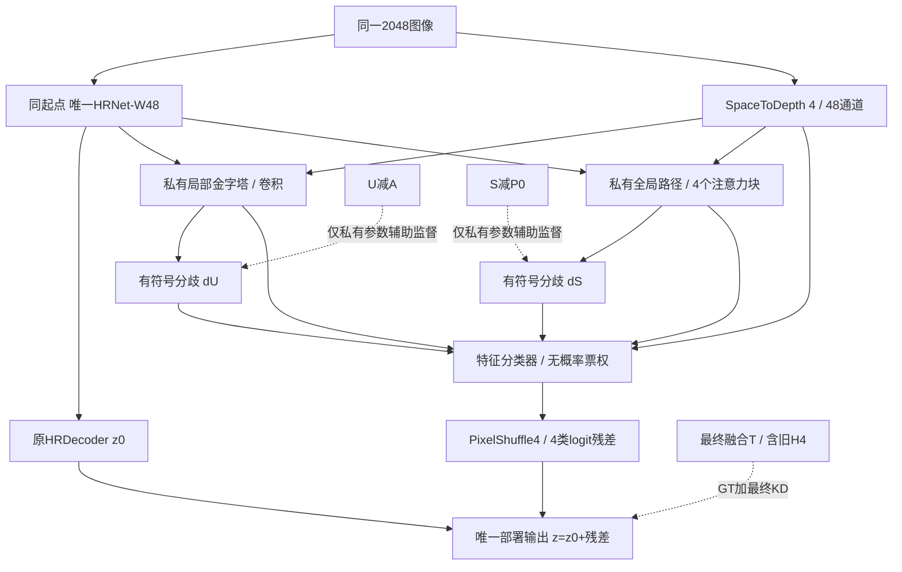

# HRDecoder v3候选：单一最终目标、私有局部/全局表示与有符号分歧

2026-10-08。本轮状态：完成本轮数学反例与新增模块CPU检查，并经反方复审修订的**研究候选**；不再把v2作为可以直接押注的定稿。这里没有新的训练成绩，也没有把候选升级为已验证最优架构。

## 1. 对用户五项质疑的逐项判定

| 质疑 | 判定 | 具体后果 |
|---|---|---|
| 10万参数支路难以承载异构知识，普通KD可能足够 | **这是合理的容量风险；尚未实测出容量瓶颈或不可能性。** 蒸馏四类预测不要求复制教师全部表示；但v2没有证据证明新增头必要 | 不把头参数量当完整学生容量；增加有独立参数的局部/全局变换，把容量主要放在低分辨率；必须与同容量、单一部署输出的最终KD比较 |
| 三阶段KD会退化为混合目标 | **对共同输出的梯度有精确退化公式。** 不能据此证明分支永远相同，但足以撤回“逐级学习”的机制主张 | 删除T0/T1分割监督和级联输出；所有部署分割只学GT与最终T |
| H4有堆叠泄漏风险且成本高 | **训练内元学习过拟合/分布偏移风险成立；不等同于验证/测试标签泄漏** | 学生默认取消在线H4；旧H4保留在最终教师T中；不伪造OOF、不追加训练 |
| 43～44.5可能比45.36更现实 | **合理的经验警惕，不是已校准区间** | 不给任何学生mIoU预测区间；45.36/45.86仅保留为目标门槛 |
| v2创新性薄 | **成立，不能靠重命名改变** | 只提出可证伪的研究假设；明确与Hydra、普通KD、分布蒸馏和参数匹配对照的关系 |

旧S@20k确实在推理中保留DINOv3 ViT-B/16与空间交互；不是仅受DINO监督的HRDecoder。源码静态算术约101.29M参数，非本轮实例实测；其任务训练谱系是Q16k→F12追加12k→S追加20k。U0是ConvNeXt-S。详见[教师身份审计](evidence/round3_teacher_identity.md)。

历史没有“同起点同预算仅改变W48/分支容量”的匹配实验，因此不能将E4、RGB专家、HE头等失败归因于容量不足。S−C支持特定DINO空间交互有效，不证明任意HRNet新分支有效。[历史机制审计](evidence/round3_history_mechanism.md)

## 2. v2共享梯度的精确问题

令a=(1/4,1/4,1/2)，三个阶段初始概率均为p。普通Bernoulli KL中，忽略与学生无关的教师熵：

\[
\sum_j a_j\,BCE(T_j,p)=BCE(\bar T,p),\qquad \bar T=\sum_j a_jT_j.
\]

对共同logit z的梯度为p−T̄。代入T0=A、T1=.75A+.25U、T2=.75T1+.25S：

\[
\bar T=.71875A+.15625U+.125S.
\]

相比最终教师T=.5625A+.1875U+.25S，初始共同监督把S权重减半、增大旧A权重。

v2实际还用了c_j=Y T_j+(1−Y)(1−T_j)，因此不是上述固定平均。设C=Σa_j c_j，则C>0时：

\[
\frac{\partial L_K}{\partial z}=C(p-T_{eff}),\qquad T_{eff}=\frac{\sum a_jc_jT_j}{C}.
\]

前景/背景分组的共同系数另乘即可；C=0时梯度为0。依旧只有一个有效标量目标。**这只描述共同输出方向及初始主路径梯度**：r1收到后两项，r2收到最后一项；参数分开后输出可以分化，所以“必然永久塌缩”不成立。v2的问题是欠缺强制有意义分工的证据，同时让主路径承受过时目标，不能用阶段命名掩饰。

## 3. v3的研究假设与不可越界的主张

研究假设是：**共享HRNet学习最终决策；两个有实质容量和不同空间算子的私有路径，同时保存两种可辨识的有符号教师分歧，并把表示提供给同一个最终分类器。弱成员不再作为部署分割的直接目标。**

这不保证统计独立、不保证教师知识完整保留、不保证泛化提升。私有路径也可能只增加拟合能力或冗余；必须用对照证伪。

容量增大不是理论保证。存在集成知识可压缩进同架构学生的理论，但依赖特定数据结构，不能移植成DDR保证。[Allen-Zhu与Li，ICLR 2023](https://arxiv.org/abs/2012.09816)

当前新增模块实例计数为**6,419,648参数**：L 2,918,816，G 3,459,872，两个分歧读出4,224，最终分类器36,736。约为v2新增参数的60.1倍；这只证明新增容量增大。2048单图新增Conv/Linear为42,549,116,928 MAC，四层attention的QK/AV另有2,147,483,648 MAC，总计**44.697G MAC**，约为v2新增部分的1.89倍。没有运行2048实际前向，未计原模型、插值、LN/激活、softmax及反向；不能据此推算GPU延迟。

## 4. 架构详细定义

保留原基线ImageNet HRNet-W48与HRDecoder初始化、2048→1024输入、原LR/HR解码和0.1 HR随机裁剪辅助监督。一次提取F1/F2/F3/F4，通道48/96/192/384、2048相对stride8/16/32/64。原前向需暴露这组特征，不能重复跑骨干。原BN行为全程保留。

以下`P(a,b)`为1×1 Conv无bias→逐像素Channel-LN(eps1e-5)→GELU。`Down(a,b)`为3×3 stride2 Conv无bias→相同LN/GELU。`B(c,k,e)`为残差块：DWConv k×k无bias→Channel-LN→1×1 c→e·c无bias→GELU→1×1 e·c→c无bias→加输入。没有零门。所有resize bilinear、align_corners=false。

### 4.1 私有局部路径L

| 层 | 2048输入时网格 | 定义 |
|---|---:|---|
| 原始子像素R | 512²×48 | PixelUnshuffle(4)，只重排已存在的2048像素 |
| L4 | 512²×32 | P(48,32)(R)，B(32,3,2)×2 |
| L8 | 256²×64 | Down(32,64)(L4)+P(48,64)(F1)，B(64,7,4)×1 |
| L16 | 128²×128 | Down(64,128)(L8)+P(96,128)(F2)，B(128,7,4)×1 |
| L32 | 64²×256 | Down(128,256)(L16)+P(192,256)(F3)，B(256,7,4)×4 |
| 回到L16 | 128²×128 | Up(P(256,128)(L32))+L16，B(128,3,2) |
| 回到L8 | 256²×64 | Up(P(128,64)(上层))+L8，B(64,3,2) |
| H_L | 512²×32 | Up(P(64,32)(上层))+L4，B(32,3,2) |

较大的通道混合放在64²网格，512²只保持32通道。目的在于增加私有表征容量，同时避免把所有新参数在2048²执行。这是成本分配理由，不是已测最优宽度。

### 4.2 私有全局路径G

1. 将F3平均池化到F4的32²，与F4拼成576通道，经P(576,256)。将R平均池化到32²，经独立P(48,256)，两项相加。
2. 加固定二维sin/cos位置编码：x/y各128维，各用64对sin/cos，位置用相应网格整数坐标，频率10000^(−2i/128)。编码无训练参数。不把这称为DINO特征。
3. 四个pre-LN Transformer块，维度256、8头、每头32维，MLP比率4、GELU、无dropout；QKV/输出/MLP线性层无bias，两个LN有affine。普通全局softmax注意力，attention scale=1/sqrt(32)。没有可变形采样或随机token路由。
4. P(256,128)后上采样到128²，加P(96,128)(F2)，B(128,3,2)。
5. P(128,64)后上采样到256²，加P(48,64)(F1)，B(64,3,2)。
6. P(64,32)后上采样到512²，加G私有的P(48,32)(R)，B(32,3,2)，得H_G。

全局注意力读整个32²网格；只增加私有运算，没有第二个预训练编码器。它具有非局部空间交互能力，**不意味着拥有DINO的预训练先验**。没有证据表明4层、256宽已足够，或SGD40k一定学好。

### 4.3 分歧读出与唯一分类器

两个独立1×1 Conv(32→64,bias=true)分别从H_L/H_G产生B_U/B_S；PixelShuffle4后得到四类、2048²的分歧预测d̂U/d̂S。用普通非零初始化，让分歧辅助路径首个启用步骤就能向隐藏层传播。这里没有sigmoid/tanh，输出是有符号回归量。

将`H_L(32),H_G(32),B_U(64),B_S(64),R(48)`拼成240通道，经P(240,64)和B(64,3,2)，最后Conv1×1(64→64,bias=true)→PixelShuffle4，得到2048²×4的logit残差r。**只有最后64→64层权重/bias置零**。

唯一部署分割为z=z0+r，最终只将z恢复原图后sigmoid、严格>0.5。无H4、无额外MA分类器、无学生概率投票、无推理教师、无TTA。分类器可以忽略无用分歧，也可以利用其方向，未规定它一定利用。

SpaceToDepth与PixelShuffle只重排子像素；前者不增加输入信息，后者消除了“残差必须是stride4粗图双线性插值”的输出限制。可以在4×4单元内输出不同残差。中间网络仍可能丢信息，且**2048缩放已丢失的原图信息仍无法恢复**。原生尺寸路径本轮不加入，避免同时更换采样/输入协议并把原因混在一起。

## 5. 有符号分歧的定义、作用与局限

教师仍按锁定配方：P0=.75A+.25U，T=.75P0+.25S；A包含旧H4。定义：

\[
d_U=U-A,\qquad d_S=S-P0.
\]

于是T=A+.25dU+.25dS。T、dU、dS包含教师三路概率的全部代数信息；逆式是A=T−.25dU−.25dS，U=A+dU，S=A+.25dU+dS。这是坐标变换，不是精度定理。

v1曾把分支部署分割概率硬绑定为U/S，v3中它们只作为**私有表示的辅助分歧回归**；分类器输出从不被要求等于弱U或S。即使U=.95在背景上错了，dU的正值只表示“U比A更确信阳性”，不规定最终输出必须阳性。

分歧保留正、负方向，不能换成绝对值、方差或硬0/1分歧而声称信息等价。目标本身可能包含噪声，准确复现分歧也可能无益；本次明确保留这个风险，不用“互补”一词把所有分歧都解释成有用。

若某合法像素dU≠dS而两个读出被强制完全相等，则无法同时使两个回归损失为零。这个**条件命题只涉及读出值**；不保证有限权重训练不塌缩、隐藏特征独立或mIoU提升。若train教师几乎全一致，目标本来就接近零，架构没有凭空制造知识的权利。

反方审查给出了反例：A=.5、U=.6、S=.425时dU=.1、dS=−.1；即使H_L=H_G=0，两套独立读出的bias也能使L_D=0。分类器还可以将B_U/B_S输入权重设成0。**因此辅助损失小不证明分歧来自不同隐藏知识，也不证明分歧帮助了最终分割。** 本轮不为排除这个反例而增加强制正交/互斥惩罚：强迫两个本来可共享的有用特征不同，同样可能制造噪声；必须以同容量对照和输出依赖诊断判断。

研究文献也提示训练集上的教师预测可能过于一致，导致多头无法获得足够多样性。本轮不将其分类任务中的输入扰动直接搬到小病灶数据，也不把离线概率几何搬运称作新教师观察。[Nam等，NeurIPS 2021](https://proceedings.neurips.cc/paper/2021/file/466473650870501e3600d9a1b4ee5d44-Paper.pdf)

## 6. 损失及明确的梯度路由

θ为原HRNet及原HRDecoder参数，ψL/ψG为各私有路径及其分歧读出，φ为最终特征分类器。

主目标只有：

\[
L_{task}=D(\sigma(z),Y;v)+0.1D_{HR}+\lambda_K(t)KL_{Bern}(T\Vert\sigma(z);v).
\]

Dice沿用平方分母、smooth1e-5；KL温度1，按每图每类合法像素均值后宏平均，不做v2的teacher-GT可信度重加权。原teacher正确与否的软正则冲突仍存在；真实GT保留独立监督。

辅助目标：

\[
L_D=\tfrac12\sum_{j\in\{U,S\}}
\frac{\sum v(1+4|d_j|)\,\operatorname{SmoothL1}_{\beta=.1}(\hat d_j-d_j)}{\sum v(1+4|d_j|)}.
\]

每图每类先算，空有效域返回可微0；教师目标、权重均detach。权重范围[1,5]，不设单独的稀少误报组；它是预先指定的工程默认，不是最优常数。

**路由规则而非简单把两个loss相加：**

- θ、φ只收到∇L_task。
- ψL、ψG收到∇L_task+λD∇L_D；L_D不得直接回传θ。

实现可先`autograd.grad(lambda_D*L_D, private_parameters, retain_graph=True)`取私有辅助梯度，再`L_task.backward()`，最后把辅助梯度加到对应私有参数，再执行一次optimizer.step。不能对普通`L_task+lambda_D*L_D`直接backward；也不能无条件detach所有私有输入，否则连主目标通过私有路径训练HRNet的梯度也被切断。只需一次共享前向，辅助反向有额外成本。

本轮只验证单进程CPU路由。未来若使用AMP，两部分梯度必须按同一GradScaler倍率生成、合并后统一unscale；若使用DDP，手工辅助梯度的跨进程归约与平均也须显式核验，不能假定手工`.grad.add_`自动触发正确同步。它们属于完整训练器集成的未验证项。

这能保证**同一参数状态下一次辅助梯度不直接修改共享主干**；私有参数未来变化仍会改变主损失和主干轨迹。它不是全部梯度冲突已消除的证明。主干不再直接受T0/T1/弱U/S的分割KD拉扯，仍受最终T和GT共同监督。

## 7. 40k预算、初始化及数据契约

- 规定未来采用与基线相同的ImageNet W48初始化规程及原随机解码头初始化顺序；新增参数随机初始化，隔离RNG。**W48文件SHA及历史B0逐张量一致性尚未核实，不能声称本次已实现同文件复现。** 没有DDR/DINO/ConvNeXt任务权重加载到学生。
- 原40,000全局批次、batch2，SGD lr=.005、momentum=.9、weight_decay=5e-4，1500步warmup ratio1e-6，poly power1 min_lr0；所有新增参数同一次SGD更新。没有单独Adam或额外训练阶段。
- λK：0至1500，至4000线性升到.5，保持至32000，至40000降到.1。λD=.2λK，峰值.1、末值.02。未通过实验选择这些常数。
- 同一两张图、同一原基线增强参数；Teacher A/U/S原图软图共享几何，v_label与独立v_geo统一屏蔽主/KD/辅助/HR crop。取消v2误报分组与可信度权重，不更改类别和阈值。
- 40k固定端点为主；每4k完整验证的best-val为次。报告历史42.20是best@32k且不能当本轮已复现对照。
- 同训练步数不等于等计算；大幅增加私有参数和注意力/反向成本，完整资源实测前不得宣称同速度或同显存。

## 8. H4、输入独立性与缓存

学生不再训练在线H4，免去该头约13.96G/2048图的前向MAC及输入漂移。新路径成本要另外统计，不能把“删掉14G”写成总计算下降。

旧H4的正成绩被保存在教师A与最终T里；这是一种传递已有成果的方式，不保证学生学会其全部修正。旧H4是成员内训练预测，不是OOF，见[独立性审计](evidence/round3_h4_independence.md)。没有证据证明当前可见的train OOF缓存可用；val上的融合交叉验证不能冒充它。

v3普通端到端特征分类器没有另训的独立元学习阶段，但同样可能过拟合；取消H4不使整个模型获得OOF保证。教师训练内KD也仍可能比测试输入干净。EMA、不同seed或detach都不能凭空生成样本独立性。

三路train概率尚未导出。原图缓存未压缩负载约104.90GiB，数据身份与原有效域合同沿用v2。无需新增高维DINO/ConvNeXt特征缓存。正式执行前必须在**train缓存**检查dU/dS能量、方向、协方差秩及各类有效覆盖；当前只知道验证融合有效，不能用验证分歧替代训练分歧存在的证据。

## 9. 创新性审查和最小证伪对照

[Hydra](https://arxiv.org/abs/2001.04694)已经用共享主干和教师对应多头保存集成差异；本方案不能声称首创多头集成蒸馏。均值+分歧的代数分解也不是自动成立的创新。局部CNN、全局注意力、PixelShuffle、梯度隔离各自都不应包装成新发明。

候选研究贡献只能是：在同初始化、同更新预算的稀疏病灶分割中，**只向共享主干提供最终决策监督，把有符号教师分歧限制在有独立容量的私有表示里**，是否比同容量普通蒸馏更好保留实测互补收益。这个命题当前没有实验结论。

最低共享对照：

1. B0同mask、同40k的HRDecoder；B1同模型加最终T KD。它检验“普通KD已足够”。
2. 相同v3网络、相同最终KD，λD=0；保留L/G、两个读出及融合，仍只输出一份部署分割。它固定容量和前向图，隔离有符号分歧辅助监督的增量。这里“单一输出”不等于删掉私有路径；另做删除路径或不同容量对照时，不能混称参数匹配。
3. 完整v3与相同网络的普通辅助梯度回传。它检验梯度路由的必要性。
4. 先做**同图成员坐标对照**：全部模块、初始化、数据、路由、λD、SmoothL1及按原d计算的[1,5]权重相同，仅将两辅助目标从dU/dS换成U/S，读出仍线性；分类器仍读同一packed tensor。它比较“均值+成员概率”与“均值+有符号分歧”两种坐标，不应冒称原版Hydra复现。两套目标中心/尺度不同正是该坐标变化的一部分，另报告目标标准差与梯度尺度，不把增益一律归因为符号信息。
   真正的Hydra家族对照应单独实现共享骨干、三个教师对应头和成员KD，匹配新增参数/计算范围与相同最终teacher/数据预算；它与本候选计算图不同，属于方法比较，不能拿同图两头版本代替原方法。若投稿必须做这项对照，需要实际冻结其完整配置；本次没有假称已经复现Hydra。
5. 同结构把分歧换成绝对值或在教师身份上打乱的诊断，保持损失尺度可比。它检验符号/身份是否真的被使用，不能只展示训练分歧MSE下降。

不可用推理时随意删分支替代训练对照。诊断必须看总mIoU、MA precision/recall、共同/独有错误区域、分歧训练与验证误差差距、同容量B1变体，以及真实资源。显著性需要多seed与独立数据；历史test反馈已参与研究，仍不能称新盲测。

## 10. 本轮自审准则

这版只允许声称：目标不再被三阶段平均稀释；辅助目标在函数层面区分方向；梯度路由能直接限制共享主干的辅助更新；解码残差有子像素输出自由度；部署不依赖额外教师或在线H4。每条都需数学或算子检查。

不能声称：容量充分、目标必定不塌缩、符号必定提高IoU、新模块优于普通KD、H4收益已被完整迁移、40k可超过45.8604，或已满足顶刊新颖性。

还存在一个容量无法单独解决的上限：令原图X、2048输入为R(X)、teacher输出为T(X)，任意只读R(X)的确定性学生，其最优平方误差为E[Var(T(X)|R(X))]。若两个原图在缩放后相同而teacher因原始细节给出不同输出，单纯加参数不可能同时复现两者。本式是条件期望的平方损失分解，不是DDR已测误差值，也不能转换成mIoU上界。本轮子像素读出只修复输出参数化限制，没有解除输入信息限制。

“距教师不超过0.5pp”意味着需要追回历史42.20→45.8604增益的约86.34%，本来就是较高目标。用户提出43～44.5的经验估计和旧文目标都不作为预测分布；当前没有足够匹配学生试验估计成功概率。

若本轮反方审查发现确定矛盾，先修改再复核；若只剩依赖训练的假设，不会通过不断增加模块伪造确定性。当前交付目标是可审查、可实现、可被实验否定的最佳候选，**不是证明存在一个无需实验的完美架构**。

## 11. 本轮验证文件与结果

[目标与损失探针](verify_v3_objectives.py)的18项检查通过，结果见[evidence/v3_objective_checks.json](evidence/v3_objective_checks.json)。[新增模块原型](verify_v3_modules.py)在128随机画布上验证shape、零末层恒等、子像素重排、参数和梯度路由；结果见[evidence/v3_module_checks.json](evidence/v3_module_checks.json)。

主代理复核后发现：只在零末层测试梯度路由会使私有主任务梯度为0，可能空泛通过。因此新增非零末层诊断副本并detach z0捷径：主任务经私有路径仍能回到共享特征，未路由辅助也确实对共享参数有非零梯度；实际路由后，共享/分类器相对task-only差0，私有相对task+aux差0。未执行任何optimizer step，诊断赋值不属于训练结果。

三份本轮事实补审与两份反方审查的处理过程见[03_审查与变更记录.md](03_审查与变更记录.md)。CPU通过不覆盖HRNet正式接入、实际几何管线、2048显存/速度或收敛与精度。
