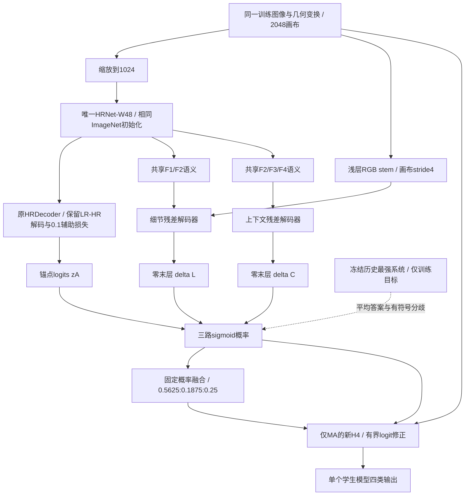

# HRDecoder-CF：将历史互补能力蒸馏进单个网络

设计日期：2026-10-08。工作名 CF = Complementarity Factorization。本文是研究设计，不是训练结果，也不声称方法名称或组合已经具有可发表的新颖性。

**唯一推荐的主方案：相同 ImageNet HRNet-W48 初始化，保留原 HRDecoder 主路径，增加原图细节残差解码支路和语义残差解码支路；从最强历史系统同时蒸馏“融合答案”和“成员之间的有符号概率差”；内置固定概率融合，再用重新训练的 MA 专用 H4 修正。整个学生只训练 40,000 次主更新，部署不调用教师。**

用户已明确允许教师蒸馏。学生不加载 E4、B、D、U0、DINO 或 S20 的任务权重。教师带来的额外知识、历史训练与导出成本单独披露，不能宣称与原 HRDecoder 完全等监督或等计算。

“每一块肯定提升”目前无法满足：没有理论能从旧系统的有限实验推出新结构、共享表示和新优化过程必定提高测试 IoU。这里给出的是证据约束下的一次主方案，明确哪些是事实、哪些是可证明的结构性质、哪些仍是研究假设。若必须承诺未训练即超过 45.8604%，诚实的答案是无法承诺。

## 1. 先固定真正要超过的对象

| 对象 | 验证 mIoU % | 测试 mIoU % | 能如何比较 |
|---|---:|---:|---|
| 自定义 DDR 划分原 HRDecoder | 39.3900 | 42.20 | 同 454/76/227 划分的本地主基线；40k 日程，best@32k |
| E4 | 38.7660 | 41.6260 | 同 ImageNet 起点、40k 的细节分支负结果 |
| D 局部学生与 B 参考组合 | 41.6150 | 42.5760 | 已经训练过的 B 起点，额外训练；不是单学生成绩 |
| 四成员翻转融合，未接 H4 | 约 41.7973 | 43.2289 | 历史复合系统，不能当单网络 |
| 四成员翻转融合 + H4 | 约 42.6694 | 44.2110 / 44.2115 | 两个历史导出口径保留原精度，不混算细小差值 |
| P0：75% 旧系统 + 25% U0 | 43.4877 | 44.7809 | 异构概率融合 |
| R：75% P0 + 25% Q16 | 44.3557 | 45.7216 | 旧参考系统 |
| 最终教师：75% P0 + 25% S20 EMA | 45.3218 | **45.8604** | 本次蒸馏教师和工程目标 |

上述数值来自用户最终报告与机器证据，详见附录 E1–E5。最终教师的四类测试 IoU 为 EX 55.1213、HE 46.1978、SE 52.8789、MA 29.2435。S20 的**单分支验证**是 42.2703，45.8604 不是 S20 单网络测试分数。

原论文 DDR 使用 383/149/225，报告 HRNet 版约 32.25% mIoU；本地 42.20% 来自另一划分。不能用 45.86−32.25 宣称公平超越。论文还采用总 batch=4、SGD lr=0.01，本地基线是 batch=2、lr=0.005。本方案锁定本地实际基线协议；若论文主张超过原论文，必须另做官方协议且重新隔离教师训练数据。[HRDecoder 原论文](https://arxiv.org/html/2411.03976v1)

为让“接近”可验收，建议预先定义为教师测试分数下降不超过 **0.5 个百分点**，即 ≥45.3604%；这只是工程容忍度，不是统计等效界限或预测值。严格超越的描述性门槛是 >45.8604%。主结果必须同时报告相对 42.20 的变化、四类变化和配对区间。

## 2. 历史实验怎样决定取舍

| 已核实证据 | 支持的设计 | 不支持的推断 |
|---|---|---|
| E4 单独 41.626 < 原基线 42.20；E4+B 融合 42.35 | 保留细节信息，但让它与语义和明确教师目标配合 | 加 RGB 小分支就一定提高单模型 |
| D 的学生与参考概率组合优于各自部分验证结果；D 最佳在追加 2k，20k 退化 | 同时保留细节与上下文；不把更久训练等同于更好 | 把 D 的 41.615 当成只需一个编码器的学生结果 |
| H4 仅改 MA，旧融合测试 MA 24.7255→28.6558，整体约 +0.9826pp | 采用 MA 专属、有界 logit 残差小头 | 给 HE/SE 复制同样头必有收益；把 +0.98 再加到最终教师上 |
| H6/H9、R6 HE 校正未胜出；随机 RGB MA 专家两套配方失败 | 不增加四个类别校正头；细节支路必须读取成熟语义并从现有预测起步 | 所有 HE 改进不可能；所有原图专家都不可能 |
| R1 融合感知最佳约 41.75 vs 41.67，未过既定门槛；R5 学生变好但加入集成增益小 | 不把“训练时也做加权平均”当主要创新；显式规定分歧来源 | 只需复刻 FusionAware 就能获得融合能力 |
| U0 独立验证 38.4464，但固定概率融合测试 +0.5699pp | 保留弱成员中有效的连续概率差异 | 只看单模型分数淘汰教师成员 |
| Q16 融合相对 P0 测试 +0.9407pp；S−C 同条件单分支验证 +1.2459pp@20k、+1.0451pp@32k | 用最强 DINO 系统提供训练知识 | 把 DINO 的预训练收益假定能靠一个小 CNN 完整重建 |
| G 高分辨率续训融合测试 44.6345 < P0 44.7809；Q_MIX、E_NEG、D/SD 未胜出 | 首次主方案不加外部病灶数据、不更换输入尺度、不加入多个新模块 | 高分辨率、外部数据在所有条件下无效 |

**保留过去的结果，也保留过去对错误解释的纠正。** 9 月 20 日报告曾把二值 OR 称为依赖 GT 的 oracle，并由 OR 下降推导 U0 没有互补价值；9 月 26 日审查已经纠正。本次复查原代码和后续 U0 结果后，采用纠正后的结论。二值 OR 直接由预测可构造，它不是一般概率融合的上界。

例如 U0 对旧冠军在 HE 上有 79,689 个独有 TP，也带来 287,515 个独有 FP。它说明简单“多报一点”危险，不能证明软概率不可融合。对只添加阳性、不删除已有预测的规则，新增 TP=x、FP=y 时，IoU 改善条件为 x>IoU_old·y；需要同时删改时必须完整重算 TP/FP/FN。

另外，旧报告“HE 头失败说明该类已充分覆盖”“BCE 最优必为全负”“小于统一噪声线的提升均无效”等解释都不是已有实验能证明的定理。本次不以这些强推断指导结构。

## 3. 本方案最核心的研究问题

**共享一套主干后，怎样保留历史异构系统中对预测有用的分歧？**

仅复制三个输出头，再让它们都学同一 GT 或同一平均教师，无法明确保留过去 U0、S20 的互补方向。共享特征还可能让错误高度相关。这里不鼓励分支为了不同而故意预测不同，而是让两组差异对应已经存在、可保存、可检查的教师概率差。

把最终教师展开：

\[
T=0.5625T_A+0.1875T_U+0.25T_S.
\]

其中 T_A 是**已经经过旧 H4 修正的完整旧 HRDecoder 系统**，T_U 是历史 U0，T_S 是锁定 S20 EMA。它们不是三个新的训练任务，而是既有最强教师推理过程的中间输出。

定义教师的两个有符号差：

\[
d_U^T=T_U-T_A,\qquad d_S^T=T_S-T_A.
\]

学生输出 p_A、p_L、p_C，内置融合 q=0.5625p_A+0.1875p_L+0.25p_C。监督 q 接近 T，同时监督 p_L−p_A 接近 d_U^T、p_C−p_A 接近 d_S^T。

这是输出函数层面的分工，**不是断言 L 获得 ConvNeXt 内部表征、C 获得 DINO 自监督表征**。不要求跨架构隐层张量形状相同，也不加入未经本地证明的特征对齐、注意力或对抗损失。

### 可以严格证明的性质

令 w_L=0.1875、w_C=0.25，d_L=p_L−p_A、d_C=p_C−p_A，则：

\[
\begin{aligned}
p_A&=q-w_Ld_L-w_Cd_C,\\
p_L&=q+(1-w_L)d_L-w_Cd_C,\\
p_C&=q-w_Ld_L+(1-w_C)d_C.
\end{aligned}
\]

因此，在某个像素类别上，若平均值和两组差全部拟合准确，三路输出就分别恢复三路教师输出。只监督平均值，在概率域内部通常留下两个自由方向，无法确定分支差异；T恰为0或1时因概率范围与正权重约束，分支已经被强制全部为0或1，是例外。这解释了为何要监督差，而不是声称它必然增加 IoU。

约束只在实际纳入蒸馏的像素上成立；有限训练、共享容量、GT 目标和误差掩码都会使拟合不完全。**线性可辨识性不等于统计独立性，不等于互补收益，更不等于泛化保证。**

## 4. 唯一主架构：一主干、两残差解码支路、一个 MA 头

### 4.1 主路径 A：完整保留 HRDecoder

学生使用原 HRNet-W48 的 ImageNet 预训练文件，HRNet 参数和预训练 BN 状态逐项匹配；解码头按原配置随机初始化。不同于加载已经做过 DDR 训练的 E4 或 B。

训练图像保持原 2048×2048 画布，主干只看缩到 1024×1024 的图。相对 2048 画布，HRNet 四路输出为：

| 特征 | 通道 | 空间尺寸 | 相对画布 stride |
|---|---:|---:|---:|
| F1 | 48 | 256×256 | 8 |
| F2 | 96 | 128×128 | 16 |
| F3 | 192 | 64×64 | 32 |
| F4 | 384 | 32×32 | 64 |

保留四路对齐拼接 720 通道、原 FCNHead 压到 64 通道及 7×7 卷积、共享 HR/LR 解码权重、原 HR 特征裁剪机制、LR/HR **logits** 等权平均。记完整主路径结果为 z_A。

“相同起点”还要求：先构造并初始化原模型，再创建新模块，或使用独立 RNG；否则新模块消耗随机数可能改变原解码头初始化。读取预训练文件哈希，不能只核对 URL 名称。

### 4.2 细节支路 L：RGB 与共享语义在分类前结合

这条支路不独立训练第二个 HRNet，也不把 RGB 从零小网当 MA 检测器。

1. 2048 RGB 经 Conv3×3，3→16，stride2；再 Conv3×3，16→32，stride2，得到 512×512×32。
2. F1、F2 各用 1×1 卷积投影到 32 通道，双线性对齐到 512×512。
3. 拼接三路得到 96 通道，1×1 卷积压到 64。
4. 两个残差块，每个为 DWConv3×3 → Channel-LN → GELU → PWConv1×1；残差连接不增加可学习零门。
5. 1×1，64→4，**仅此输出卷积的权重与偏置为零**，得到 Δ_L，再对齐到 z_A 网格。

各 stem/投影/fusion 的非输出卷积后使用逐像素通道 LayerNorm 与 GELU。Channel-LN 只对该像素的通道归一化，不包含 H/W；不要把它误写成对空间也做归一化的 GroupNorm。除了最后分类层，卷积 bias=false。

\[
z_L=z_A+\operatorname{Up}(\Delta_L),\qquad p_L=\sigma(z_L).
\]

L 学习 U0 相对旧系统的概率差，但其实现是新的轻量解码器，不是压缩后仍保持原功能的 ConvNeXt。采用 RGB 与语义在输出前结合，是为避开 E4 无语义细节输出和随机 MA 专家的已见局限；收益仍未被本地实验验证。

### 4.3 语义支路 C：不同尺度路径提供第二种修正

F2/F3/F4 各独立 1×1 投影到 64 通道，Channel-LN+GELU。先把 F4 上采样加到 F3，经过一个 DWConv7×7 → Channel-LN → GELU → PWConv1×1 残差块；再上采样加到 F2，经过同结构残差块。最后 1×1，64→4，权重和偏置为零，产生 Δ_C。

\[
z_C=z_A+\operatorname{Up}(\Delta_C),\qquad p_C=\sigma(z_C).
\]

C 不读取额外原图编码器，负责学习 S20 相对旧系统的输出差。它用较粗语义路径与 L 形成结构差别，但**不能把“粗尺度”解释为已经获得 DINO 全局注意力**。是否足以拟合 S20 的有效知识，是本方案的重要风险。

选择两条残差支路而不是四个同构头：旧系统已有三个自然教师来源；两组差正好补足平均值之外的两维信息。新增第四支路没有当前证据支持。选择普通卷积而不把 S 的可变形注意力搬入 HRNet：S 的匹配收益证据来自 DINO+F12，不能直接迁移成 HRNet 增益。

### 4.4 固定概率融合

\[
q=0.5625p_A+0.1875p_L+0.25p_C.
\]

这组权重来自锁定冠军的真实展开式，首次方案不再搜索空间门控、类别门控或新的混合权重。固定融合也避免“弱分支尚未学成，门控就把它关掉”的额外机制。

这不表示教师的最佳权重也必然是学生的最佳权重；这里用确定的历史配方减少一次实验的自由度。新结构若要推翻这些权重，需要后续匹配证据，不能根据测试结果临时改。

三路初始 logits 相同，因此初始概率融合等于原路径输出。它提供函数层面的安全初始化；新增损失在后续更新仍会改变训练轨迹，不保证训练后优于原模型。

### 4.5 新 H4：最后处理 MA，并保护主模型优化

输入 7 通道：

\[
X_H=[I_{norm},\operatorname{logit}_{\epsilon}(q_{MA}),
\operatorname{logit}_{\epsilon}(p_{L,MA}),
\operatorname{logit}_{\epsilon}(p_{C,MA}),p_{L,MA}-p_{C,MA}],\quad\epsilon=10^{-4}.
\]

结构严格沿用原 H4：Conv3×3(7,16)+ReLU → Conv3×3(16,16)+ReLU → Conv1×1(16,1)，3,361 参数。隐藏层正常初始化，仅末层置零。

\[
\delta_H=6\tanh(h(X_H)),\qquad
p_{out,MA}=\sigma(\ell_{q,MA}+\delta_H).
\]

非 MA 的三个通道直接保留 q。这里的 \(\ell_q\) 使用三路 logits 的稳定概率混合 logit：

\[
\ell_q=\operatorname{LSE}_j(\log w_j+\log\sigma(z_j))-
\operatorname{LSE}_j(\log w_j+\log\sigma(-z_j)).
\]

在 FP32 中以 log-sigmoid/logsumexp 计算，不先把 q 截到 [1e-4,1−1e-4] 再作为残差基准。这样，H4 的末层零初始化不会因概率截断改变极端预测。**f7 特征中的 logit 仍按旧 H4 做截断**；特征变换和输出基准是两个不同位置。

H4 的 f7 和输出基准 \(\ell_q\) 在训练中都 stop-gradient。主网始终由四类主损失训练，H4 的 MA 损失只更新 H4；防止 MA 小头通过反传改变其它三个通道的共享表示。这不等同于冻结主网，L/C 输入仍随训练变化。

不加载旧 H4 权重：旧 ps/pr 是冻结 D/B，现在是学习中的 L/C；即便形状都为 7 通道，输入语义、概率分布、教师组合都已改变。

T_A 已包含旧 H4 的知识，新 H4 的任务是修正**学生剩余误差**。不把旧 H4 的 +0.98pp 计作这次可再次获得的收益，不对教师 T 再运行一次旧 H4。

## 5. 训练目标：GT、平均答案和可解释分歧

### 5.1 四类主监督保留原 Dice 家族

主网络：

\[
L_{main}=0.75D(q,Y)+0.25D(p_A,Y)+0.1D_{HR}
+\lambda_K(t)K(q,T)+\lambda_D(t)L_{diff}.
\]

D 使用原仓库 BinaryLoss 的 Dice 定义、smooth=1e-5、原类别与有效区域约定；实现时调用原损失或做逐项等价检验，不能默默替换为最终 DINO 报告的线性分母 Dice。原模型的额外 HR 裁剪损失仍保留四个 feature crops 和 0.1 权重。

0.75/0.25 主监督分配为本次保守工程选择：最终融合负责主要目标，锚点保留独立 GT 约束。不是历史扫参得到的最优值。原始 HRDecoder 同蒸馏对照必须得到相同形式的标签与蒸馏预算，才能分离架构收益。

K 为四个独立 Bernoulli KL（等价于软标签 BCE 去掉教师常数），温度固定为 1。病灶是四个 sigmoid 通道，不用四类 softmax 把病灶误当互斥概率分布：

\[
K(q,T)=T\log(T/q)+(1-T)\log[(1-T)/(1-q)].
\]

实际用稳定 logits 形式计算。

### 5.2 两个概率差的监督

\[
L_{diff}=\frac37\Vert(p_L-p_A)-(T_U-T_A)\Vert^2+
\frac47\Vert(p_C-p_A)-(T_S-T_A)\Vert^2.
\]

3:4 来自两条非锚点教师的权重比例，不额外学习。差的范围为 [−1,1]。它同时保留“某个专家提高概率”和“某个专家压低概率”的信息；不像 OR 只能增加阳性。

差损失对两条支路和锚点都正常反传，不对 p_A 单独 detach；否则优化目标与所写公式不同。新支路零末层不等于零梯度：首步末层可更新，隐藏层从后续步开始学习。禁止同时使用零系数乘零输出层形成永久阻断。

### 5.3 防止背景淹没与盲目复制教师错误

GT 主监督覆盖所有合法像素；蒸馏支持域限定为：

\[
M=v\land[(T>0.5)=Y].
\]

v 是有效标签/几何区域。教师最终二值判断与 GT 不一致的位置，只由 GT 纠正，不强迫学生复制教师；这里使用 GT 仅限训练集。

K 和差损失在同一 M 上，逐类分成三个不相交组：GT 阳性；GT 阴性但至少一个教师预测 >0.5；其余 GT 阴性。每组先求均值，再对非空组等权平均，再对四类非空结果平均。某类完全没有支持像素时贡献零，不能出现 0/0。

这是一项**尚未验证的损失设计**：它保留争议背景，缓解海量容易背景的主导，但会丢掉教师错误/弱阳性处的软信息，也可能过度强调噪声小组。对照中要单独评估，不能把它描述为已证实的最佳蒸馏掩码。不使用熵最小的教师自动等同于正确教师。

### 5.4 H4 监督必须修正 ignore 实现

最后 1,600 次全局更新内，对同一批学生输出训练 H4：

\[
L_H=0.5\operatorname{BCE}_{valid}(p_{out,MA},Y_{MA})+
0.5\left(1-\frac{2\sum v p_{out,MA}Y_{MA}}
{\sum v p_{out,MA}^2+\sum vY_{MA}^2+1}\right).
\]

沿用旧 H4 的平方分母与 smooth=1，但 BCE、Dice 分子和两个分母均排除 ignore/padding。旧脚本把 255 清成背景后继续计 BCE 与 Dice 负例，这个实现问题已在审计中明确。新方案不能复制它，也不能在未做量化对照前声称修复它必定涨分。

H4 使用 GT，不再叠加一个高权重教师 MA 损失。教师知识已经通过 q 和分歧进入学生；GT 允许学生纠正教师，是“可能超过教师”的必要机会之一，不是充分保证。

## 6. 总计 40,000 次更新：明确执行日程

| 全局更新 t | 主网络 | 蒸馏 | H4 |
|---|---|---|---|
| 1–1,500 | 原 SGD warmup；两条新支路已在图中 | λK=λD=0 | 恒等、无参数更新 |
| 1,501–4,000 | 主监督和 HR 辅助继续 | 线性升到 λK=0.5、λD=0.1 | 恒等 |
| 4,001–32,000 | 全主网持续更新 | 保持 0.5、0.1 | 恒等 |
| 32,001–38,400 | 全主网持续更新 | 线性衰减，40k 时到 0.1、0.02 | 恒等 |
| 38,401–40,000 | 主网仍正常更新、仍为同一批次 | 延续上述衰减 | 同批 detached 预测上训练，共 1,600 次 |

这不是先训 40k、再加 1,600 步；没有新的数据批次或额外 backbone 更新。每次全局更新至多一次主网 SGD 和一次 H4 Adam，分别计数，不能把两个优化器调用数隐去。**主网 40,000 次、H4 1,600 次、全局训练批次 40,000 个。**

主网沿用本地原基线：有效 batch=2，SGD lr=0.005、momentum=0.9、weight_decay=5e-4，warmup=1500、ratio=1e-6、poly power=1、min_lr=0。前38,400步原BN行为不变；新增模块用Channel-LN。新支路不增加第二次图像或HRNet前向。

**末段校准的明确配方差异：** 从38,401步起固定原主干及原解码头BN的running mean/variance，BN affine和所有主网权重继续训练；新模块Channel-LN不受影响。这使同批H4读到的是按部署归一化方式生成的预测，避免用batch统计训练H4、用running统计部署H4的额外错位。仅设置BN层eval，不能把整个主模型改成不可训练。该选择借鉴历史低学习率冻结BN经验，但时点及新架构收益未验证，必须披露为与原基线的训练配方差异；B1/B2/B3公平对照使用同样末段BN规则。它不增加步数，也不让基座变成完全冻结。

H4 使用 Adam lr=1e-3、线性衰减至接近零、clip_grad_norm=5，权重衰减为0；仅在最后阶段激活 optimizer。末段 Adam 有自己的1,600步时钟，不能从全局38,400误算成学习率已为零。

选择末段是为了让 H4 读取较成熟预测，1,600来自旧 H4 的有效观察点；这**不是证明新 H4 也在1,600最优**。旧 H4 基座完全冻结，新基座末段仍更新。记录末段输入均值、分位数、L/C 分歧与修正前后验证 IoU；低学习率只减轻漂移，不消除漂移。

训练图像抽样和增强沿用原 baseline：ratio_range=(0.5,2.0)、2048 crop、flip=0.5、rotate±45°等，从同一批两张图产生四个原 HR feature crops。不要改成8个native窗口后仍称“同曝光40k”。旧配置 padding 与新几何有效 mask 要分开：主损失遵循原基线标签规则；教师损失必须排除源图外区域；若统一修正主损失 padding 规则，应同时修改并报告对照。

预先固定每4k一次完整76图验证，保存对应完整快照、best和last。主科学端点为40k，另报告与历史相同选点规则的best-val结果；本次不能把best当成40k终点成绩。H4只出现在最后快照，不额外扫描1600步内几十个节点；best若在早期，相应H4保持恒等，也必须如实报告。

首次方案不增加EMA、额外外部监督、TTA、checkpoint平均或验证权重搜索。教师 S20 使用EMA是教师身份的一部分，不代表学生也使用EMA。

## 7. 教师缓存与几何契约

本次没有运行教师或导出训练概率。所需是454张 **train** 的 T_A/T_U/T_S 三份FP32软概率及来源元数据；T由固定式派生，不必重复保存第四份。已存在的val/test缓存只能作对应评估证据，不进入训练。

教师要使用锁定推理管线，包括旧系统的H4/TTA和S20 EMA；不能拿S32、训练态S20或某一路logits代替。每个缓存记录图像ID、原图H/W、类别顺序、checkpoint SHA、配置SHA、推理几何、概率dtype与哈希。三路必须同坐标、同类序，且保存soft probability，不能用packbits二值掩膜蒸馏。

建议对原图坐标的教师概率做与学生图像一致的几何变换：teacher用双线性，离散GT用最近邻，有效区域单独传播。Resize/crop/flip/rotate顺序与像素中心约定必须一致；输出方向恢复、RGB/BGR及归一化均核对。不要只翻图像没翻教师，也不要把2048的坐标直接拿去切原图缓存。

把整图教师预测变换为增强视图的目标，是**整图上下文指导增强学生视图**；它通常不等于让教师重新预测增强图像。此差别要在方法中写清，不能宣称数值等价。原几何中的极小MA经插值可能变弱，因此保留真实GT主监督，禁止把教师软图阈值化替换GT。

若每张都统一2048²，三路四类FP32缓存未压缩约85.125GiB；原图缓存应按实际像素总数计算，可能更大。可无损压缩并按图像分块读取，保留原精度；不悄悄量化为FP16。教师导出过程本来就计算三路中间概率，保存中间结果不会新增学生训练步，但占用导出计算与磁盘。

教师在454张自己的训练图上预测属于训练内蒸馏，不是折外预测。若在这454张内部另切验证折，原教师已经见过其中标签，不能再把它当该折的无泄漏教师。官方协议或新保留集也必须同时检查教师训练覆盖，不能只检查学生。

本次按现有冻结图像ID清单独立复算，旧自定义train与官方train/valid/test的交集分别为232/80/142张。因此旧教师已经见过142张官方test标签；“学生换回官方划分”无法消除教师通道的泄漏。这不是当前自定义划分泄漏的证据，而是禁止跨协议直接复用旧教师的具体依据。图像ID互斥也不自动证明患者互斥。

## 8. 推理、数值和计算成本

部署只有一个学生checkpoint，一个HRNet实例，A/L/C/H4属于同一计算图。保留三个小解码路径不是保留三套独立大模型，也不是把三个非线性分支重参数化成一个卷积。

顺序固定：图像→原基线2048预处理→一次1024 HRNet→三路logits→**各路先按原协议恢复原图logits尺寸**→各自sigmoid→概率融合→H4仅改MA→严格p>0.5。

不能把“上采样logits再sigmoid”改成“先sigmoid再上采样”而还声称初始等价。归一化RGB按同一输入画布回到输出网格后进入H4，遵循旧头的输入语义，不宣称它等于未经缩放的相机原图RGB。

H4由两个3×3和一个1×1卷积组成、没有空间归一化，可用固定512输出块加两像素halo处理原图，只有整图边界做零padding。验证tile与整图一致后用于节省峰值内存；这只降低激活峰值，不降低总MAC。主路径和其他分支不能在未验证的条件下随意改成tile。

按第4节精确层定义解析计数（不含原HRDecoder）：

| 新增部分 | 参数数 | 说明 |
|---|---:|---|
| L细节支路 | 26,004 | 包括各Channel-LN affine与最后bias |
| C语义支路 | 58,372 | 三投影、两残差块、最后分类层 |
| H4 | 3,361 | 原始7→16→16→1结构 |
| 合计 | **87,737** | 是设计层计数，不是已实例化模型实测 |

L/C新增卷积约6.27G MAC/2048画布/图；H4另为3,328×原图像素数MAC。若输出也是2048²，H4约13.96G MAC，总新增卷积约20.23G MAC。未计插值、归一化、激活、分支概率、训练反传和缓存I/O；FLOPs与MAC不能混用。H4参数小但工作在高分辨率，不能宣称计算可忽略。

完整延迟、显存、吞吐和训练墙钟尚未测量。相同步数不等算力；单骨干也不意味着自动等速。验收必须从原RGB计时到最终四类输出，不用预先算好的教师P0缓存计作在线速度。

## 9. 为什么可能接近教师，也为什么可能失败

有利条件：学生仍有完整HRNet-W48容量；最终软概率直接提供跨主干经验；GT约束允许纠正教师；两个额外解码视角与明确差目标抑制完全同化；H4只处理一个已有强证据类别。

主要风险和诊断：

| 风险 | 可观察证据 | 含义 |
|---|---|---|
| 共享主干无法容纳DINO与局部知识 | 训练和验证的差重建均高误差，C长期近零 | 容量/优化/信息不足，不能声称已内化异构知识 |
| 三路同化 | 学生分歧远低于教师，而meanKD已经较低 | 平均结果可能学到，内部互补主张未成立 |
| 复制成员错误 | 差拟合改善但GT IoU下降，特别是MA FP升高 | 多样性不是目的，完整任务结果优先 |
| 教师训练内预测过于乐观 | train KD很好而val提升很小 | 不能把拟合教师当成泛化证据 |
| H4读取分布漂移 | 最后1600步输入分位变化、修正后验证下降 | 旧固定专家证据不能直接推广到新动态头 |
| MA细节不足或过度加阳性 | MA FN/FP、面积分桶和AUPR变化不同向 | 不能只看病灶数量或召回 |
| 一次种子偶然偏好 | 小幅优势、配对区间宽、类别不稳定 | 一次运行不支持稳定或顶刊级普适主张 |

任何一项诊断都只定位可能问题，不自动决定“再加注意力”“再训8k”或换测试阈值。本次设计锁定后若失败，应该记录失败，不用临时增加模型成员把单模型任务偷换回集成。

## 10. 一次主训练与顶刊论证的区别

本次只给一个主方案，不安排本轮训练。未来若资源仅允许一次新训练，可以评价这次方案是否达到工程目标，但**无法用一次训练证明每个组件有效或方法稳定**。

若目标是顶刊，最小有解释力的后续对照如下；它们是发表所需证据计划，不是本次暗中增加的训练任务：

| 对照 | 回答的问题 |
|---|---|
| B0：同协议原HRDecoder | 在当前环境复现42.20附近基线与成本 |
| B1：原HRDecoder + 相同最终教师/掩码/蒸馏日程 | 提升是否主要来自强教师，而非新架构 |
| B2：A/L/C + meanKD + 相同H4，无差监督 | 分歧监督是否超出普通多分支蒸馏 |
| B3：完整CF，无H4训练 | H4在新输入语义上是否真的有贡献 |
| B4：完整CF | 主结果 |

同一个完整模型在推理时关掉H4可以给直接输出效应；因H4训练梯度已隔离且不开启额外数据，其对主模型训练的因果干扰很小，但仍要核查RNG/实现。关掉L/C的推理诊断不能替代从头训练的结构消融。

完整CF和最强公平对照至少多个独立种子，样本配对bootstrap按图像重采样、每次重新汇总TP/FP/FN；若有患者/双眼分组，优先患者级重采样。单次图像bootstrap只表示固定训练结果的样本不确定性，不能涵盖种子和反复选型不确定性。

报告四类IoU、macro mIoU、AUPR、精确率/召回、面积分桶、每图差异、模型/成本和教师来源。H4相关组件结果是像素分割证据，不是临床敏感性。旧报告中MA大于等于65像素连通域占约68.85% MA标注像素，说明只追最小病灶计数不等于优化当前像素IoU。

历史227测试集已多次反馈研究过程。新方案沿该划分的成绩有工程比较价值，但不能称为从未触碰的独立确认。发表需要独立保留数据或严格隔离教师的官方协议；不能重新划分一次就假定旧教师没有见过新测试。

若超过45.8604但区间包含零，应写“本次点估计更高”，不写显著领先。若接近教师且明显降低部署成本，可形成有价值的压缩结果；能否达到顶刊还取决于新颖性、跨数据集验证和足够强的公平基线，不能由架构名称保证。

## 11. 文献定位：哪些思路已有，研究空间在哪里

已检索原论文、官方/作者资料及直接相关原始研究；这是针对本设计的文献筛查，不是截至2026年的穷尽查新。

| 原始来源 | 已有工作与本方案关系 | 本方案不能声称 |
|---|---|---|
| [Hinton等，2015](https://research.google/pubs/distilling-the-knowledge-in-a-neural-network/) | 集成知识压入单模型的经典动机 | 首创多教师/集成蒸馏 |
| [ONE，NeurIPS 2018](https://proceedings.neurips.cc/paper/2018/hash/94ef7214c4a90790186e255304f8fd1f-Abstract.html) | 单个多分支网络在线形成教师，分类任务 | 首创边训练边融合；本方案也不是没有离线教师成本 |
| [Multi-branch Diversity Enhancement，ACCV 2020](https://openaccess.thecvf.com/content/ACCV2020/html/Li_Online_Knowledge_Distillation_via_Multi-branch_Diversity_Enhancement_ACCV_2020_paper.html) | 讨论在线多分支同化及多样性增强 | 首创发现分支同化问题 |
| [Ensemble Distribution Distillation，ICLR 2020](https://arxiv.org/abs/1905.00076) | 从集成转移预测分布/多样性，而不只平均值 | 首创保留分歧；本方案没有概率分布校准保证 |
| [SDES，AAAI 2023](https://ojs.aaai.org/index.php/AAAI/article/view/25266) | 分割任务的多个专家解码器与自蒸馏 | 多解码头用于分割本身是新贡献 |
| [医学分割集成蒸馏研究](https://pmc.ncbi.nlm.nih.gov/articles/PMC9142841/) | 直接研究不同架构/损失组成教师再蒸馏到单网络 | 医学分割集成压缩是首次 |
| [HRDecoder，MICCAI 2024](https://arxiv.org/html/2411.03976v1) | 本方案的主路径来源，原模型已经有LR/HR融合 | 把原有多尺度路径改名成原创模块 |

可以检验的论文主张是：**在稀疏多病灶分割中，平均教师监督之外的、有符号且受真值约束的互补目标，是否让共享主干保留有效专家差异；这种差异能否被MA修正头利用，并在固定学生训练预算下降低复合系统部署成本。**

这比“加两条分支、一个H4”更具体，也更容易被实验推翻。均值/差的线性变换本身很简单；顶刊贡献需要证明它解决了实际问题，和普通多头KD、差异/分布蒸馏公平比较，并检查本设计与已有工作是否实质重复。

不建议当前就使用“Guaranteed Improvement”“SOTA”“Fully Autonomous Ensemble”“首次”等表述。可以暂用中文题目：**面向稀疏眼底病灶分割的互补信息分解蒸馏与单骨干残差解码**。

## 12. 交给实现者的不可省略检查

这些是未来实现验收，不是本次已运行的训练或GPU测试。

1. 原预训练权重哈希、原主路径逐张量初始化、解码头RNG和BN状态与基线一致；绝不加载任务checkpoint到学生。
2. 三教师来源、类序EX/HE/SE/MA、图像身份与训练清单一致；没有val/test概率混入train。
3. 所有新末层零时，逐路原图预测与基线数值等价；检测概率极值，不能只在0.5附近检查。
4. 原HR内部logit平均、学生外部概率平均、H4 logit残差三处不互换；先恢复logits尺寸再sigmoid。
5. 人工坐标棋盘/细线图核对所有几何变换；teacher bilinear、GT nearest和ignore掩码顺序正确。
6. 首步新输出层梯度非零；后续隐藏层梯度有限；H4损失不进入主网；主监督和KD能进入主网及支路。
7. 只有MA被H4改变；delta幅度≤6；非MA逐位保持q；tile两像素halo与整图一致。
8. 对ignore区修改RGB/概率不应改变其直接损失贡献；有效区域卷积上下文影响与损失屏蔽应分开解释。
9. 主网40,000、H4 1,600、总批次40,000，恢复后时钟、优化器和采样状态一致；不因新增optimizer重复取图。
10. 参数实例化计数对照87,737设计数；主训练显存与两张batch能否容纳实测，不能靠降低batch隐性改协议。
11. 每4k节点只比较完整76图，保存best与40k；不得读test做阈值、权重、模块开关和节点选择。
12. 运行前写入“达标/接近/超越/未达标”的判据和报告口径；预测结果未出前不写承诺分数。

本次实际完成的验证限于离线设计检查：解析层计数、卷积MAC、1万组人工概率的均值/差逆变换、极端logits的稳定恒等式，以及既有图像ID交集复算。记录见 `evidence/design_verification.json`。逆变换最大浮点误差约2.22e-16；人工OR反例表明OR下降而概率融合上升在数学上完全可能。这些检查没有加载学生模型，不包含GPU、真实指标或梯度实测。

## 附录：本地证据入口

以下路径均相对 `D:/dataset/experiment/`。三份专项审计在本目录evidence中，包含原代码行号及更细的阶段信息。此次没有逐字读取所有日志或重新推理所有模型；使用全档案台账定位，再回查与设计有关的原始配置、代码、JSON和结果。

- **E1** `HRDecoder_FinalDecision_20261005/最佳模型技术报告/HRDecoder最佳模型训练与改进报告.md`：整体构成、训练链、H4、S四臂及最终类别数值。
- **E2** `HRDecoder_FinalDecision_20261005/结题报告/HRDecoder项目结题报告.md`，及 `evidence/four_arm_saved_validation.json`、`final_locked_test_evidence.json`、`original_HRDecoder_baseline_evidence.json`、`component_diagnostics.json`、`historical_experiment_ledger.json`：科学/产品端点、原始计数与公平性。
- **E3** `_全实验档案_20260920/02_HRDecoder逐实验事实档案.md` 与后续04/05补充：早期至高分辨率实验；过时状态以有原始证据的后续纠正为准。
- **E4** `autodl100/work/HRDecoder/configs/lesion/exp/baseline_split613.py`、`configs/_base_/datasets/hr_ddr_2048.py`、`mmseg/models/segmentors/HRDecoder.py`：实际基线与E4、训练/推理行为。
- **E5** `HRDecoder_审查轮_20260916/tools/h4_post_fusion_corrector.py`，`audit_runs/audit_20260916_A/experiments/h4_post_fusion_corrector.json`、`h4_test_confirmation.json`、`h5_test.json`、`h7_test.json`：H4输入、优化、真实增益及实现问题。
- **E6** `HRDecoder_FusionAware_20260917/HRDecoder-DDR-阶段成果报告-20260917至0918.md` 及原始round5/round6 JSON：融合感知与MA专家负结果；不直接采信过强机制解释。
- **E7** `HRDecoder_FullCompetition_20260920/analysis_results/expert_complementarity_20260920/analysis_outputs/expert_complementarity_per_class.csv`、`EXECUTION_REPORT_20260920.md`，以及 `analysis/analyze_expert_complementarity.py`：逐像素互补、OR定义。
- **E8** `HRDecoder_重新诊断与三点提升方案_20260926/01_重新诊断与主方案.md`、`04_审查修正与证据链.md`：已有纠错、GroupNorm/padding风险、历史初始化、MA面积分桶与独立测试边界。
- **E9** 本目录 `evidence/history_audit.md`、`h4_code_audit.md`、`teacher_protocol_audit.md`：GPT-6-Luna（max）只读整理，经主代理综合判断。子代理输出不自动视为最终结论。

本次交付不改变历史任何模型或训练文件，不启动训练、服务器或教师推理。具体结构、损失、日程及可检验假设均已给出；没有把尚未取得的指标写成结果。
