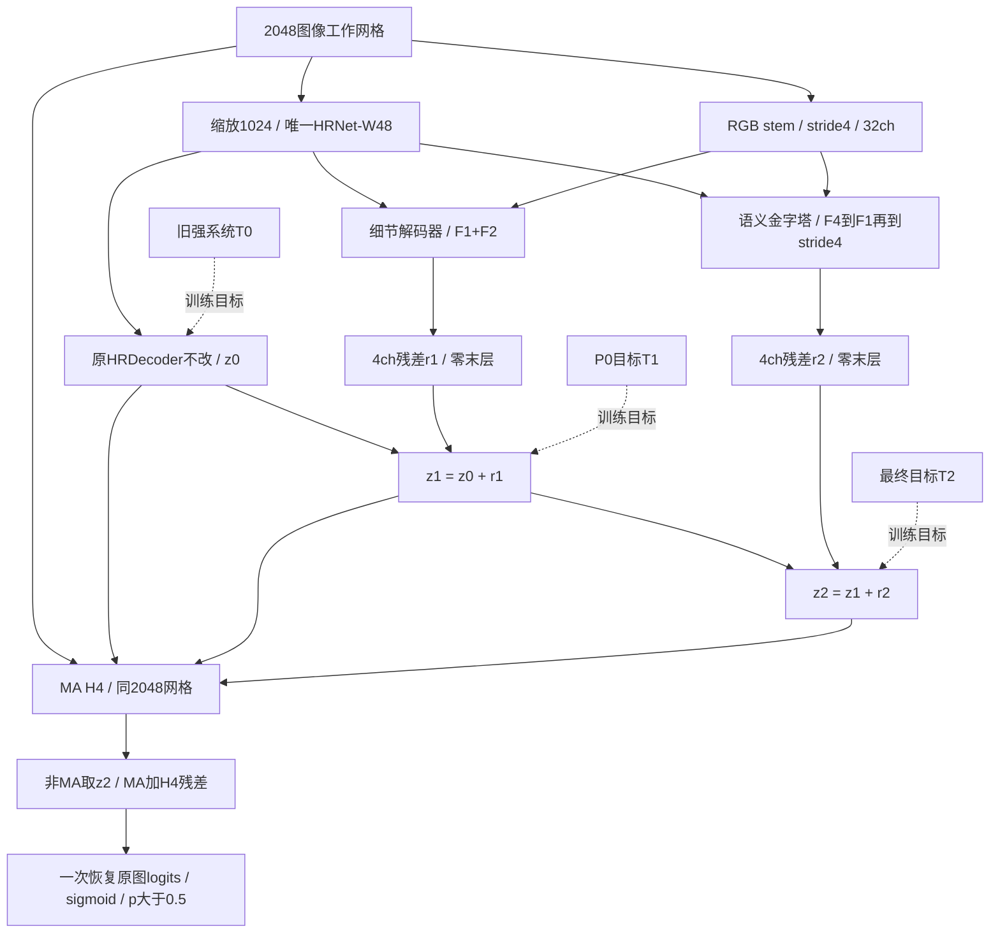

# HRDecoder-CF v2：逐级学习历史融合的修正

2026-10-08。当前推荐版本；替代v1。状态：完成设计与CPU合成契约检查，未训练、未运行真实学生或教师推理。所有待验证超参数均是工程默认值，不是已测最优值。

**结论：保留一个ImageNet HRNet-W48及原HRDecoder，加入两级可覆盖主路径错误的细节/语义残差解码；分别学习旧强系统→P0→最终强系统的预测。MA保留重新训练的H4，整套网络在同一40k日程内训练。取消学生的固定概率投票、原始弱教师差值MSE和最后1600步专训H4。**

## 1. 我撤回v1的哪些决定

| v1决定 | 审查发现 | v2处理 |
|---|---|---|
| 学生沿用0.5625/0.1875/0.25概率权重 | 若pA≤1/9，另两路即使都为1也无法让q>0.5；若pA>8/9，另两路都为0仍无法判负 | 学生用可正可负的logit残差，不设多数路径否决权 |
| 让L/C重建U0/S20相对旧系统的原始概率差 | 平均值+差拟合精确时，连弱成员错误也会被精确复制；数学可逆不是任务收益 | 蒸馏已有强系统的三个阶段结果；不要求复现弱成员本身 |
| teacher最终判断正确才做KD | y=1、teacher=.49被全删，=.51被全保留；两者差异不支持这种跳变 | 连续GT一致性权重，无0.5筛选门槛；极端自信但错误的teacher可取零权重 |
| 稀小的“任一教师阳性背景”组等权 | 一个噪声像素也可获得与上百万背景相同总权重 | 移除该独立组；仅前景/背景两个固定质量组，并记录有效像素数 |
| 语义支路只在画布stride16输出 | 输出变化只能由粗网格插值构成，无法单独重建更细的教师修正 | 语义路径逐级到stride4，并共享真实RGB细节特征 |
| H4训练2048、部署原图尺寸 | 同一个5×5感受野对应不同图像尺度；与插值先后顺序不等价 | 所有学生分支和H4均在2048工作网格组合，最后一次恢复原图logits |
| H4只在最后1600步训练，并切换BN | 旧best@1600来自冻结D/B、batch1；新模型batch2且基座变化，不能照搬最佳步数 | H4随完整40k日程更新，不切换原BN策略；所有验证节点结构完整 |
| 初版只做公式和解析计数 | 没有检查真实算子的shape、零初始化、梯度断开、tile和ignore | 增加小尺寸随机张量CPU探针；不运行训练或真实数据推理 |

概率否决是**固定其他路径时的表达限制**。联合训练仍可改变pA，所以不能说v1整个网络永远无法检出这些像素。真正的问题是：当更高分辨率的新信息只存在于细节路径时，固定投票限制了它独立纠正主路径的能力。

H4的±6范围是另一个可达性限制，但这里保留：它承担有限MA校准，两条主残差无±6限制。没有证据证明取消H4边界比保留更好，不为追求纸面“能翻转任意概率”新增放大器。

## 2. 不变的任务边界与证据

- 学生仍只加载与本地原基线相同的ImageNet HRNet-W48；不加载任何DDR训练权重或DINO权重。
- 总计40,000个全局训练批次，batch2，主网络40,000次SGD；无额外图像曝光、第二个HRNet、外部病灶监督或训练后追加微调。
- 教师允许使用既有最佳系统，历史计算、DINO通用预训练与缓存导出成本单列。
- 自定义DDR 454/76/227，输出顺序EX/HE/SE/MA，原图累计TP/FP/FN，严格p>0.5。
- 工程参照是本地基线42.20%与完整教师45.8604%；不是把原论文另一划分的32.25%直接混入排行榜。[HRDecoder论文](https://arxiv.org/html/2411.03976v1)

最重要的历史正证据仍是H4对旧系统MA的净改善、U0/Q16的概率融合增益、S−C匹配验证改善。E4单独退步、随机RGB专家失败、HE头不增益，以及更多训练/外部数据未必带来融合增益，仍限定本次复杂度。它们都没有证明v2会提升。

历史详证保留于[evidence/history_audit.md](evidence/history_audit.md)、[H4代码审计](evidence/h4_code_audit.md)、[教师协议审计](evidence/teacher_protocol_audit.md)。v1和首次验证结果保留于archive/v1，不修改原始实验。

## 3. 教师按已经取得的融合阶段组织

令A为旧HRDecoder完整系统（**含旧H4**），U为U0，S为S20 EMA：

\[
T_0=A,\quad T_1=0.75A+0.25U,\quad
T_2=0.75T_1+0.25S.
\]

对应已经存在的三个系统：旧冠军、P0、最终45.8604%系统。教师式中的历史权重只用于构造目标，不作为学生推理权重。

v1要求学习U本身，U独立验证只有38.4464%；v2的第二阶段学习P0，目标已包含旧系统对U的约束。第三阶段学习最终融合，目标也不是单支S。**系统总体更强不等于每个像素都更好**，三阶段仍接受同一真实GT监督。

若三个阶段概率都精确匹配，学生阶段差自然对应T1−T0、T2−T1；不再为精确复制差异增加一个直接MSE损失。差异是机制诊断量，不是必须不惜标签准确性维护的目标。没有声明这些路径形成统计独立的专家。

当T0/T1/T2均在(0,1)内时，理论logit增量为logit(T1)−logit(T0)、logit(T2)−logit(T1)，二者之和是logit(T2)−logit(T0)；再加z0=logit(T0)才得到logit(T2)。端点0/1不适用这个有限增量恒等式。**训练不直接回归这些logit差**，避免教师极端概率产生巨大残差目标；实际用稳定的软标签交叉熵/KL监督阶段输出，包括teacher概率0/1。

## 4. 完整架构与张量定义

### 4.1 原HRDecoder与共同输入

2048画布缩到1024送入原HRNet。F1/F2/F3/F4的通道为48/96/192/384，空间为256/128/64/32，相对画布stride为8/16/32/64。保留原720→64的FCNHead、7×7卷积、LR/HR logits平均、4个随机feature crops及0.1 HR辅助损失，得到2048网格z0。

**需修改前向接口，不修改原解码算子。** 原代码将`extract_feat(lr_img)`直接送入`_transform_inputs`，只向外返回融合logits。实现时先保留原生`features=(F1,F2,F3,F4)`，再用同一组features拼成720通道供原LR/HR解码；内部公共接口返回`z0, features, HR辅助输出与裁剪坐标`。训练与推理均只提取一次HRNet特征，不为L/C再次调用`extract_feat`；原HR随机裁剪与滑窗解码仍保留。新增CPU探针用随机features检查新模块，尚未实际接入这个接口。

先初始化原模型，再创建新增模块，或者使用独立RNG，保证原随机解码头也不被新模块的随机数消耗改变。预训练SHA仍待未来运行前核验；相同URL不足以证实相同文件。

### 4.2 细节残差r1

RGB stem：3×3 stride2，3→16；3×3 stride2，16→32，得512×512×32的N。每层后接逐像素Channel-LN和GELU。

F1、F2各1×1投影到32、Channel-LN+GELU，插值到512²，与N拼成96通道；1×1压到64、Channel-LN+GELU；两个64通道残差块；最后1×1到4通道，权重和bias置零。插值到2048得到r1。

残差块为DWConv3×3→Channel-LN→GELU→PWConv1×1，输入与输出相加。它不独立承担从RGB发现全部病灶的任务，已有语义和z0先验参与整体决策。

### 4.3 语义残差r2：修复粗网格表达限制

F1/F2/F3/F4各自1×1投影到64、Channel-LN+GELU。F4上采样加F3，接DW7残差块；上采样加F2，再接DW7残差块；上采样加F1，接DW3残差块。上采样到512²，与同一个N拼成96通道，1×1压到64、Channel-LN+GELU，接DW3残差块，最后零初始化1×1到4，插值到2048得到r2。

DW7块除深度卷积为7×7外，其余同DW3块。所有非输出卷积bias=false，输出bias=true。Channel-LN只沿C归一化、eps=1e-5；不是包含空间维度的GroupNorm。两条支路共享RGB stem和HRNet，C不复制stem。

让C读取细节并不证明它会获得DINO表征。它只消除了“只能在stride16网格表达修正”的结构限制；仍不能恢复2048缩放已经丢掉的相机原图信息。

### 4.4 学生融合改为逐级logit修正

\[
z_1=z_0+r_1,\quad z_2=z_1+r_2,\quad p_j=\sigma(z_j).
\]

r1、r2无tanh边界和固定投票权。只要残差容量足够，就能覆盖原路径的强阳性或强阴性；例如z0=−10、r1=11、r2=0时最终概率约0.731，而v1在对应极低pA下不能靠其它分支翻正。

仅最后输出层置零，没有“零门×零输出层”。初始r1=r2=0，三个阶段与原z0相同。首步隐藏层因末层为0暂时收不到该支路梯度，末层可先更新；这是启动延迟，不是永久死分支。

L/C不是三个独立模型的等价替身。部署是单骨干、两级残差细化，能够学习历史融合带来的修正；在未验证前不称为已经实现多模型集成的统计收益。

## 5. H4：保留有效机制，消除坐标与选点不一致

7通道改为：归一化RGB三通道，加clip(z0_MA)、clip(z1_MA)、clip(z2_MA)、p2_MA−p0_MA。clip界限为±log(9999)，与旧logit(clamp(p,1e-4,1−1e-4))在实数域对应。

结构仍为Conv3×3(7→16)+ReLU、Conv3×3(16→16)+ReLU、Conv1×1(16→1)，3,361参数；末层零初始化，不加载旧H4权重。

\[
z_{out,MA}=\operatorname{sg}(z_{2,MA})+6\tanh h(\operatorname{sg}(X_H)).
\]

sg只说明H4损失的训练梯度；推理数值就是z2加修正。EX/HE/SE不变。主网络仍对**未经过H4的z2全部四类**做GT/KD监督，MA不会因为head detach而失去训练。

H4和所有主残差在同一个2048网格完成，之后将四类z_out统一bilinear恢复到原图H/W，再sigmoid。零初始化时，这个顺序回到原基线“恢复logits后sigmoid”的行为。

不再把H4搬到原图网格执行。代价是放弃旧头的原尺寸操作条件；优点是训练和部署同工作尺度。旧H4收益只能支持其机制，不能作为新H4收益的精确预测。

部署时H4可在no_grad下按512输出块、两像素halo计算；头无归一化层，只有局部卷积。扩大后的输入片在真实画布边缘截断，各卷积在真实边缘使用自己的padding；取输出中心，丢弃内部tile边缘受假零影响的halo。这样推理可减少中间激活峰值；halo重算会略增MAC。训练时若简单拼接所有tile再反传，会保留各块autograd激活，不能据此承诺节省训练显存。本次没有制定或验证分块训练反传方案。

±6仍不能在固定z2时纠正所有极端错误：有限实数head输出下，q≤σ(−6)时无法翻正，q≥σ(6)时无法翻负，因为tanh的数学值严格在(−1,1)。浮点tanh可能舍入至±1，边界实现应另按严格p>0.5核验；不能以饱和舍入作为可靠纠错能力。保留这一能力范围，是校准器的明确取舍；主残差本身可以继续学习改变z2。

## 6. 损失：删掉硬差异拟合，保留GT与软教师的正常折中

设阶段权重a=(1/4,1/4,1/2)，主损失：

\[
L_{main}=\sum_{j=0}^{2}a_j D(p_j,Y)+0.1D_{HR}
+\lambda_K(t)\sum_{j=0}^{2}a_j K_j.
\]

D是平方分母Dice，原基线smooth=1e-5：每图每类先计算，再对有效图类平均。三个阶段初始相同且a和为1，标签主损失初始值等于**在同一个新有效掩码v上计算的z0 Dice**；不等于历史未正确屏蔽padding/ignore的原训练损失，也不意味着新增支路梯度或之后轨迹等于原训练。数学记号D接收概率；本次探针函数接收logits并且只sigmoid一次。旧`BinaryLoss`外层也会sigmoid，不能把p直接传进去导致二次sigmoid。

每个阶段使用对应Tj的Bernoulli KL，温度1，用BCEWithLogits减教师熵实现，教师概率0/1时用xlogy或等价稳定实现。不要对四病灶做softmax。

连续可信度权重为c_j=Y·Tj+(1−Y)·(1−Tj)。用GT阳性与背景两组，固定各占1/2：

\[
K_j=\frac12\frac{\sum_{vY=1} c_j\,KL(T_j\Vert p_j)}{\max(1,\sum vY)}+
\frac12\frac{\sum_{v(1-Y)=1} c_j\,KL(T_j\Vert p_j)}{\max(1,\sum v(1-Y))}.
\]

每图每类计算，再平均；空组贡献0，**不把剩余组重新放大到1**。分母不改为Σc，避免把低可信度权重整体归一化掉。v包括合法标签和几何有效域。教师=.49/.51附近权重连续，弱阳性软信息仍可使用；不会单独放大“一个教师误报”的背景小组。

这是新的、未验证的蒸馏加权选择。它仍会在某些像素上与GT梯度相反；这种软约束可能提供正则化，也可能妨碍拟合。不能把所有梯度不一致都叫实现错误，也不能证明该权重优于普通全像素KD。普通KD是必须保留的对照。

审查中还考虑过“学生比教师更接近GT时完全关闭KD”。它可得到逐像素梯度同向的性质，但也会丢掉教师对过度自信学生的正则化，因此不放入默认方案。更精确模仿教师并不自动带来更好泛化，已有研究也指出这一点。[Stanton等，NeurIPS 2021](https://research.google/pubs/does-knowledge-distillation-really-work/)

H4损失沿用0.5 BCE+0.5平方Dice（分母+1），但全部乘v。无MA前景的图像跳过Dice项、保留0.5 BCE；不能让空前景常数1伪装成有效梯度。整张全ignore时两项都是可微的0。H4损失不回传主网络。

## 7. 统一40k日程与公平选点

- 主网络：SGD lr=0.005，momentum=0.9，weight_decay=5e-4；原1500步linear warmup、ratio=1e-6；poly power1，min_lr0，batch2。
- H4：同40k全局时钟，每批一次Adam，base lr=1e-3、weight_decay0、clip_grad_norm5；使用相同warmup/衰减倍率。不另取图像、不额外前向HRNet。
- 原主干与解码头BN全程沿用基线行为；**取消末段BN切换**。训练BN与eval BN本来就有差别，这是普通联合训练需要验证的风险，不能假装冻结统计就使主模型静止。
- λK：前1500步0；1501–4000升到0.5；4001–32000保持；32001–40000降到0.1。删除λ_diff。
- H4从开始就在计算图里，零初始化并随日程学习。每4k验证一次的所有候选都包含已训练到该点的完整结构。
- 主科学端点40k；另列best-val节点，保存完整主网络/H4/两个optimizer/RNG/时钟。不能把早期主网与最后H4拼成一个未评估的新候选。
- 不使用学生EMA、TTA、checkpoint平均、外部数据或测试集阈值调节。

更新数明确为40k全局批次、40k主SGD、40k小头Adam。小头更新被包含在每个全局步内，不是额外40k数据批次，也不是相同总FLOPs。原H4在静态输入上短训有效，**没有证明动态输入下长训更优**；本次改变的理由是联合架构和完整选点一致性，收益仍需验证。

1:1:2阶段权重、KD峰值0.5、H4优化器及新归一化都是预先固定的工程默认，不是“有定理保证最优”。没有现场逐项试出最优值的证据，不能用“完美”掩盖它们。

## 8. 数据与几何契约必须可执行

1. 教师只对原自定义train的454张导出。需要T0/T1/T2三张FP32软图，或等价原始A/U/S；不能拿val缓存或test计数代替。
2. 三阶段教师全部在同一原图坐标构造，再共享学生完整几何变换。概率bilinear，离散GT nearest；空间变换先于KD连续权重计算。
3. 使用独立的源图有效区域图v_geo，覆盖Resize、Crop、Rotate、Pad全过程；不要只用gt!=255，因为原基线把旋转/补边标为背景0。拒绝含源图外插值支持的目标像素；正常眼底黑背景仍是合法背景，不能与padding混淆。
4. 统一有效掩码v=v_label∧v_geo用于新主损失、KD和H4。相较旧BinaryLoss忽略方式，这是监督实现修正，所有公平对照同改；历史42.20保留历史口径，不冒称重新复现。
5. HR随机feature-crop辅助损失也要裁剪同一v。坐标顺序、align_corners=false、RGB/BGR、归一化、类别通道逐项锁定。
6. 变换原图教师soft map不等于重新运行教师预测增强图像。老师可使用整图上下文，学生看增强画布；这是一项训练设计，不是数值等价。
7. 教师native S20可能看见2048学生画布已丢失的细节。KD无法凭空恢复缺失信息；v2的stride4改进也不能解除输入信息上限。

完整原图三路train概率负载约104.90GiB：454张原JPG尺寸与data_identity清单逐项一致，合计2,346,569,020像素，乘3目标×4类×4字节。若统一2048则85.125GiB；这是未压缩张量字节计算，都未实测落盘占用。通过图像ID、形状、类序、权重SHA和概率SHA核验后再使用。已有文件并未证实454张完整目标已导出。复算依据见[evidence/review_v2_protocol.md](evidence/review_v2_protocol.md)。

旧教师train与官方valid/test分别重叠80/142张，所以官方协议发表必须重建隔离教师；本次自定义划分的训练目标不能跨协议复用。训练内teacher概率不是OOF预测，也不能用于宣称454内部新验证折独立。

## 9. 计算量与小分支的实际含义

| 新增模块 | 参数 |
|---|---:|
| RGB stem与L | 26,004 |
| 含细分辨率出口的C | 77,444 |
| H4 | 3,361 |
| 合计 | **106,809** |

这些数量同时由层定义和小尺寸CPU模块实例核对。它不是完整HRNet学生参数实测，也没有推断GPU延迟。两条主残差只在stride4及更粗网格工作；H4在固定2048网格，是新增卷积MAC的重要部分。

删除原图H4后，头的成本不再随相机原图面积变化；最终四类logits恢复仍随输出尺寸变化。每图2048画布新增卷积MAC：L含RGB stem为5,939,134,464，C为3,734,241,280，H4为13,958,643,712，合计**23.632G MAC**。计数公式为各Conv输出元素数×(输入通道/groups)×核面积，CPU探针在64画布统计后按面积放大；本结构所有网格相同比例缩放。未计原HRDecoder、插值/LN/激活/反传。GPU显存、完整速度和40k墙钟仍待测，不能以10.7万参数称计算免费。

## 10. 三轮审查能证明什么，不能证明什么

第一轮使用反例撤销v1固定概率投票、弱教师差异绑定和H4尺度/日程假设；三名GPT-6-Luna（max）分别核查H4、目标和协议。

第二轮构造v2，做CPU小尺寸随机张量验证：模块参数/shape、零初始化、标签与teacher有效域、输出层与隐藏层梯度、H4梯度隔离、空标签/ignore、tile halo、组合/恢复顺序。探针不含HRNet、教师权重、真实病例或optimizer更新。

第三轮复核新版目标是否为了“消除冲突”删掉有用正则、是否新增了错误等价声明，并核对文档/JSON/探针一致性。拒绝把“能表达任意修正”“初始恒等”或“梯度有限”写成“最终mIoU一定提升”。

收敛标准是：没有遗留的已确认内部矛盾；可检查的结构和数值约定通过；剩余问题有明确实验判据。继续在没有新证据时增加模块、调常数，不构成更可靠的改进。

## 11. 剩余风险和能够推翻方案的证据

| 仍需实验回答 | 失败证据 |
|---|---|
| 共享65M量级HRNet是否能吸收强教师知识 | 同预算普通HRDecoder+最终KD更好，或阶段teacher拟合好但验证退步 |
| 两级残差是否比直接细节融合有价值 | 参数/信息匹配的单残差或concat对照相同或更好 |
| 分阶段目标是否超过仅最终T2 | 同结构只用T2表现更好；说明历史步骤并非有效课程 |
| 连续加权KD是否值得 | 普通KL对照更好、少量前景组使波动增加或教师FN拉低召回 |
| 新H4是否保留收益 | 配对验证中MA改善不稳定或FP代价高；不能引用旧+0.98替代 |
| 40k能否接近/超过45.8604 | 单模型真实测试未达标；不能再把旧教师接回推理充数 |

“接近”仍建议预登记为差距≤0.5pp（≥45.3604），仅是工程容忍度；“超越”是>45.8604的点估计，再报告配对区间和种子方差。历史test已多次影响研究，不是新盲测。

## 12. 顶刊需要的最小解释性对照

论文不应把普通多头、KD、残差或H4重新命名就当创新；[ONE](https://proceedings.neurips.cc/paper/2018/hash/94ef7214c4a90790186e255304f8fd1f-Abstract.html)、[SDES](https://ojs.aaai.org/index.php/AAAI/article/view/25266)已有相邻思想。更大的教师也不自动适合学生。[Cho与Hariharan，ICCV 2019](https://arxiv.org/abs/1910.01348)

最低应区分：原HRDecoder；相同有效mask+最终T2 KD的原HRDecoder；v2结构仅最终T2；v2分阶段教师；完整v2加H4。还需要信息/参数匹配的更简单细节融合对照和普通KD权重对照，才能说明额外复杂度必要。按科学问题合并共享对照，不为每个常数做大规模搜索。

H4输入/基准detach且使用独立RNG后，同一checkpoint关闭H4能测该头的直接输出效应；不能用推理时去掉L/C替代训练消融。最终方法与最强公平对照需要多种子、图像/患者级配对区间和外部隔离证据。

这是后续发表证据需求，不是本次训练授权。本次只做设计与无参数更新的合成检查。**v2比v1消除了更多可证明的缺陷；目前仍不能称为完美架构、确定超越教师或顶刊保证。**
