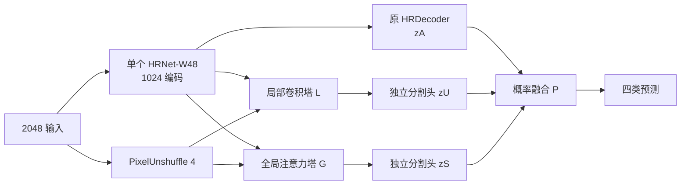

# 20k 零检出诊断与 v4：真值锚定的三路概率蒸馏

**版本定位更新：本文件保留诊断证据与稳定性底座；v4 固定三头平均现作为对照。主研究架构改为 [HRDecoder-CET](../research_v5/00_HRDecoder_CET_架构与训练方案.md)，不再把 v4 作为最终论文方案。**

2026-10-09。目标保持：相同 ImageNet HRNet-W48 权重、40,000 次更新、batch 2，训练一个部署时不依赖教师的学生，争取接近并超过锁定融合系统。**已定位并实测修复的是监督失效机制；v4 的最终精度尚未验证，不能承诺必胜或“完美”。** 本轮所有模型诊断均为固定检查点前向、梯度或内存中的模块替换，没有 optimizer.step，没有新训练。

## 1. 诊断结论：已经知道什么

20k 的全 76 图验证为 15.0509%，EX/SE 的 TP、FP 均为 0；8k best-val 为 37.9882%。单纯检查参数没有 NaN/Inf，并不能证明模型健康。

### 1.1 归一化和推理精度不能单独解释这次故障

读取保留的 8k、20k 检查点，选择两张训练图、两张验证图，均含 EX/SE。GPU FP32 上分别用 BN running statistics 和当前图像 batch statistics；其余模式固定为 eval，Dropout 关闭，不修改持久检查点。

- 20k 在四图、两种 BN 条件下，EX/SE 全部仍无正预测。训练图也失败，故不能仅解释为验证泛化差或 BN 推理统计失配。
- 8k 在两张相同训练图上 EX/SE 能检出。验证图 SE 在 8k 已有困难，不能把选定四图当作无偏性能样本。
- 原来的 CPU FP32 复核与新 GPU FP32 结果一致。此结果排除了“只由 BF16 推理舍入造成”，没有排除 BF16 训练历史的作用。
- 8k 和 20k 都有极小 BN 方差；不能根据 20k 某些方差小就宣布 BN 是根因。

证据：[归一化反事实](evidence/normalization_probe_cuda.json)。初次 CPU 探针被另外一处用户停止操作中断，部分结果保留于 `normalization_probe.json`；它没有被冒充完整实验。

### 1.2 真实标签和教师阳性信号存在，学生已经失活

在三张实际训练图上复用正式 `TrainCacheDataset` 的 2048 增强、GT/教师共用坐标及有效域，固定 seed=42000。三图不是随机代表样本，选择条件是增强后存在 EX 和 SE。

| 类别 | 教师 T 在 GT 阳性区的均值范围 | 20k 学生在 GT 阳性区的均值范围 | 旧 Dice 对该类公共 logit 的梯度范围 |
|---|---:|---:|---:|
| EX | 0.6359–0.7607 | 1.13e-7–1.39e-7 | −2.78e-7 至 −2.26e-7 |
| SE | 0.7719–0.8716 | 2.54e-8–1.11e-7 | −2.23e-7 至 −5.07e-8 |

教师不是在这些 GT 区域全部漏检，学生也不是没有看到标签。原 Dice 的正例救援梯度已衰减到很小；三张 EX/SE 空目标训练图，旧 Dice 仍给出约 +1.83e-4–+2.34e-4 的 EX 抑制梯度和 +4.41e-5–+4.98e-5 的 SE 抑制梯度。这里正梯度经梯度下降会压低 logit。

同一输出上，换用本方案 GT 损失后，阳性类公共梯度约为 −0.25；空类仍有负监督，但已经接近零的负类不再被 Dice 平滑项强推。上述是单类、尚未再乘四类/批次宏平均和各头权重的数值，不能与整网参数梯度混为一谈。增强填充区不属于监督有效域；原诊断 JSON 的 `probability_max` 是全画布最大值，不应拿填充区响应充当有效病灶检出。

证据：[真实增强样本与教师/输出梯度](evidence/real_objectives.json)、[缓存核查](evidence/teacher_cache_audit.md)。缓存的通道与无损保存审查通过；这不等于穷尽所有训练时输入故障。

### 1.3 真正的分类器参数梯度也复现了问题

进一步在 20k 固定模型上使用三个 batch=2 的“阳性图＋阴性图”配对，启用实际 train 模式 BN/Dropout、正式随机 HR 裁块。只让分类器 bias 参与求导，不创建优化器。旧 GT 含原来的 0.1 HR loss；对比仅替换主 GT 和 HR GT 损失，KD 保持完全相同。

| 配对 | 旧 GT：EX bias 梯度 | 旧 GT：SE bias 梯度 | 修复 GT：EX bias 梯度 | 修复 GT：SE bias 梯度 |
|---|---:|---:|---:|---:|
| 1 | +8.74e-5 | +2.54e-5 | −0.03393 | −0.03393 |
| 2 | +1.03e-4 | +3.16e-5 | −0.03393 | −0.03393 |
| 3 | +9.32e-5 | +3.94e-5 | −0.03393 | −0.03304 |

**三个批次包含阳性监督，但旧 GT 汇总后仍压低 EX/SE 的分类偏置；替换损失后方向逆转。** 原 KD 在这些配对中反而试图恢复两类：因此不能把蒸馏直接判为罪魁祸首。加入 KD 后，旧总梯度在部分配对已向上恢复，但量级弱；修复后总梯度都保持强恢复方向。

证据：[真实分类器梯度](evidence/classifier_gradients.json)。此测试包含 HR GT，仍没有完整 SGD momentum/weight decay 轨迹，且只检查 classifier bias。它确认了当前状态上的可修复近端机制；**没有唯一证明哪个步骤、哪个模块首先触发了坍缩**。要唯一归因仍需相同曝光序列的配对训练，不能用几次探针冒充。

### 1.4 简单换头不能救回当前终端输出

20k 模型中，仅换回 8k 的 EX/SE 分类行，或整个 8k decoder，保留其余 20k 模块，四张探针图的最终 EX/SE 仍为零检出。混合检查点不是正式模型，不构成精度结果，也不能直接证明主干不可恢复；它说明单个输出层补丁没有解决已测故障。

证据：[模块置换](evidence/head_intervention.json)。不建议从 20k 修修补补后当作“同起点 40k 新架构”；正式 v4 从原 ImageNet 起点重新开始。

## 2. 为什么旧目标允许这种退化

旧的平方 Dice 对空目标仍计算：

\[
L_{empty}=\frac{\sum_i p_i^2}{\sum_i p_i^2+\epsilon},\quad\epsilon=10^{-5}.
\]

当输出接近全零时，空类 loss 可以从接近 1 降到接近 0。阳性类在相同极低概率下，Dice loss 接近 1，但恢复梯度随 sigmoid 饱和而变弱。空间均值 KL 的病灶信号又随像素面积缩小。signed auxiliary 监督的是教师差值，不是 GT，也没有一条直接修复主输出阳性梯度的路径。

这是原 HRDecoder Dice 也有的机制，不是 v3 新写错了公式；因此不能说“原 baseline 必然也崩”或“只改这一个式子已证明全部根因”。v3 的额外自由度和共同训练是否增加进入该区域的机会尚未量化。历史 RGB MA 专家也曾全负失败，说明单纯加头或普通 Dice+BCE 不足以提供保证。

推导与反例：[损失机制审计](evidence/loss_mechanism_audit.md)、[历史边界](evidence/history_repair_constraints.md)。

## 3. v4 框架：三个独立概率分量，直接形成最终预测

保留一个原 HRNet-W48、原 HRDecoder、v3 的局部卷积塔 L 和全局注意力塔 G。移除“差值回归头→大融合分类器→无界 logit 残差”的输出方式；L/G 各自输出四类独立 logits。它们是有完整分割监督的预测头，不再把“小辅助误差”当作主任务有效性证据。

\[
P=0.5625\sigma(z_A)+0.1875\sigma(z_U)+0.25\sigma(z_S).
\]

教师仍为锁定的 A（旧 HR 集成，含 H4）、U（ConvNeXt U0）、S（DINOv3 S20 EMA）；最终教师 `T=.5625A+.1875U+.25S`。在分量被精确学会的条件下，学生概率融合与教师融合代数一致；这是可检查的目标对应关系，不是容量或精度保证。L/G 不是预训练 ConvNeXt/DINO，不能声称复现了它们的全部表征。

保留 L/G 的层数与宽度以控制此次修订范围：L=2,918,816 参数，G=3,459,872；两头分别为 32→64 的 1×1 Conv 加 PixelShuffle4，各 2,112 参数。全部层定义在 [参考结构](v4_architecture.py) 及其明确复用的 `../training_execution/private_modules.py`；主干各尺度仍为 48/96/192/384 通道。

两头的最后一层 W/b 为零，其余新模块随机初始化。首个前向 pU=pS=0.5，因此初始 `P=.5+.5625(pA-.5)`，严格 `P>.5` 与 pA 的二值决策相同；概率并不相同。塔的任务梯度有首步延迟，头更新后才进入塔，不能把零初始化写成“从第一步所有层都有梯度”。原 v3 的 auxiliary 在前 1500 步也因 λ=0 未启用。

选择固定权重，取消任何逐阶段弱教师目标、训练中的 gate 和在线 H4。H4 的已有知识继续通过教师 A 进入；不把历史冻结集成上 H4 的收益套到动态学生。

概率域有 `P≥.5625pA`。所以 pA>8/9 的阳性不会被其余两头压成负类。但这不是全面召回保证：若 pA=0、另两头都为1，P仍只有.4375；固定权重存在主头主导风险。保留这个已知反例，要求分别报告三头和融合的逐类指标，不宣称无条件保留所有互补检出。

## 4. 修复监督：每个头都能从极低阳性概率恢复

令 y 为四个独立前景 one-hot，m 排除 ignore=255 和几何无效区，p=sigmoid(z)。对每个图像、类别：

\[
D_+=\mathbf1[N_+>0]\left(1-\frac{2\sum mpy+\epsilon}{\sum m(p^2+y^2)+\epsilon}\right),
\]
\[
B_+=\frac{\sum my\,\mathrm{softplus}(-z)}{\max(N_+,1)},\quad
B_-=\frac{\sum m(1-y)\,\mathrm{softplus}(z)}{\max(N_-,1)},
\]
\[
G(z)=\mathrm{mean}_{\text{有效图像/类别对}}[D_++0.25(B_++B_-)].
\]

空类的 Dice 项为 0，但仍进入固定 active-valid 宏平均并保留 B−，绝不把完整标注的阴性当作 ignore；缺失正/负组贡献 0，不把另一组乘2。全 invalid 返回可反传的零。阳性 logit 很低时，B+ 的总恢复梯度不再随 p 指数消失。0.25 是基于探针选择的候选系数，尚未获得端到端最优性证据。

这不同于历史上把普通全像素 BCE 加到仍含空类的 Dice 上；同时移除空类 Dice 的抑制来源，并改变阳性 BCE 的归一化。代价是概率校准与误检行为改变，必须记录 precision/FP，不能只盯 recall。

GT 主任务固定为：

\[
L_{GT}=0.5G(z_P)+0.25G(z_A)+0.125G(z_U)+0.125G(z_S)+0.1G(z_{HRcrop}).
\]

zP 使用 log-sigmoid/logsumexp 计算概率混合的 logit，避免直接 clamp 概率把极端梯度截断。每条分支都有自己的 G，防止混合 Jacobian 让弱分支得不到直接阳性信号。

## 5. 蒸馏和梯度边界

在 GT 与教师硬决策相反的位置不施加 KD；用严格 `q>.5` 与 GT 判断一致。`g=1[(q>.5)=y]`，teacher、g 都 detach。KD 分子乘 m·g，分母仍为全部有效像素数 sum(m)，不以被保留的稀少像素数放大损失。

这个筛选只排除教师的硬决策错误，**不保证 GT 与 KD 梯度同向**；例如 GT0、q=.49、p=.05，KL仍会抬高p。它也改变有效KD强度，必须记录每师/每类正负区域的覆盖率。所有被筛掉的像素仍由 GT 监督。

\[
L_{task}=L_{GT}+\lambda_K K(z_P,T),
\]
\[
L_{component}=0.5\lambda_K[.5625K(z_A,A)+.1875K(z_U,U)+.25K(z_S,S)].
\]

- shared HRNet：只接收 Ltask 梯度，即最终强教师及所有真值任务。
- 原 decoder 与 L/G/两头：接收 Ltask 和各自 component KD；component KD 的共享主干梯度不写入 `.grad`。
- 一次 `autograd.grad` 抽取 component 参数梯度，随后 task.backward，再相加；同一 optimizer 只 step 一次。不能把两 loss 直接相加 backward，也不能 detach 全部 private 输入切断合法 GT 任务梯度。
- λK 与 v3 一致：0–1500为0，4000升至.5，至32000保持.5，40000降至.1。最终教师始终是 T，没有弱到强的阶段目标；固定概率权重从第1步使用。

实现：[损失参考](v4_objectives.py)、[结构与路由](v4_architecture.py)。

## 6. 初始化、预算和推理规范

| 项目 | 固定要求 |
|---|---|
| 起点 | 同一 ImageNet HRNet-W48 SHA `d2186c55782308392ae14cf179ac4840143b09abdbba81aa3f9274c795ebc960`；不用20k/8k任务权重初始化 |
| 数据 | 自定义 DDR 454 train / 76 val / 227 test；EX/HE/SE/MA；标签1–4，背景0，ignore255 |
| 主干 | 每次前向一个 HRNet；2048输入、1024编码；BN保持原协议，不因这次失败盲目换GN或冻结BN |
| 更新 | 40,000，batch2；原图曝光序列和增强策略固定，不额外加病例/图像、不重抽额外teacher样本 |
| 优化 | SGD .005 / momentum .9 / weight decay 5e-4；原1500 warmup与poly1；所有loss/mixing FP32 |
| 教师成本 | 已有冻结 FP32 train 缓存；教师历史训练和缓存成本单独披露；不声称同总算力 |
| 推理 | 无教师、无在线H4、无TTA；分别将三头 logits 双线性还原到原图，再各自 sigmoid、概率融合、严格>.5 |
| 验证 | 每4k完整76图；固定40k为主要结果，best-val为次；异常日志不能只记平均loss |

注意：不能把2048上已融合的logit统一resize后当作原图概率融合。这两种运算不交换；[inference_probabilities](v4_architecture.py) 明确在原图网格混合，才能保留概率代数及下界。B0对照仍使用原版单头 logits还原规则。

v4新增参数 **6,382,912**，全模型 **71,955,332**。新增2048单图MAC：卷积/线性 **33,002,881,024**，注意力 QK/AV **2,147,483,648**，合计 **35,150,364,672**。v3对应44,696,600,576，减少9,546,235,904，约21.36%；这只是新增模块的MAC差，不是整网加速率。插值、归一化、softmax及概率混合未计入这些MAC，不代表实测GPU时长。

## 7. 本轮已完成的验证及尚未完成项

已完成：

1. CPU/GPU固定检查点、BN反事实、真实教师GT+区域检查、真实loss梯度、真实分类器bias梯度、内存中模块置换；全部无SGD更新。
2. 新目标10项CPU测试：极端logit、全invalid、ignore、空类负监督、错误teacher掩码、正确teacher梯度、概率混合恒等与参数合法性。
3. 新模块参数/MAC、初始阈值、原图概率混合、共享与私有梯度路由测试通过；被排除的原始aux共享梯度实际非零，避免虚假的路由通过。
4. 服务器原运行环境下接入真实 ImageNet HRNet，128画布/batch2前向反向通过，HR loss正常，初始化未改、只调用一次backbone、全参数梯度有限、未创建优化器。

另已完成：v4 在服务器 RTX4090 上，用真实阳性/阴性训练图完成2048/batch2、BF16网络/FP32损失的前向反向；一次主干调用、梯度有限，峰值已分配19,890,649,600字节、峰值保留21,839,740,928字节。没有创建优化器，SGD动量约287,821,328字节仅为估算。这是一次初始化状态检查，不能代表持续训练，更不是 CET 的资源验证。证据：[完整画布检查](evidence/v4_full_resource_checks.json)。

尚未完成：持续训练的完整资源与吞吐测量、40k精度、随机种子稳定性、数据外泛化、v4相对简单KD的收益。当前交付是经过机制验证的候选及参考代码，不是可宣称准确率的训练成品。证据：[目标测试](evidence/v4_objective_checks.json)、[结构测试](evidence/v4_architecture_checks.json)、[真实HRNet接入](evidence/v4_integration_checks.json)。本地接入曾因缺少mmcv失败，随后在服务器固定环境通过，没有把本地失败隐藏成成功。

## 8. 审稿式反驳与实验优先级

最重要的反驳是：这次收益可能全部来自损失修复，三路结构可能仍没有价值。必须先与“原HRDecoder＋修复GT＋最终教师KD”以及“v3只修复GT”比较，再看取消component KD的同容量对照。如果三路没有超过简单KD，就删除三路研究主张，不能靠增加模块掩饰。

版本更新：v4 现在用于稳定性对照，主研究方案为 HRDecoder-CET。本文的损失修复和实测证据继续有效；原先推荐 v4 作为唯一主实验的建议已撤回。一条40k曲线无法单独证明因果、稳定性或顶刊贡献。

下一轮日志必须有：每类GT阳性曝光数/有效面积，三头与融合的逐类precision/recall/IoU，阴性图FP，GT阳性区域概率，teacher可靠掩码覆盖率，GT/KD分类器梯度方向，以及每头对各教师的交叉拟合误差。若固定阳性训练探针与完整val同时再次零检出，应保全现场并中止主实验进入排查；不能因平均loss下降而持续运行。任何修复后恢复的结果应标明协议版本，不能混写为原v3的固定40k结果。

验收口径：历史基线固定40k val=38.835%，best-val=39.390%；融合val=45.3218%，test=45.8604%。不得将本轮val直接与历史test比较。要声称超过原论文，需处理官方划分不同、旧教师训练与官方val/test重叠等问题；当前目标是自定义划分上的技术改进。

## 9. 文献与创新边界

单骨干、多头分别蒸馏集成成员已有 [Hydra](https://arxiv.org/abs/2001.04694)；不能把本方案的多头本身包装为首创。[Ensemble Distribution Distillation](https://arxiv.org/abs/1905.00076) 已区分平均预测蒸馏与保留分歧分布，本文也不能把可观测分量等同于已保留全部异构知识。

本次BN排查参考 [Rethinking Batch in BatchNorm](https://arxiv.org/abs/2105.07576) 所强调的训练/推理统计边界；实测结果不支持把改BN当现成解药。结构化分割蒸馏也已有 [Structured Knowledge Distillation for Dense Prediction](https://arxiv.org/abs/1903.04197)，因此暂不追加特征图/关系蒸馏来制造复杂度。

可研究的主张是“极稀疏病灶下，如何防止成员蒸馏中的类别失活，同时保留可检验的异构分量贡献”。它是否具有足够新颖性、是否适合顶刊，必须由系统文献比较、多数据集和受控实验决定。当前不能保证。

独立反驳：[教师与架构复审](evidence/v4_design_redteam_teacher.md)、[真实梯度复审](evidence/real_gradient_review.md)。
