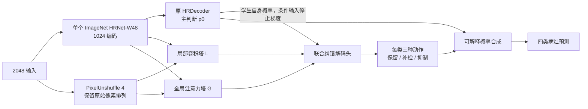

# HRDecoder-CET：把异构互补证据变成可学习的纠错解码

2026-10-09。当前主研究方案，替代 v4 的固定三头平均方案。CET 为 Complementary Evidence Transport（互补证据转移）的工作名，不是已发表方法名称，也不是首创性声明。

**目标不变：同一 ImageNet HRNet-W48 初始化、同样 40,000 次更新、batch 2，部署一个模型，争取超过当前锁定融合系统。** 本文交付架构和训练方案；按用户最新要求，不再追加扫描、实验或审查。没有启动新训练。v4 保留为稳定性对照，不作为最终论文架构。

## 1. 这次要改变的核心

v3 暴露的是两个不同层面的问题。已实测的监督问题是：20k 模型在三个“阳性图＋阴性图”训练批次里，旧 GT 损失汇总后仍在压低 EX/SE 分类偏置；阳性区域概率已到约 10^-7，Dice 的恢复梯度很弱。修复损失后，同一状态的梯度方向逆转。这确认了可修复的失效机制，但没有唯一定位训练历史中最先触发坍缩的那一步。

更深的架构问题是：**把教师分歧回归得很准，不等于最终决策真的用到了它。** v3 的分歧辅助头和自由残差融合器之间缺少可解释的输出约束。v4 虽把输出改成独立概率，但固定平均仍有明确反例：主头为0、另外两头都为1，最终也只有0.4375，不能检出。

因此，CET 不把“避免再崩溃”当核心论文贡献。它研究一个更具体的问题：**融合已经错了、至少一个成员却是对的时，如何把这部分有用的分歧训练进学生，并让它具备直接改变最终决策的能力？**

这保留了 v3 希望学习有符号分歧的研究方向，但把符号定义为经训练 GT 确认的“应该补检”或“应该抑制”，并把这两个方向直接接入前向公式。它不要求学生额外完整复制 ConvNeXt 与 DINO 的全部表征。

## 2. 一张架构图

一个共享主干，一条原 HRDecoder 主路径，两条有独立参数的多尺度表示路径，一个联合纠错头。没有推理时教师，没有在线模型集成，没有离线再训练一个 H4，没有硬选择的专家路由。

### 2.1 主判断路径

保留原 HRNet-W48 和 HRDecoder，包括原来的 HR 裁块辅助训练与局部/全局解码流程。主输出 `p0=sigmoid(z0)` 同时接受 GT 和锁定融合教师 T 的监督。主头从一开始就学最终教师，不经历弱教师到强教师的级联。

### 2.2 两条表示路径

复用已有 v3 的 L/G 层定义，不因本次失败把它们缩成两个极小分类头，也不把参数量本身当作学习能力的证明。

| 路径 | 结构与作用 | 参数量 |
|---|---|---:|
| L | 原图 PixelUnshuffle4；1/4、1/8、1/16、1/32 多尺度卷积编码和逐级解码；读取 HRNet F1–F3，输出1/4网格32通道 | 2,918,816 |
| G | 读取 HRNet F1–F4 与原图路径；32×32网格、256维、4层全局注意力；逐级恢复到1/4网格32通道 | 3,459,872 |

L 提供细小病灶和边界证据，G 提供较大范围的上下文。这是结构的感受野分工，不是假定“ConvNeXt 只懂局部、DINO 只懂全局”；两类教师产生的互补监督共同作用于 L/G。

完整层定义沿用 `../training_execution/private_modules.py` 中的 `LocalPath`、`GlobalPath`。两条路径合计约638万参数，有独立的非线性表示容量；它们不是只有10万参数的附属头。共享特征仍会限制独立性，当前不能据此声称足以压缩 DINO 的全部知识。

### 2.3 联合纠错头

在1/4网格拼接：L的32通道、G的32通道、`PixelUnshuffle4(stop_gradient(p0))` 的64通道，共128通道。

固定结构：

1. 128→64 的无偏置1×1卷积，通道 LayerNorm，GELU。
2. 一个64通道残差块：3×3 depthwise卷积、通道 LayerNorm、64→128→64 的点卷积与GELU。
3. 64→192 的有偏置1×1卷积，PixelShuffle4，得到12通道。
4. 按4个类别、每类3个动作重排，FP32 softmax 得到 `πkeep, πon, πoff`。

头部共37,888参数。小的是读出层，真正学习纠错表征的是前面的 L/G。主头概率的条件输入停止梯度；主头进入最终概率公式的直接路径不停止梯度。

初始化末层 W=0，每类三个动作的 bias 分别设为 `log(.98), log(.01), log(.01)`，并在每个 PixelShuffle 子像素重复。其余新增模块用固定种子随机初始化。于是：

\[
P_{init}=0.98p_0+0.01.
\]

初始二值阈值判断与主头一致，概率并不完全相同。首步先更新末层，零末层后面的任务梯度在后续更新才进入塔；不宣称所有新增层从首步就有非零任务梯度。

## 3. 关键前向公式：补检和抑制能够真正改变判断

每个像素、每个类别使用：

\[
\pi_{keep}+\pi_{on}+\pi_{off}=1,\qquad
P=\pi_{keep}p_0+\pi_{on}.
\]

也可以写成：

\[
P-p_0=(1-p_0)\pi_{on}-p_0\pi_{off}.
\]

两项分别表示补入阳性证据、移除错误阳性证据。最终概率始终在[0,1]，但纠错幅度不被固定的教师融合权重限制。

- `p0=0, πon=.8` 时，最终 `P=.8`，可以救回主头漏检。
- `p0=1, πoff=.8` 时，最终 `P=.2`，可以否定主头误检。
- `πkeep≈1` 时，保留主判断。

与 v3 的差别是，纠错动作就是前向运算的一部分；没有另外一个不受约束的分类器再决定是否使用分歧。与 v4 的差别是，主头没有固定权重带来的否决权。

这不意味着学出的动作一定正确。错误的 `πon` 会增加误检，错误的 `πoff` 会压掉病灶；这是需要被监督的主要学习问题，不能靠公式自动消失。

计算损失时不用 clamp 后的概率求 logit，而使用：

\[
\log P=\operatorname{logaddexp}(\log\pi_{keep}+\log\sigma(z_0),\log\pi_{on}),
\]
\[
\log(1-P)=\operatorname{logaddexp}(\log\pi_{keep}+\log\sigma(-z_0),\log\pi_{off}).
\]

`zP=logP−log(1−P)`。动作 log-probability 用 log_softmax，全部概率和损失运算用FP32。

## 4. 教师如何教“互补”，而不仅是教平均答案

保留已锁定的三组教师概率：A 为旧 HR 系统（含历史 H4），U 为 ConvNeXt U0，S 为 DINOv3 S20 EMA。三者均为训练图原坐标缓存。

\[
T=.5625A+.1875U+.25S,\quad q_{max}=\max(A,U,S),\quad q_{min}=\min(A,U,S).
\]

训练时，对每类独立使用 GT `y∈{0,1}`，阈值统一严格 `>.5`，定义：

| 区域 | 定义 | 教给纠错头的内容 |
|---|---|---|
| C+ | y=1，T≤.5，qmax>.5 | 融合漏掉了、至少一名成员看到了的病灶 |
| C− | y=0，T>.5，qmin≤.5 | 融合误报了、至少一名成员正确拒绝的背景 |
| C0 | T 的硬决策与GT一致 | 保留正确的融合判断 |
| Cunknown | 融合和全部成员都错 | 不给动作蒸馏目标，由GT负责学习 |

构造唯一采用单向动作的目标：

\[
\pi_{on}^*=\begin{cases}(q_{max}-T)/(1-T),&C+\\0,&\text{其余}\end{cases},
\]
\[
\pi_{off}^*=\begin{cases}(T-q_{min})/T,&C-\\0,&\text{其余}\end{cases},\quad
\pi_{keep}^*=1-\pi_{on}^*-\pi_{off}^*.
\]

Cunknown 的形式值可设为 keep，但必须从动作损失中剔除，不能把“大家都错”教成“应当保持”。所有标签无效区域也剔除。

有效 C+ 的分母 `1−T≥.5`，C− 的分母 `T>.5`，不会靠除以接近零的教师概率放大数值。实现必须只在对应掩码内计算分式，避免先在全图计算0/0再乘掩码。

由此得到训练期目标：

\[
T^*=\pi_{keep}^*T+\pi_{on}^*.
\]

它在 C+ 等于 qmax，在 C− 等于 qmin，其余等于 T。它是**使用训练标签构造的监督目标**，不能作为一个可部署教师去报告验证精度，更不能把它的 oracle 指标与真实模型比较。验证和测试时不提供这些区域或动作目标。

这里恢复的是“融合出错但成员正确”的互补证据，不保留所有教师身份与全部连续分歧。更宽泛的成员知识由 T 的软概率传递。该取舍避免要求有限容量学生同时完整复制三个异构模型。

### 4.1 两个条件性质，以及它们的边界

**性质一：** 若学生动作恰好等于目标动作，对于任意主头概率 p0，C+ 只提高阳性概率，C− 只降低阴性概率，C0 保持不变。因此这些区域上的逐像素 GT BCE 不会增加。这个结论不要求主头先精确等于 T。

**性质二：** 设动作 softmax 的 logits 为 ukeep、uon、uoff。对单像素未加权 BCE：GT为1时，`∂BCE/∂uoff=πoff`；GT为0时，`∂BCE/∂uon=πon`。因此当头部极度倾向错误抑制或错误补检时，存在直接纠正错误动作的梯度，不必先靠主头 sigmoid 从极端区域恢复。

上述都是代数条件，不是实际训练精度定理。目标动作能否从图像中学会、能否泛化，仍是研究问题。动作监督覆盖面也尚未完成全量统计；按用户要求，后续扫描已停止，不把未完成结果当作证据。

## 5. 固定的训练方案

### 5.1 GT 监督底座

使用本轮真实检查点梯度已支持的修复。每个有效图像/类别对：有阳性才计算平方 Dice；正像素 BCE 和负像素 BCE 分开按各自像素数求均值。

\[
G(z)=\mathrm{mean}_{valid\ pairs}\left[D_+(z)+.25(B_+(z)+B_-(z))\right].
\]

`D+` 只在该图该类有阳性时启用，smooth=1e−5。`B+=mean_positive softplus(−z)`，`B−=mean_negative softplus(z)`。空组贡献0，不把另一个组的系数翻倍。完整标注的空类仍进入宏平均并保留负监督。ignore255、几何无效区排除，全 invalid 返回可反传的零。

主 GT：

\[
L_{GT}=.75G(z_P)+.25G(z_0)+.1G(z_{HRcrop}).
\]

主头单独受GT约束，避免纠错头完全接管后主路径失去训练信号。不能把 on/off 两个动作分别当作完整分割头施加相同GT，否则会把“补充/抑制”变成两份重复的全任务。

### 5.2 教师与动作监督

令 K 为与训练GT硬决策一致区域的 Bernoulli KL，分母为全部有效像素数；它沿用修复底座的定义。只排除教师硬决策错误，不宣称完全消除GT/KD梯度竞争。

\[
L_{task}=L_{GT}+\lambda_K\left[K(z_P,T^*)+.25K(z_0,T)\right].
\]

对动作使用三类 categorical KL：

\[
L_{action}=\mathrm{mean}_{valid\ pairs}\frac13
\sum_{r\in\{C+,C-,C0\}}\mathrm{mean}_{i\in r}
KL(\pi_i^*\|\pi_i).
\]

空区域项为0，**1/3固定，不因某个组缺失而增加其他组权重**。这样稀少的互补区域不会在全图背景均值里消失，同时 C0 保留避免任意纠错的监督。该归一化会提高少量标签误差的影响，属于明确的风险；不把它说成已知最优。

动作辅助权重固定为 `.25λK`，只写入 L/G 与纠错头的参数梯度。共享 HRNet、原 decoder 接收 Ltask；不接收 Laction 的直接梯度。不能把所有损失直接相加 backward 而破坏这个边界。每个更新只做一次 optimizer.step。

λK 与既有协议相同：前1500步为0；1500到4000线性升至.5；至32000保持.5；到40000线性降至.1。GT从第一步启用，不引入三个依次变化的教师目标，不增加预训练阶段。

### 5.3 起点与预算

| 项目 | 固定方案 |
|---|---|
| 基础权重 | 原 ImageNet HRNet-W48，SHA256 `d2186c55782308392ae14cf179ac4840143b09abdbba81aa3f9274c795ebc960` |
| 初始化种子 | base=42；新增模块=20261008；不使用8k或20k任务权重 |
| 数据 | 454 train / 76 val / 227 test；EX、HE、SE、MA；标签1–4，背景0，ignore255 |
| 曝光与更新 | 原训练图序列及增强；batch2；40,000更新 |
| 优化 | SGD，lr=.005，momentum=.9，weight decay=5e−4；1500 warmup，ratio=1e−6，poly=1 |
| 精度 | 网络BF16；概率、动作softmax和损失FP32；沿用旧运行环境的BF16插值兼容处理 |
| 验证口径 | 每4k验证完整76图；固定40k为主结果，best-val为次结果 |
| 推理 | 单主干、单模型、无教师、无额外H4、无TTA；每类严格>.5 |

同起点、同更新数不等于同参数量或同总训练算力。教师历史训练和缓存的成本必须单独披露。

新增参数按沿用层定义推算为 **6,416,576**，全模型 **71,988,996**。新增2048单图前向MAC推算约 **43.89G**，不含原 HRDecoder 和插值/归一化/softmax等操作；这些是结构算式，不是本版本的实测资源结果。v4 的真实2048检查不能挪用成 CET 已通过的证明。

推理时分别把 z0 和12通道动作 logits 还原到原图，再分别 sigmoid、softmax，最后做 `P=πkeep·p0+πon`。不能先合成 logit 再整体 resize，因为运算不交换。

## 6. H4 的成果如何进入新架构

保留两层价值：

1. **已有模型成果：** 教师 A 继续包含旧 H4；不丢弃其已学得的 MA 修正。
2. **架构设计启发：** H4 的成功支持“融合后仍存在可判别的误检/漏检结构”这一研究方向。CET 将判断功能纳入同一个学生，推广到四个类别，输出语义明确的保留/补检/抑制动作，并从第一轮训练共同学习。

这不是直接移植 H4 参数。旧 H4 面对的是冻结异构集成，CET 面对的是持续变化的学生；输入、训练条件和任务均不同，不能继承旧 H4 的 +0.98pp 作为预期收益。

纠错头训练和部署时都读取学生自身预测与自身特征；教师概率只用于构造训练目标，不作为纠错头输入。这避免把训练时“很干净的教师输入”换成部署时学生输入的显式分布切换。它不能消除训练集过拟合；现有教师缓存仍是 in-sample、不是 OOF。

## 7. 顶刊研究主张应聚焦什么

建议主张为：**在稀疏病灶分割中，把异构集成的有效分歧分成有方向的决策动作，通过概率前向结构让互补证据直接影响学生输出，同时给类别失活保留明确的GT恢复路径。**

论文应回答的是：超过简单蒸馏的收益，是否来自“学会了成员能纠正融合的那部分证据”，而不只是来自损失修复或多加参数。最能区分解释的后续对照是：同一修复损失的原HRDecoder＋最终KD、v4固定三头平均、CET去动作监督，以及只使用T*改目标但不使用CET的同容量学生。本文仅规定研究问题，不执行这些实验。

多教师加权、GT条件筛选、残差蒸馏和多头结构均已有先例：

- [Hydra](https://arxiv.org/abs/2001.04694)：共享主体、多头保留集成差异。
- [ResKD](https://arxiv.org/abs/2006.04719)：逐阶段拟合教师—学生残差。
- [PFS](https://arxiv.org/abs/1910.14226)：用GT类别置信度差选择蒸馏区域。
- [Refined Logit Distillation](https://openaccess.thecvf.com/content/ICCV2025/html/Sun_Knowledge_Distillation_with_Refined_Logits_ICCV_2025_paper.html)：利用标签修正教师蒸馏信号。

因此不能把“纠错”“多教师”或一个门控公式本身包装成顶刊创新。CET 的研究价值需要落在上述具体机制、可解释现象和受控收益上；目前的文献核查不能证明它在全球文献中没有同类结构。

当前自定义划分上，融合 val=45.3218%、test=45.8604%；二者不能混用。超过原论文还需要官方划分与教师训练数据的独立性口径，当前旧教师与官方划分有交叉，不能用这套自定义实验直接声称官方公平胜出。

## 8. 最终取舍

本次推荐 **CET 作为主研究架构，v4 作为稳定性对照**。保留原HRDecoder起点、已有教师和具有实际容量的L/G表示路径；替换的核心是从“模仿多个完整教师并平均”转为“学习融合遗漏的有效互补，并在模型内部执行有方向的纠错”。

它有超过固定融合的表达能力，也有训练期的目标来源；尚没有超过固定融合的实测精度。目标设得高，机制必须写清楚，效果不靠承诺填补。

诊断依据：[20k诊断与稳定性底座](../diagnosis_v4/00_诊断结论与v4方案.md)。本文件是架构与方案交付，不是已经部署的训练程序；旧训练代码和检查点未被替换。
