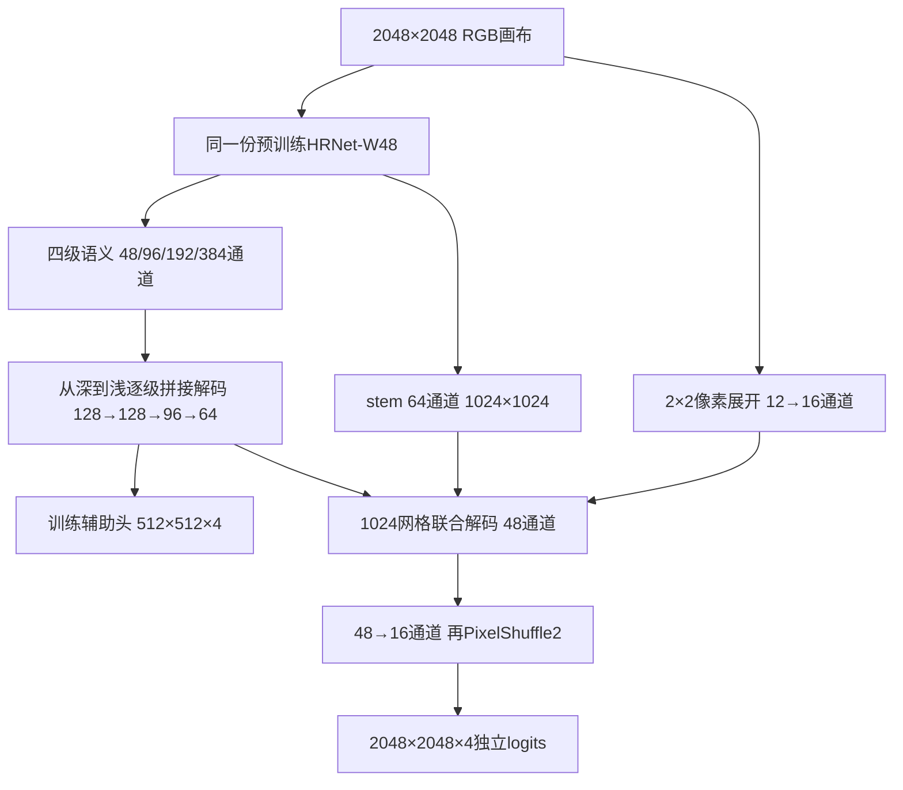

# 同 W48、同 40k：NativePyramid v2 架构方案

2026-10-11。**本次交付为方案；不启动训练。现有目录中的 Python 程序是未通过四类学习验收的 v1 原型，不能直接作为 v2 正式运行。**

## 1. 目标与当前结论

主候选固定为：**一个直接处理 2048 画布的 HRNet-W48，接逐级语义解码器、预训练浅层特征和密集亚像素输出；四类共同端到端训练。** 不再给低分辨率预测串联私有纠错头。

验收线保持：验证 mIoU 至少 **45.321831227388%**，测试 mIoU 至少 **45.860383832668%**；严格大于才称“超越”，相等只称“不低于”。最终按相同划分、原尺寸、固定阈值评价，训练裁块分数不代替验证/测试分数。

这两个目标来自历史锁定融合系统 `0.75 P0 + 0.25 S20k EMA`，是本次单模型必须面对的工程门槛；该融合系统不是等预算单模型对照。[历史融合证据](D:/dataset/experiment/HRDecoder_FinalDecision_20261005/结题报告/evidence/final_locked_test_evidence.json)

当前没有新框架的正式 val/test 成绩。方案的交付状态是“修订设计完成，等待未来实现验收”，不是“已经达到融合指标”。

|固定约束|具体定义|
|---|---|
|数据|用户接受的融合标签和 train454 / val76 / test227，不改划分|
|标签|0背景，1 EX，2 HE，3 SE，4 MA，255忽略；四个独立输出通道|
|初始化|仅原 ImageNet HRNet-W48，不继承任何 DDR 任务权重，不蒸馏融合模型|
|权重 SHA256|`d2186c55782308392ae14cf179ac4840143b09abdbba81aa3f9274c795ebc960`|
|正式预算|40,000 次 SGD 更新；每次两张图，共80,000图次；不含另外披露并丢弃权重的工程诊断|
|主节点|固定第40,000步 raw 权重；best-val只作次要结果，不用它掩盖末期退化|
|推理|单模型、单尺度、无TTA/EMA、无阈值或融合比例搜索|

“同预算”对应本项目 B0 的 batch2/40k；原论文 batch4、融合系统累计训练成本均不是这个预算。参数量接近也不表示 FLOPs 或耗时接近。

“同预训练模型”在本方案中固定为上表指定 SHA 的 ImageNet W48 文件，未来实现须逐键核验，不能换成任意同家族权重。历史 B0 未完整保留可核验的原始权重字节身份与测试累计计数；其42.20%仅作舍入历史参照，本轮没有复现 B0 起始状态或成绩。

## 2. 历史证据怎样决定取舍

|已确认的证据|设计决定与边界|
|---|---|
|v3 8k为37.9882%，20k跌到15.0509%；Detail 12k为36.7358%，16k跌到13.0748%|不能以早期PASS、loss下降或有限数值认定稳定；按类别持续监控|
|Detail崩塌时EX/SE阳性logit约−10至−25；交换BN统计未救回|阳性直接接受FP32 logit BCE；不把BN当成唯一根因|
|10月8日旧审查已明确“缺失组置零，不给另一组加倍”；v1没有落实|v2固定正负系数、使用完整batch分母，撤销v1空类负权重重分配|
|IoUCorrection的强负例梯度和多项工程检查通过，4k仍明显损害召回|OHEM不作为必胜依据；同时记录TP、FP、FN、precision和recall|
|CET完整40k为38.3138%；多次私有纠错增益弱；但历史H4确实有效|本轮选单主干联合解码是针对公平初始化和训练路径简化，不宣判所有纠错无效|
|旧H0已采用直接编码、冻结BN与BCE+Dice；1024crop、batch8、AdamW，与本轮不同|不把这些旧做法包装成新贡献；待检验差异是2048深层采样与逐级/浅层解码|
|M0/M1曾有约4.18个百分点的零步推理几何差异，细节支路训练收益很小|训练/推理必须走同一网络，几何变化单列；不能将推理变化归因训练|
|旧HE/SE大量漏检处在较大病灶内部，细节改善常伴随更多FP|保留完整深层语义；不把所有问题归结为MA尺寸或边界|
|Residual 8k仍快速上升却因私有增益门槛被拒；PrivateExpert 2k HE为零而4k恢复|取消早期“必须高于融合”的分数淘汰；持续失学才暂停诊断，不能推成永久无效|

近期指标依据：[完整实验报告](D:/dataset/experiment/HRDecoder_ArchitectureDesign_20261008/final_report/HRDecoder完整实验报告.md)。旧实验解释及冲突修正见 [历史审核台账](D:/dataset/experiment/HRDecoder_重新诊断与三点提升方案_20260926/02_历史实验台账_审核版.md)、本目录 `review/history_*.md`。

## 3. 架构规格

这里的“原生”指 **2048预处理画布未经再次减半进入主干**，不是保留相机原图全部分辨率。



|模块|精确接口|
|---|---|
|W48输出|stem `[B,64,1024,1024]`；F1/F2/F3/F4分别为48@512、96@256、192@128、384@64|
|最深层|F4经1×1投影384→128，接一个细化块|
|三级融合|F3投影192→128，拼接后256→128；F2投影96→96，拼接后224→96；F1投影48→64，拼接后160→64；每级接一个细化块|
|细化块|并行depthwise 3×3与7×7，各GN+SiLU；相加后1×1通道混合+GN，与输入残差相加后SiLU|
|浅层融合|语义64上采样至1024；stem投影64→32；PixelUnshuffle RGB得到12通道再投影至16；拼接112→48，再接两个细化块|
|输出|1×1卷积48→16，PixelShuffle2得到四类完整网格logits|
|辅助头|语义64→4；logit插值至完整标签网格计算辅助损失，权重0.2|

投影卷积后均用GN+SiLU；GN组数为`gcd(8,C)`，插值均为双线性、`align_corners=False`。所有路径接受主损失反传，没有detach或概率域硬裁剪。辅助头保留小阳性标签监督，但不能使粗网格天然分辨所有小病灶。

主干保留预训练BN的running mean/variance，affine继续学习；新头使用GN。这便于微批与激活重算保持一致，但冻结BN仍存在域适配风险，GN仍会受空间padding影响。不得声称这些归一化选择已经证明解决崩塌。

**v2初始化修订：**每类readout先初始化一个小非零48通道向量（标准差0.01），复制到该类四个PixelShuffle相位；四相位bias均为`log(0.01/0.99)`，随后独立训练。辅助头权重标准差0.01、相同bias。这样消除初始化的相位差异，保留首次反传通路；不是训练后不退化的保证。[ICNR原文](https://arxiv.org/abs/1707.02937)

现有同形状v1为65,569,364参数，其中decoder244,244；v2只改初始化/监督定义，不改变参数数量。主干2048相较1024增加计算；本机两步测速不足以给正式耗时承诺。

## 4. 修订损失：先把稀少类别的梯度账算对

两张图构成一次完整batch。对图`i`、类`c`，有效集合排除255；阳性数`P_ic`、有效像素数`V_i`，负例数`N_ic=V_i-P_ic`。每图分别选择该类logit最大的阴性：

`k_ic = min(N_ic, max(1024, 3*P_ic))`。

选择顺序固定为 logit 降序；logit 相等时按该图有效阴性像素的展平索引升序，取前 `k_ic` 个。主头和辅助头分别选择，不依赖设备默认的 top-k 平分值次序。

完整batch统计：`P_c=ΣP_ic`、`K_c=Σk_ic`、`A_c=Σ1[P_ic>0]`、`V=ΣV_i`。这些分母只由标签确定，先计算，再拆微批。

当`P_ic>0`时，在有效像素上计算平方Dice：

`D_ic = 1 - (2*Σ(p*y)+1e-5)/(Σp²+Σy+1e-5)`；否则`D_ic=0`。

每类损失精确定义为：

```text
L_c = Σ_i D_ic / max(A_c,1)
    + 0.25 * Σ_i Σ_positive softplus(-z) / max(P_c,1)
    + 0.25 * Σ_i Σ_selected_negative softplus(z) / max(K_c,1)
    + 0.05 * Σ_i Σ_valid BCEWithLogits(z,y) / max(V,1)
L_head = (L_EX + L_HE + L_SE + L_MA) / 4
L_total = L_main + 0.2 * L_aux
```

缺组分子为零，**不把缺失正组的0.25转给负组**；全阴性图仍有难负例和全像素BCE。正像素按完整batch总数归一，Dice按阳性图数归一；它是明确的混合加权，不冒充全数据集IoU的无偏优化。

Dice 对每张阳性图等权，会相对放大小标注图及其噪声的影响；该取舍须由四类学习和正式验证检验，不视作提升mIoU的证明。

微批1时，每次只累加自身分子，使用同一组完整batch分母，**不能再乘1/2**。Dice仍按图计算，不能偷偷换成全batch池化Dice。两个微批后统一裁剪、一次SGD；单个全ignore图贡献零，整个batch全ignore则拒绝更新并报数据异常。

FP32完成sigmoid、softplus和求和。阳性logit极负时，softplus保留向上校正的局部梯度；这不保证共享参数净更新、召回或mIoU必然改善。固定系数及OHEM比例是待验证配方，不能称历史已证明有效。

## 5. 训练、几何与恢复契约

SGD `lr=.005, momentum=.9, weight_decay=.0005`，所有可训参数同LR，梯度总范数裁剪5。第`u=0…39999`次更新使用：

`lr(u)=.005*(1-u/40000)*w(u)`，前1500次`w(u)=1e-6+(1-1e-6)*u/1500`，其后为1。seed42，head seed20261011。

使用固定BN/GN、BF16前向和FP32损失/主权重；硬件不支持时不得静默换精度。激活重算前后须验证输出、梯度和BN buffer一致；timm分割骨干需逐键加载1830个张量，并显式将31处最近邻融合替换为归档主干的双线性规则，126个分类头张量明确排除。

保留B0增强类型及DDR RGB归一化：mean `[81.205,50.636,21.216]`、std `[76.252,48.798,21.625]`；训练等比例长边2048×随机倍率[0.5,2]、随机2048裁剪、水平翻转、±45°旋转。标签最近邻，旋转新生边界与padding标255；真实黑边继续按原标签监督。crop类别最大比例.75、最多10次尝试，失败取最后一次，不暗中改为病灶过采样。

验证整图固定resize到2048方形，再把FP32 logits插值回原尺寸、sigmoid后严格`>0.5`。训练增强与验证仍存在尺度/形状分布差异，这是保留B0类型协议的取舍；共享forward不等于消除了这种差异。独立OpenCV实现也不冒充逐像素复现旧mmcv随机流。

每次取两张图；按seed42+epoch均匀置换454图，每图增强seed独立于模型随机数。恢复须保存模型、optimizer、步数、RNG、采样游标和监控历史。每次更新记录已执行数，checkpoint另记已持久化数。

**只允许完整SGD边界的受控PAUSED检查点续接。** OOM/非有限/状态不一致写终态失败标记，恢复入口必须先检查它；不能从旧last回滚补跑而仍宣称实际计算恰好40k。若异常导致更新数或状态不可确定，单列已花费与不确定部分，不能隐藏重复训练。

健康告警的PAUSED与数值/状态失败区分：前者保存当前完整状态后可诊断续接，保持同一模型、配方和预算计数；若要改结构、损失或超参数，另立试验并披露已花费预算，不把改前改后拼成一次预先锁定的40k比较。

## 6. 验收顺序与防崩塌监控

以下是未来执行要求，**本次不运行**。

1. 静态/数学验收：类映射、ignore不变性、空类监督、极端logit梯度、micro1×2与batch2梯度一致性、PixelShuffle四相位初始一致、标签几何、预训练逐键身份、恢复状态机。
2. 丢弃权重的四类学习检查：固定训练集8个真实256裁块、每类至少两块含阳性，冻结样本清单；最多256次更新，SGD lr.005、不增广、不warmup。末224/256两节点各类训练IoU至少20%，且loss末16次均值低于首16次均值。门槛是接线与可学习性筛查，不是泛化证明；失败不能改为PASS或无限增加步数。
3. 真实2048检查：固定训练图组覆盖四类，完成8次global-batch2更新，记录逐类阳性数、梯度、参数变化、BN不变及显存。不能再用两张仅含MA的图证明四类路径已验证。此项与上一项相互补充，不替代40k。
4. 正式每250步在固定8张训练整图上测四类TP/FP/FN、阳性logit分位数，样本须保证每类至少两张含阳性；分层梯度和clip系数取自正常SGD已产生的记录，不为探针额外反传。每2000步完整val76。探针只前向、不更新BN/权重；完整val按累计计数报告四类IoU。
5. 分开处理两类探针异常：尚未建立“已学会”状态的类别连续三次TP=0且已到4k，并且最近1000步确有该类阳性监督，标“持续未学会”；只有4k及以后连续两次探针recall≥5%，才建立该类“已学会”状态，此后连续两次recall≤0.1%标“已学会后丢失”。均在当前完整SGD边界保存并进入可诊断续接的PAUSED，不要求logit先小于−12，也不把暂停写成该架构永久无效。
6. 非有限立即失败。val较既有峰值下降≥15个百分点，保存当前状态并进入PAUSED。完整val的类别告警单独建立学习证据：4k及以后连续两个val节点该类recall≥5%，随后连续两个val节点≤0.1%才暂停；单次零检出仅记录，不用训练探针的学会状态替代val证据。正常起伏和早期落后融合不触发精度淘汰。报警只能减少继续浪费，不能阻止所有退化。

正式终点完整保存40k raw、完整曲线、每图每类计数、数据/权重/源码/验证器/环境身份。val达到目标后才执行预先锁定的test一次；首次读取test时逐文件核验227对图像/标签SHA。不得只校验清单JSON而漏掉实际文件。

严格按累计 `TP/(TP+FP+FN)` 求四类均值，含无阳性图中的FP；不算背景IoU、不平均逐图mIoU。test不达标就记录未达标，不能回头挑节点或阈值。固定test在历史实验中已多次使用，相关目标记录仅有seed42，沿用它能做工程比较，不能称为新的独立盲测或多种子泛化证据。

## 7. 当前原型的处置与后续最小比较

v1两份预检均为 `INCOMPLETE_OR_FAILED`。第二次128步裁块检查四类IoU为17.1002 / 66.7563 / **0** / 52.0751%，SE TP=0、FN=6004。因此当前代码没有获准作为正式候选；没有证据说它已经满足目标，也不能由128步外推40k必然失败。[验收记录](D:/dataset/experiment/HRDecoder_NativePyramid_20261011/验收记录.md)

v2待落实事项：损失分母与缺组权重、四相位初始化、持续失学监控、失败恢复阻断、实际test文件SHA、验证器/依赖身份锁。现有v1 PASS子项不能继承为v2验收。

未来只设一个主候选。若需要解释收益，先做相同训练配方下的1024主干输入对照，以及去RGB/浅层支路的匹配训练对照；不靠把语义特征置零这种分布外输入就宣称因果。所有追加训练另记预算。本轮没有授权启动这些实验。

本方案押注的是在相同W48知识来源下，让更密集的深层语义与真实浅层信息共同参与最终分类，再消除已经明确发现的监督和执行错误。它没有借用DINO的知识，也没有用一个更强的名称替代性能证据。[HRDecoder原文](https://papers.miccai.org/miccai-2024/paper/4020_paper.pdf)、[HRNet原文](https://arxiv.org/abs/1908.07919)、[GN原文](https://arxiv.org/abs/1803.08494)

## 8. 阅读与审查范围

开始时没有完整阅读全部资料，不能回答“全读完了”。本次建立288个Markdown路径、265份SHA去重内容的覆盖清单，由主审和三个子代理分阶段补读；按用户最新要求，最后使用三个Luna max子代理完成缺漏补读和架构、稳定性、比较协议复审。最终计数和未读项见 [审查结论与阅读范围](D:/dataset/experiment/HRDecoder_NativePyramid_20261011/01_审查结论与阅读范围.md)，逐文件记录见 `review/coverage_*.json`。目录索引、全部原始日志、所有源码和二进制资产不冒充逐份精读。

审查结果不是全票同意就算成功：本轮实际找出v1重复的缺组加权错误、四类学习失败、监控盲区及恢复漏洞。最终主张限于已修订设计；性能验收线不下调。
