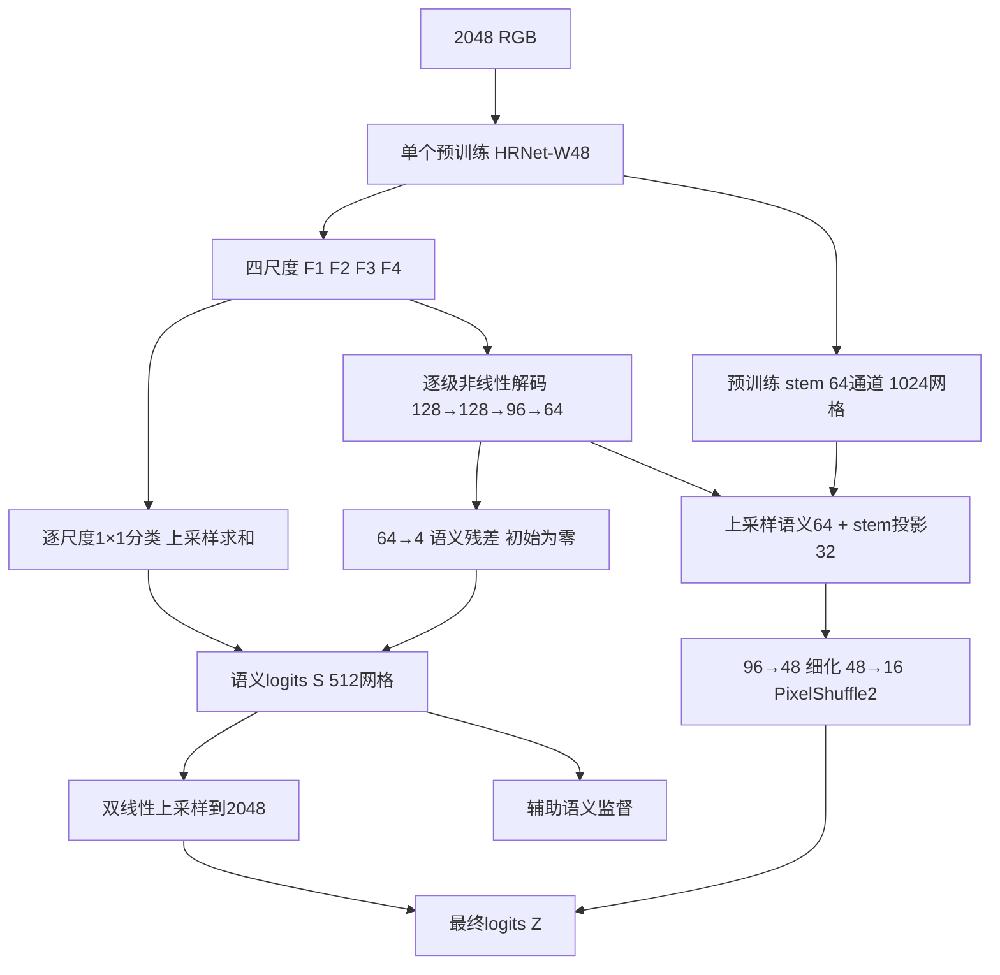

# NativePyramid-SP v3：保留直接语义通路的高分辨率解码器

2026-10-16。范围：架构设计与证据审查，不启动训练。本文替代10月11日v2作为下一次实现的设计依据；目录中的Python仍是旧v1，不能按本文名称直接开跑。

## 1. 最终选择

保留一个直接接收2048画布的ImageNet HRNet-W48；保留v2的逐级非线性语义解码。在此基础上增加四个预训练尺度直达四类logits的线性通路，将最终预测写成“多尺度语义预测＋高分辨率细节残差”。细节使用预训练stem与语义特征，去掉单独的裸RGB PixelUnshuffle支路。新解码器统一采用逐像素通道LayerNorm；主干继续使用固定预训练BN统计。

关键修订是：主干已有信息不必全部穿过新建的窄解码器才获得类别监督；新细节头从零残差开始，不在初始化时向预测叠加随机空间图案。保留非线性语义支路，是为了避免把跨尺度交互削减成纯线性模型。

正式验收目标不变：val mIoU至少45.321831227388%，test至少45.860383832668%；严格大于才称超越。当前没有v3的训练或验证成绩。下面区分可由结构核验的性质和必须由正式实验核验的性能。

## 2. 历史证据对设计的约束

|补读与原始证据核查|对本设计的影响|
|---|---|
|最终融合相对P0：EX约+0.524、HE+0.996、SE+2.795个百分点，MA变化不足0.01个百分点；P0本身包含不同骨干的融合|目标差距不能只解释成MA细节不足；优先保留各尺度语义和HE/SE的区域识别能力，不把P0当纯W48对照|
|Detail 4k同一checkpoint的private/base头：MA IoU为16.4472%/1.8081%，TP为21,810/25,245，FP为63,322/1,326,940，FN为47,474/44,039；随后16k严重退化，SE零检出|这是同一模型双头对比，不能隔离细节支路的训练贡献；早期分数上涨伴随少检阳性，必须同时检查TP、FP、FN及后期曲线|
|v3旧实验与Detail两次崩塌均未确证BN或单一代码错误为根因，且不是干净的单变量对照|不宣称改一种归一化就解决全部崩塌；监督、语义路径与执行检查分别负责|
|旧v3和Detail中的残差模块也使用过零末层初始化，之后仍有严重退化|零残差只是可检查的起点，本轮不把它当作新的稳定性证据；真正新增的是与直接语义路径、监督及归一化范围的组合|
|归档H0候选适配器为720→64的7×7卷积；原HRDecoder的compress配置先以1×1将720→64，再用64→64的7×7卷积；v2为逐级解码|区分三个源码结构；H0运行未绑定该候选文件的精确SHA，不将候选实现直接认作已证实的运行身份，也不将旧结构描述成“没有多尺度语义”|
|裸RGB/细节支路历史上存在互补收益，也存在单体下降和组合退化；没有PixelUnshuffle裸RGB的隔离有效性试验|删去该支路是减少未经隔离验证的路径，不能写成已证明RGB有害；预训练stem仍接收全部RGB输入|
|弱单体分支曾改善集成，强单体也曾降低集成；同一任务上高分辨率继续训练并不自动提高最终成绩|不以组件数量、分辨率或单支分数替代新单模型的终点验收|

P0的边际增量不是纯W48的全部差距。B0报告的舍入test IoU为EX/HE/SE/MA=51.56/43.13/49.98/24.11%，与最终融合比较时MA差距反而最大，约5.13个百分点。因此本设计同时保留stem细节路径与直接语义路径；既不只补MA，也不因P0的增量分布而忽略MA。B0缺少原始类别计数，该比较仅用于描述历史分数。

原始证据与覆盖记录统一收录于[本轮审查目录](D:/dataset/experiment/HRDecoder_NativePyramid_20261011/review_20261016)。Detail双头计数来自[validation_series.json](D:/dataset/experiment/HRDecoder_ArchitectureDesign_20261008/detail_execution/validation_series.json)的4000更新节点；它没有病灶边界/内区分区统计，不支持额外的空间定位结论。历史融合数值见[锁定测试证据](D:/dataset/experiment/HRDecoder_FinalDecision_20261005/结题报告/evidence/final_locked_test_evidence.json)。本轮只核查已有结果，没有产生新的test评估。

## 3. 网络的精确构成

“2048”指预处理画布，不是相机原始分辨率。



|模块|规格|
|---|---|
|主干输出|stem：64×1024×1024；F1：48×512×512；F2：96×256×256；F3：192×128×128；F4：384×64×64|
|直接语义分类|四个无bias的1×1卷积，分别48/96/192/384→4；各自logits插值到512后相加，最后只加一份4类bias|
|逐级语义解码|F4：384→128并细化；F3投影192→128，拼接后256→128；F2投影96→96，拼接后224→96；F1投影48→64，拼接后160→64；每级细化，输出G：64×512×512|
|语义残差C|沿用旧aux的64→4权重接口，去掉bias；S=S_direct+C(G)|
|细节融合|G插值到1024，stem投影64→32；拼接96→48，再接两个细化块|
|细节残差D|1×1卷积48→16，有bias；PixelShuffle2输出4×2048×2048|
|最终输出|Z=双线性上采样(S)+D；四个独立前景logits，不额外加一份分类bias|

细化块沿用v2：并行depthwise 3×3与7×7，各接通道LayerNorm及SiLU；两路相加后1×1混合与通道LayerNorm，再与块输入相加并SiLU。各投影为无bias卷积、通道LayerNorm、SiLU。所有双线性插值`align_corners=False`，不引入dropout、可学习总门控或概率裁剪。

上文“投影”仅指特征投影。四个直接分类`W_i`以及C、D的末层均为纯线性卷积，不接Norm或激活；`W_i`前也不增加新归一化。最终Z直接进入logit损失，推理时才按既定位置执行sigmoid。

直接通路定义：

`S_direct = b + Σ_i U_i(W_i F_i)`。

其中`U_i`只改变空间采样。对无bias的1×1线性卷积，在精确算术下，上采样与该卷积可交换，所以上式等价于将四尺度上采样拼成720通道后做一次线性分类。实现不需要显式分配720通道的512网格。浮点结果按规定容差核验，不能要求不同计算顺序逐位相同。

统一在512网格求S，再按既定路径上采样到2048。不能把`Fi→512→2048`擅自替换为`Fi→2048`并声称等价，两次离散插值通常不等于一次插值。上述线性等价也不等于原HRDecoder带BN/ReLU及7×7卷积的完整head。

非线性逐级支路仍然存在，因此没有把跨尺度交互全部换成线性求和。细节残差从所有类别联合学习，也不冻结或detach主干；它不是在一个已训练融合模型外面追加私有纠错器。

## 4. 初始化、归一化与梯度

四个直接分类卷积使用标准差0.01的非零正态初始化；直接语义的唯一共享bias为`log(0.01/0.99)`。这只指定bias，不会把包含随机特征读出的实际初始概率固定为1%。C无bias，权重全部为零；D最后一层48→16的权重和bias全部为零。其余新层沿用统一的卷积初始化，LayerNorm的γ=1、β=0。

去掉C的bias是精确消除冗余：若C带常量bias，它与S_direct的bias只通过和进入同一个S，两者收到相同任务梯度，会把该公共偏置的有效更新叠加。一个共享bias已能表示同一组S函数；D的相位bias仍保留，因为最终Z与辅助S的监督位置不同。

因此初始化时严格有`C=0、D=0、Z=U(S_direct)`。四相位残差全零，不会在起步时产生随机相位差异。这个起点是新建的多尺度线性分类器，不是已经训练成功的HRDecoder或融合模型。

C、D末层在第一次反传可获得梯度，具体是否非零取决于输入和上游损失梯度；它们之前的新层在零末层后第一步梯度为零。直接通路仍为主干提供反传路径。不能要求第一次更新所有新层都有非零梯度，也不能忽略永久死分支：未来预检必须在末层实际更新后，检查内部梯度、参数变化及逐类响应。零初始化不等于分支永远冻结，不等于后续残差不会变大。

这里的“梯度为零”指任务损失梯度；当前SGD还对参数施加weight decay。仅观察到参数变化，不能据此证明任务梯度已经穿过零末层。

新的通道LayerNorm按每个`(batch,y,x)`位置独立计算C个通道的均值与总体方差，统计用FP32、ε=1e−5，γ/β各C个；不跨batch或空间求统计。这样可以核验：单个归一化操作的有效像素输出不依赖远处ignore padding的面积。卷积边界、插值和输入几何仍会影响结果，不能扩展成整个网络的padding不变性。主干BN保留预训练running统计，affine可训练，仍需面对域适配风险。

实现时应在通道轴求均值/方差，或将NCHW临时换为NHWC后应用`LayerNorm(C)`；不能使用`LayerNorm([C,H,W])`，否则会重新引入空间统计。1024网格的FP32中间张量可能增加内存峰值，需避免无用的整张特征副本，并在未来真实2048前后向中记录峰值；参数量很小不能作为显存已经可行的证据。

固定形状下静态参数核算：decoder **246,132**，全模型 **65,571,252**。相对v1/v2减去RGB投影224、融合权重768和旧aux的4个bias，增加直接分类2,884，净增1,888；GN换通道LayerNorm的affine数量不变。该数字要求C替代旧aux，不能另添同名辅助头。参数量不代表相同FLOPs、显存或耗时。

## 5. 训练与监督保持锁定

初始化只允许指定ImageNet W48文件，SHA256：

`d2186c55782308392ae14cf179ac4840143b09abdbba81aa3f9274c795ebc960`。

数据为用户接受的融合标签与454/76/227划分；0背景、1 EX、2 HE、3 SE、4 MA、255忽略。正式40,000次SGD更新，每次两张图，共80,000图次。SGD lr=.005、momentum=.9、weight_decay=.0005、全局梯度裁剪5，前1500更新线性warmup后接原40k线性衰减；seed42、head seed20261011。精度、增强、采样、权重加载和恢复约束沿用[v2的完整执行协议](D:/dataset/experiment/HRDecoder_NativePyramid_20261011/00_最终架构方案.md)，不借本次结构修订增加任务预训练或额外训练步数。

仅保留两个损失位置：最终Z和同一个语义S。S的logits上采样到完整标签网格后监督，不能降采样标签来抹掉小阳性。

`L_total = L_head(Z) + 0.2 * L_head(U(S))`。

每个head使用v2已核算的四类损失。图i/类c的阳性数为P_ic，有效像素数V_i，负例数N_ic；每图负例数`k_ic=min(N_ic,max(1024,3P_ic))`。按logit降序选取，平分值按有效阴性像素展平索引升序。完整batch分母为`P_c=ΣP_ic`、`K_c=Σk_ic`、`A_c=Σ1[P_ic>0]`、`V=ΣV_i`。

```text
D_ic = 1-(2Σpy+1e-5)/(Σp²+Σy+1e-5)，仅P_ic>0时计算，否则为0
L_c = ΣD_ic/max(A_c,1)
    + 0.25 Σ_positive softplus(-z)/max(P_c,1)
    + 0.25 Σ_selected_negative softplus(z)/max(K_c,1)
    + 0.05 Σ_valid BCEWithLogits(z,y)/max(V,1)
L_head = 四类L_c的算术平均
```

所有求和排除255，损失用FP32。缺组分子为零，系数不转移；微批共享完整batch分母、累加自身分子，不再乘1/2；两微批后统一clip并更新一次。一个全ignore图贡献零；全batch全ignore拒绝更新。S和Z分别选择难负例。

这些系数、难负例比例与阳性图等权Dice仍是待验收配方。保留它们是为了使本次结构改动可以被解释，并不是已有证据证明它们必胜。辅助损失也意味着初始化时语义梯度与单损失模型不同，不能声称训练轨迹与旧HRDecoder完全相同。

## 6. 需要核验的结构性质与验收顺序

|可以直接核验的性质|不能由它推出的结论|
|---|---|
|四个尺度各有独立线性路径抵达类别logits|不能推出信息全部保留、每类梯度永不抵消或mIoU必升|
|初始最终输出等于直接语义分类器的上采样|不能推出初始分类器已有任务精度，也不限制未来残差幅度|
|新头归一化不计算空间统计|不能推出整个网络对padding或域变化不敏感|
|完整batch分母、固定BN和逐像素Norm允许微批一致性检查|不能替代实际的数值容差、checkpoint及恢复检查|

未来实现后先做以下验收，本轮不执行：

1. 加载逐键身份、类别/ignore、四尺度形状、直接通路交换等价、唯一bias、初始化Z=U(S_direct)、归一化通道轴及完整batch/微批梯度一致性检查。
2. 四类裁块学习门和真实2048检查沿用v2：8个固定256裁块、每类至少两块阳性，最多256更新；224/256节点逐类IoU≥20%且loss下降；另用覆盖四类的真实2048图组检查8次global-batch2更新。诊断权重丢弃，计算单列；失败不改写为PASS。
3. 调整梯度接线检查以符合零残差起步：第一次检验C/D末层与主干直接路径；末层更新后再检验内部路径。正式训练记录S与Z的逐类累计TP/FP/FN，四个直接分类通路各类logit的均值与绝对值分位数，C/D幅度，以及正常SGD反传中各模块裁剪前后的梯度范数。直接分类器另外按`W_i.weight.grad[c]`统计四尺度×四类别的梯度范数，裁剪前后各一份，避免整层范数掩盖某一类的失学。这些标量来自已有梯度缓冲区，用于发现尺度幅度失衡或分支失学线索；不额外反传、不保存完整高分辨率特征。仅靠范数不能判断共享主干中的梯度方向抵消，这些观察和S-Z差也不能单独证明训练因果。
4. 使用v2的持续失学/回落PAUSED规则；探针与val分别建立连续两节点学习证据，单次零检出不判死刑。正常SGD记录梯度，探针不另加反传。异常状态不得回滚旧last隐瞒额外更新。
5. 主结果固定40k raw，单模型、单尺度、阈值严格>0.5、无TTA/EMA/阈值搜索。logits先回原尺寸再sigmoid，累计四类TP/(TP+FP+FN)后平均，含无阳性图中的FP；不算背景、不平均逐图IoU。val达标后按预锁定协议评一次test。

如后续要解释结构改进，只设置匹配预算的三项对照：v2；v2仅加入直接语义/残差起步；完整v3。该链只能分别识别第一次改动组及后续改动组的效果，不能把最后一步同时去RGB和换Norm的结果归因其中一项；若要分开归因，必须再做对应单变量对照并另记预算。不得以关闭已训练支路的分布外结果替代匹配训练。

匹配对照中的共同模块应复用同一初始化快照或按参数名固定初始化，输入增强序列也应锁定；相同seed数字本身不保证增删模块后的共同权重和随机数消费顺序相同。

## 7. 交付判定

本设计比v2多了可检查的语义直达路径和精确的零残差起点，减少了裸RGB支路及空间归一化依赖；没有增加骨干、外部任务权重或新的训练预算。它针对已发现的结构风险做出了具体修订。

历史B0的test报告为42.20%，选用best-val@32k模型，训练上限为40k；它不是固定40k raw的已验证test成绩，原始权重字节身份和逐类TP/FP/FN也不完整。融合系统使用额外模型与累计训练，固定test已有历史复用。这里锁定的是相同更新次数/图次和预训练文件，并未锁定相同FLOPs。达到规定mIoU是未来执行的验收要求；本轮审查不把它记录成已经实现的性能事实。完整阅读范围和反方复核结论见[本轮补读与设计裁决](D:/dataset/experiment/HRDecoder_NativePyramid_20261011/03_全量补读与设计裁决_20261016.md)。
