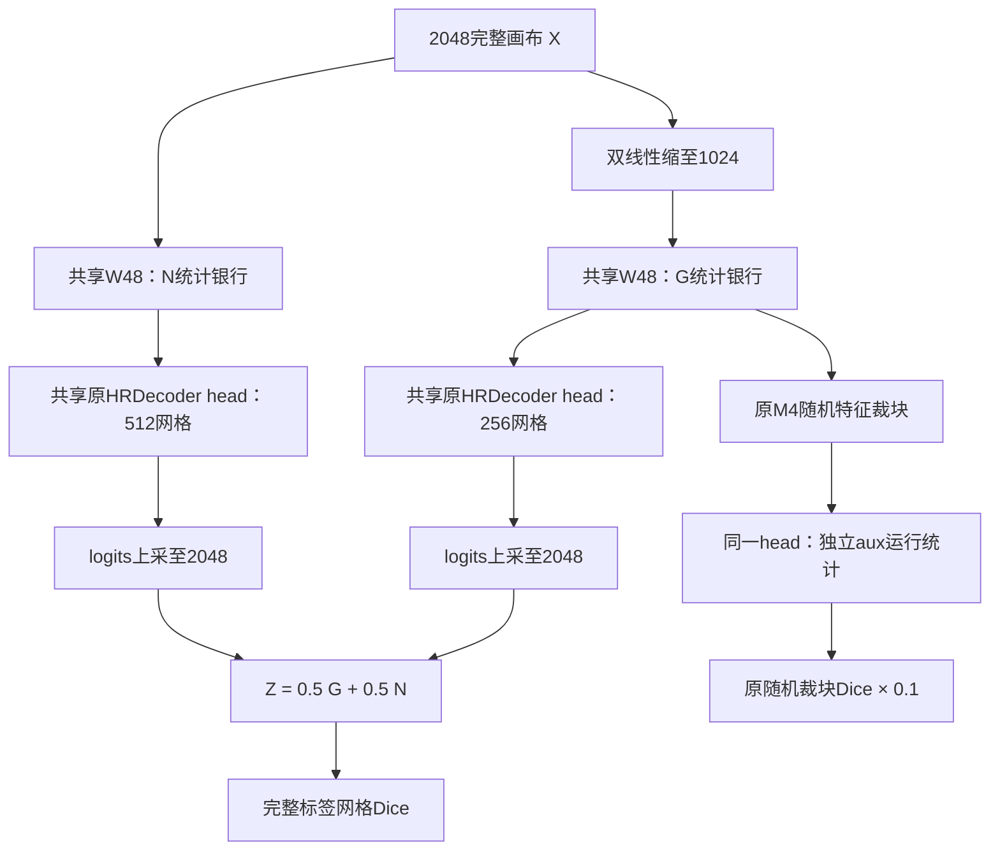

# HRDecoder-DualScale：双尺度共享编码候选方案（未放行训练）

> 历史版本：本方案已由[07 HRDecoder-JointContext最终架构方案](D:/dataset/experiment/HRDecoder_NativePyramid_20261011/07_HRDecoder_JointContext_最终架构方案_20261017.md)替代。下面内容保留当时的设计与判断；新的主路径、损失、BN及执行约定以07为准。

2026-10-17。设计文档；本轮不启动训练。目标仍为相同ImageNet-W48初始化、40,000次更新与每更新2张原图，使用已接受的融合标签。本文不包含已训练的新成绩。**目录现有Python仍为v3；本文件不是已经实现的DualScale训练入口。**

**最后一次训练约束下的追加判断：当前方案不建议直接启动唯一一轮40k。** 静态定义自洽，不等于具备超过45.321831%的性能证据；恢复原损失、固定双路平均、共享参数优化仍有未解决的效果风险，实现和资源检查也尚未执行。文件名保留以维持已有链接，原“定稿”称谓不表示训练就绪。详见[最后一次训练前复核](D:/dataset/experiment/HRDecoder_NativePyramid_20261011/review_20261017/last_chance_review_20261017.md)。

**主代理独立审查：** 用户要求后，后续审查由主代理亲自完成，依据源码、完整40k日志投影和两份76图逐图计数重新计算。发现并补齐M4全ignore裁块的处理缺口；同时明确逐图Dice与累计mIoU的目标差异。最终判断见[06主代理独立审查](D:/dataset/experiment/HRDecoder_NativePyramid_20261011/06_主代理独立审查_20261017.md)，子代理“静态通过”不作为正式训练依据。

## 1. 当前候选架构

用**同一个HRNet-W48**分别编码1024全图和2048全图，恢复原HRDecoder的非线性解码器，在完整2048网格上等权平均两路logits。两路卷积、分类器及BN affine参数共享，BN运行统计按尺度分别保存。原HRDecoder的随机特征裁块辅助监督保留。

这次不延续v3的逐级窄解码器、四尺度线性直读、PixelShuffle细节残差、固定主干BN统计以及正例均衡BCE/OHEM混合损失。选择依据是恢复已有HRDecoder中实际工作过的全图上下文、非线性读出与监督方式，并让高分辨率路径读取真实高分辨率图像。

v3本身已编码2048，因此“更多高频输入”不是对v3失败的充分解释。本方案对v3的主要改变是加入原1024全图上下文、恢复原解码/损失及训练BN；这些变化共同构成新配方，不能由一次后续实验分别归因。

## 2. 实测目标约束

|类别|v3 40k val IoU|融合目标val IoU|差距/百分点|目标TP−v3 TP|目标FP−v3 FP|
|---|---:|---:|---:|---:|---:|
|EX|46.621127%|50.370204%|3.749077|−4,420|−39,153|
|HE|40.943980%|45.040467%|4.096487|+3,547|−145,776|
|SE|49.639041%|59.841784%|10.202743|+14,210|−19,544|
|MA|20.498056%|26.034870%|5.536814|+3,833|−8,583|

v3终点mIoU为39.425551%，融合目标45.321831%，缺5.896280个百分点。最大逐类缺口是SE；EX的TP已经更高，仍因FP更多而落后。设计必须同时关注语义精度、误检和小病灶检出。

令某类真实阳性总数为T，当前计数为TP、FP，目标IoU为t。准确关系是：

`IoU = TP / (T + FP)`

`新IoU ≥ t ⇔ ΔTP − t·ΔFP ≥ t·(T+FP) − TP`。

右侧对EX/HE/SE/MA分别约为15,301.45、69,205.19、25,905.48、6,067.57。它们是错误计数预算，不能由“网络有更大感受野”直接推出已经满足。逐类都达到对应目标足以达到总体目标，但不是总体mIoU达标的必要条件。

融合目标来自异构模型、任务训练父链和已有融合程序；本方案不调用这些模型、预测缓存或额外任务权重。目标来源的额外训练不能被隐匿成与单个W48完全匹配的对照。

### 完整40k日志对设计的约束

用户授权后，远端原始`train.jsonl`已被逐行读取并计算SHA256：`2b286aee99ed75d894c8d60a239c92018fed158bc98d0def7eed9e61fcf3a63f`。文件3,473,259,370 bytes，更新1–40,000连续且唯一；读取前后size/mtime一致。本地保存完整40k关键字段投影，仅省略庞大的逐参数`parameter_modules`字典。它不是完整原文件副本，源文件SHA与投影SHA分别记录。

- 总训练loss的首2k均值约1.147，末2k约0.450，末段仍在下降；与此同时，val从36k的40.2770%回落到40k的39.4256%。这支持训练目标下降不等于验证精度上升，不能仅由此把全部差距归为过拟合。
- 全程26.77%的更新发生范数裁剪，系数中位数1、均值约0.9225；末2k触发19.8%，平均系数约0.939。日志不支持“全程被严重裁剪所以必然失败”。global clip对某一步的全部参数梯度使用同一缩放系数，不会只压制MA。
- MA每更新平均约1,902个阳性像素，仅7.13%的更新没有MA阳性；各2k阶段比例稳定。MA直达分类器四尺度梯度范数的中位数约0.133/0.117/0.118/0.115，均高于对应SE的0.038/0.061/0.058/0.061。这些是混合主/辅损失的权重梯度范数，不能当作独立因果贡献，但足以否定“MA长期缺监督或直达头一直断梯度”的解释。
- C、D及上游解码模块在末段仍有非零梯度；不能把v3残差分支简单描述为永久死分支。SE约一半更新没有阳性，属于需要记录的样本构成事实，不据此额外引入类别过采样或按val调权。

因此本设计的依据是恢复参考语义解码与监督，并联合使用两种完整图像尺度；不是声称已找到一个能独立解释全部失败的优化器故障。完整分桶统计和限制见[日志分析](D:/dataset/experiment/HRDecoder_NativePyramid_20261011/review_20261017/redesign_math_evidence.md)，源/投影校验见[回收manifest](D:/dataset/experiment/HRDecoder_NativePyramid_20261011/review_20261017/recovered_logs/train_metrics_all40000.manifest.json)。

## 3. 精确前向

“2048”指完成既定增强与归一化后的画布，不是相机原始尺寸。输入X的shape为B×3×2048×2048。

数据划分保持454/76/227，使用已核验的融合标签；类别编码为0背景、1 EX、2 HE、3 SE、4 MA、255忽略。四个输出是独立前景logits，背景像素参与四类负例监督，不新增背景分类通道或softmax。几何增强与验证预处理沿用本轮已核验的数据实现；padding/旋转产生的255仍按有效mask排除，不为了套用旧Dice而改成背景。

本次绑定既有v3运行的数据身份`7c53b86bcb27ccd121042f667cc58e39b98716a8c477bfd1f1657fa126575719`。未来执行应复算同一文件清单、划分和标签字节身份，不仅比较图片数量。历史B0的报告级同划分不足以证明其全部标签字节与当前完全一致。

|输出|1024全图路径G|2048全图路径N|
|---|---|---|
|W48 F1|48×256×256|48×512×512|
|W48 F2|96×128×128|96×256×256|
|W48 F3|192×64×64|192×128×128|
|W48 F4|384×32×32|384×64×64|
|四尺度对齐|到256，拼接720通道|到512，拼接720通道|
|共享head|720→64的1×1 Conv+BN+ReLU；64→64的7×7 Conv+BN+ReLU；64→4线性分类|相同卷积与affine参数|
|head logits|4×256×256|4×512×512|

完整FCNHead配置固定为`in_channels=720, in_index=0, channels=64, num_convs=1, kernel_size=7, compress=True, concat_input=False, dropout_ratio=-1, num_classes=4, align_corners=False`。norm为BN，激活ReLU；7×7卷积dilation=1、padding=3；分类层为1×1、有bias。无dropout、无context模块、无conv_cat。不要只复刻卷积尺寸而遗漏这些开关；初始化复用原FCNHead/ConvModule实现。

`G = U_2048(H_G(E_G(resize_1024(X))))`

`N = U_2048(H_N(E_N(X)))`

`Z = (G + N) / 2`。

所有双线性插值统一`align_corners=False`。先分别对齐logits，再求均值；不能改成概率平均或在不同网格先混特征。原始尺寸评估仍先把Z插值回标签原尺寸，再sigmoid、严格大于0.5二值化。

主预测没有裁块，也没有窗口拼接缝；训练和推理均执行这两张完整视图。保留M4辅助路径时仅从G的低分全图特征取原实现规定的随机裁块、缩放并监督，不额外编码四张RGB裁块。

原B0的主HR路径来自低分特征裁块和插值。这里以N替换该主HR路径，**不是原B0预测函数的恒等重写**；初始化也不保证等于B0。恢复其LR部件和head不能被描述成保持B0最终精度。

## 4. BN状态与共享参数

卷积权重、分类器、每个BN的gamma/beta只存在一份。主干每个BN建立G/N两组`running_mean`、`running_var`、`num_batches_tracked`；head建立G/N/aux三组对应buffer。银行是独立存储，不得指向同一buffer对象。

主干G/N初始统计均复制自同一指定ImageNet checkpoint。新head各银行从相同的初始均值0、方差1、计数0开始，affine遵循原head初始化。不得引入本轮v3、B0或融合系统的任务训练权重。

权重加载顺序为：先用原W48结构核验并加载指定预训练张量，再建立统计银行，最后构造一次优化器。银行化保持原卷积与BN affine的数值和共享关系；只复制运行buffer，不复制一套可训练W48。使用现有逐键加载核验清单，不能以`strict=False`静默漏掉一部分主干；最终按Parameter对象身份检查优化器没有重复条目。

训练时使用当前物理batch统计，更新本域银行；推理时使用本域running统计。G/N前向顺序不得改变对方的buffer；aux不得更新G/N银行。共享权重仍同时接受多路梯度，这种状态隔离不解决梯度方向冲突，也不能证明mIoU提高。

BN明确使用epsilon=1e−5、momentum=0.1、可训练affine。训练归一化为`gamma·(x−mean_batch)/sqrt(var_batch+epsilon)+beta`，不读取running均值/方差来归一化。因此对相同输入、参数和物理batch，单纯把running buffer分银行不改变训练态输出或任务梯度；它改变的是各尺度推理时使用的EMA状态。不得把“分银行”实现成另一种归一化公式或给两路各自学习一份gamma/beta。

目标训练规格为每条主路径的BN统计覆盖同一步的两张原图：单卡真实batch=2，或两张实际可用GPU各1图并在该域使用同步BN。不得把宿主机显示的GPU数量当作当前容器可用数量。普通非同步microbatch=1累积不能宣称等价。若显存不足，应先处理计算图保存/重算，不能偷偷改成冻结BN、跨域共用统计或单图BN再沿用同一配方名称。

激活重算必须保持训练batch统计及梯度语义，同时避免第二次更新running buffer和计数。重算中的BN仍按训练batch统计归一化，仅抑制EMA buffer及计数的重复写入，不能切到eval代替。checkpoint函数显式捕获G/N/aux域标识，不能在反向重算时读取已经被下一分支改过的全局域开关。只有重算前后输出、损失、梯度在容差内一致，并且每银行计数只按真实前向增加，才能用于该配方。当前没有执行此资源与数值验证，不把显存可行写成已证实。

## 5. 损失与优化定义

恢复原HRDecoder的逐图、逐类平方分母Dice，显式修正255忽略像素的处理。令v为有效mask，p=sigmoid(z)，y为该类二值标签：

`D_ic = 1 − (2 Σ(v·p·y) + 1e−5) / (Σ(v·p²) + Σ(v·y²) + 1e−5)`。

先四类算术平均，再对两张有效图平均。该图有有效像素但某类没有阳性时仍按公式计算，不跳过该类；整图全ignore才不计该图，完整主监督batch全ignore拒绝更新。所有交叠和分母均排除255，求和用FP32。

`L = Dice_full(Z,Y) + 0.1 · Dice_M4(H_aux(crop_resize(F_G)), crop(Y))`。

M4裁块生成、尺度范围0.75–1.25和归约沿用原实现；四个crop贡献取原均值，不变成四份额外完整权重。没有额外G-only/N-only损失，没有难负例挖掘、正例组均衡BCE、门控惩罚或按val调类别权重。

**M4的255边界补充（主代理审查修正）：** 每步先按原规则产生4个空间窗、对应两张原图的至多8个crop实例。在进入aux head前，排除有效标签像素数为0的实例；有有效背景但无病灶的实例必须保留。不因病灶类别、阳性数量或难度重采样。设保留实例集合为A，`L_aux=mean_{j∈A,c}(D_jc)`；A为空时令`L_aux=0`，跳过本步aux head及其BN银行更新，继续有效的全图主监督。不能因辅助crop全ignore而拒绝整个SGD更新，也不能把255补成背景。日志记录实际有效crop数及aux跳过标记。若全部8个crop均有效，该定义等于原M4均值；存在全ignore实例时属于本方案明确新增的mask处理，不声称与原B0逐位一致。归约前的过滤同样避免无监督填充crop参与aux训练态BN统计。

纯Dice并非完美校准损失；空阳性图上的负例梯度可能很弱。选择这一有原B0工作记录的参考损失是减少未经验证的配方变化，不能据此宣布它已解释v3的全部失败。255显式mask与原B0代码路径的差异须单独记录。

该损失是每图每类Dice平均，评估则是先在全部图上累计每类TP/FP/FN再求宏平均IoU；二者的图像权重与非线性归约不同。“完整网格监督”不等于已直接优化最终累计mIoU。主代理复算还确认：若只清除各类无该病灶图上的全部FP、而有该病灶图预测不变，v3的mIoU也仅从39.425551%变为41.273504%。这是限定条件下的代数结果，说明不能把空阳性处理当成覆盖全部差距的改进依据。

初始化仅允许SHA256为`d2186c55782308392ae14cf179ac4840143b09abdbba81aa3f9274c795ebc960`的ImageNet W48。随机seed=42；新head遵循原FCNHead的初始化，分类器不采用v3的固定1%先验bias；银行复制不消耗随机初始化序列。

优化器为SGD lr=0.005、momentum=0.9、weight_decay=0.0005；1500步linear warmup，warmup_ratio=1e−6；总40k、poly power=1。学习率的iter索引与warmup/poly组合顺序直接复用原调度语义，预检核对0/1499/1500/39999节点，不另造一条看起来类似的折线。参考配置未设差分学习率或新增paramwise规则，共享参数只进入优化器一次。原B0继承的`optimizer_config=dict()`没有grad_clip；本配方也不设置max_norm=5。这个选择是还原参考优化器，并非宣称裁剪已被证明是v3失败根因。非有限loss或梯度拒绝更新并报错，不用静默跳步或隐藏裁剪代替。

卷积使用BF16 autocast，BN运行状态与参数、最终logits对齐/融合、sigmoid、Dice归约和优化器状态为FP32。不使用FP16动态loss scaling跳步。BF16是本方案明确的执行规格，不声称与历史B0的算术逐位相同；其数值与资源检查属于实现验收。

## 6. 数学性质及其适用范围

1. 在融合节点，`∂L/∂G = ∂L/∂N = 0.5·∂L/∂Z`。它排除了该节点可学习门控饱和与零末层阻断；不证明梯度非零、不证明共享主干的两路梯度不会抵消，也不等于学习率减半。
2. 每个像素、每类有`min(G,N) ≤ Z ≤ max(G,N)`，不会由自由残差产生超出两路logit区间的输出。两路都错、校准不同或误差相关时，均值仍会错。
3. G提供与原HRDecoder相同的低分整图输入尺度，N接收完整高分画布；N输入中的信息没有先经过G的1024缩小。编码器仍会压缩信息，这不是完整信息保留定理。
4. 每次更新对完整融合图监督，不把随机局部Dice冒充全图Dice的无偏估计。`Dice((G+N)/2)`也不等于两路Dice的均值。
5. BN银行隔离保证某域running buffer不被另一域前向更新。这是状态性质，不能推出训练稳定或验证精度单调提高。

仅有架构、损失下降或上述性质，不能数学推出未观测的40k验证mIoU一定大于45.321831%。把这一结论写成100%成功，会再次超过证据。验收数字保持不变；本文件给出的是可审计的新设计，而非已经完成的性能证明。

## 7. 预算与资源

40,000次SGD更新、每次2张原图，共80,000原图出现次数。每次出现包含1024和2048两次共享编码，共160,000个不同分辨率的encoder视图；M4为特征裁块，不另算RGB编码。

每原图输入像素面积为`1024²+2048²`：是原B0单1024编码的5倍、v3单2048编码的1.25倍。这只是面积比例，不是精确FLOPs、显存或时长。没有增加独立骨干或可训练参数集合；新增的是BN运行状态和计算。

既有run环境确认RTX 4090、BF16可用；服务器`/proc`列出8张4090，但这不证明当前容器能使用8张卡。总/可用显存与容器可用卡数未被可靠取得，本设计不声称已经在该机器跑通真实batch=2。未来实现须核定资源、选择符合上述两图BN定义的执行方式，并测量峰值和耗时；资源不足不能靠更改已锁架构偷偷绕过。

## 8. 执行前的必要检查与正式判定

本轮仅设计，不执行下列训练检查。未来实现应先完成：同一W48/共享参数身份、四尺度shape与插值顺序、三种head银行隔离、一次优化只更新一次共享参数、完整Dice与ignore、G/N真实BN batch、重算计数一致性，以及真实2048/global2资源检查。检查失败属于实现未就绪，不得以降低分辨率、改BN或缺少一条路径绕过。

结构、数值和资源检查可采用前向/反向而不执行SGD更新。正式训练前恢复规定的初始权重、所有BN银行、优化器及数据随机状态；不把预检期间的BN统计带进正式run。诊断计算单独记账，正式模型仍只有40,000次更新。

正式日志保留G、N、融合Z的每类累计TP/FP/FN和Dice；它们用于描述同模型路径，不能替代单独训练消融。同步记录loss、梯度范数、学习率、每类阳性响应和完整运行身份。`clipping_enabled=false, clip_coefficient=1`明确记录禁用状态，不能由外层训练框架偷偷施加裁剪。必须写入紧凑逐步日志并验证回收路径，避免再次只带回探针。

主结果固定40k raw、完整双路径、无EMA/额外模型/测试增强/阈值搜索。val四前景宏平均mIoU至少45.321831227388%，严格大于才称超越；val达标后按原协议评一次test，目标45.860383832668%。best-val、单支输出及历史test成绩不替代主结果。

这227张test在历史开发中已被复用；即使本次只评一次，也不能把它重新称为从未接触的独立盲测。本轮没有新访问test图像或执行test推理。

## 9. 证据索引

- [本轮失败复盘](D:/dataset/experiment/HRDecoder_NativePyramid_20261011/04_v3_训练复盘_20261017.md)
- [目标与历史证据](D:/dataset/experiment/HRDecoder_NativePyramid_20261011/review_20261017/redesign_target_evidence.md)
- [原HRDecoder实现核对](D:/dataset/experiment/HRDecoder_NativePyramid_20261011/review_20261017/redesign_reference_implementation.md)
- [数学、损失与日志分析](D:/dataset/experiment/HRDecoder_NativePyramid_20261011/review_20261017/redesign_math_evidence.md)

原运行的00/02及训练源码保持原字节；本设计通过新文档交付，不改写v3身份或已完成结果。完整日志已纳入裁决；Luna max从目标/计数、实现语义、损失/数学三个角度反方复核。审查确认的是文档内部定义与证据口径，不是性能验收。

静态终审记录：[目标与结构](D:/dataset/experiment/HRDecoder_NativePyramid_20261011/review_20261017/redesign_final_review_results.md)、[实现与资源](D:/dataset/experiment/HRDecoder_NativePyramid_20261011/review_20261017/redesign_final_review_implementation.md)、[数学与损失](D:/dataset/experiment/HRDecoder_NativePyramid_20261011/review_20261017/redesign_final_review_math.md)。未来仍须通过实际实现、数值与资源检查；新模型40k成绩当前为未验证。
