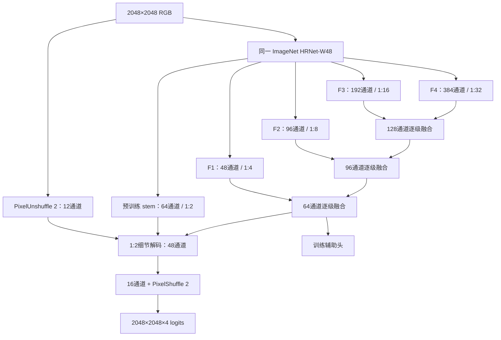

# 阅读入口：NativePyramid-SP v3 设计

**最新设计：[v3最终架构设计](D:/dataset/experiment/HRDecoder_NativePyramid_20261011/02_v3_最终架构设计_20261016.md)；[全量补读与设计裁决](D:/dataset/experiment/HRDecoder_NativePyramid_20261011/03_全量补读与设计裁决_20261016.md)。本轮按用户要求只做设计和审查，没有启动训练。**

v3增加四尺度直接语义分类通路，保留非线性逐级解码与预训练stem细节路径；新残差末层从零开始，新头改用逐像素通道LayerNorm。完整规格及40k、同预训练文件、同数据口径以v3设计为准。它尚无训练成绩。

此前的[v2设计与执行协议](D:/dataset/experiment/HRDecoder_NativePyramid_20261011/00_最终架构方案.md)和[10月11日审查记录](D:/dataset/experiment/HRDecoder_NativePyramid_20261011/01_审查结论与阅读范围.md)保留用于追溯；v3明确继承的执行细节继续引用v2。

以下原文描述历史v1原型。v1四类学习检查未通过（SE零检出）；Python尚未实现v2/v3。下列旧命令不是当前开跑建议，旧检查结果也不是v3验收。旧v1的损失、微批累积与恢复说明可能与后续设计不同，不能混用。

---

## 原型 v1 的历史说明

本次实现针对目标：在自定义 **454 / 76 / 227** 划分上，以同一份 ImageNet HRNet-W48 初始化、batch=2、40,000 次 SGD 更新，争取超过固定融合系统的 **val 45.321831227388% / test 45.860383832668%**。当前实现与本地诊断结果见 [验收记录](验收记录.md)。正式 40k 的成绩只能由 `endpoint_lock.json` 和 `test_result.json` 给出。

保留旧实验目录，本轮代码集中在当前目录；入口是 `train.py`，模型是 `model.py`，所有训练口径固定在 `protocol.json`。

## 1. 历史证据改变了这次的设计

| 核实的历史事实 | 本次处理 |
| --- | --- |
| v3：8k val 37.9882%，20k 降至 15.0509%；Detail：12k 36.7358%，16k 13.0748%，EX/SE 后续零检出 | 正样本从第一步就有稳定的 logit BCE 梯度；每 250 步用固定训练图检查阳性召回和 logit，异常连续确认后保存并停止 |
| Detail 崩塌后 EX/SE 阳性 logit 约 −10 至 −25；交换 BN 统计未救回 | 不把 BN 视为已经证实的唯一根因；同时处理监督、特征分辨率和梯度路径 |
| CET 完整 40k val 38.3138%，其 base 为 38.5364%；多数纠错分支没有稳定的独立净收益 | 去除旧预测加私有纠错的结构，所有特征共同形成最终预测并接受反向传播 |
| Semantic 4k final 32.8890%，base 33.2550%；IoUCorrection final 26.2690%，base 32.5182%，四类召回下降 | 保留全部阳性监督，困难背景单独取样，同时保留少量全背景 BCE；不用整体替换成 Lovasz 来强行换取 precision |
| 旧实现把 2048 图像先缩到 1024，最细 HRNet 深层特征只有 256×256 | 主干直接读入 2048，最细深层特征达到 512×512，复用预训练的 1024×1024 浅层特征恢复细节 |
| Residual 8k 从 29.4758% 上升到 37.2124%，仍因私有净收益仅 +0.2782pp 被短筛拒绝 | 取消“4k 必须超过某个绝对分数/私有增益”的淘汰条件；正常学习时执行完整 40k，严重崩塌和数值错误仍停止 |

依据：[最新完整报告](../HRDecoder_ArchitectureDesign_20261008/final_report/HRDecoder完整实验报告.md)、[Detail 实测诊断](../HRDecoder_ArchitectureDesign_20261008/detail_execution/diagnosis_16000/诊断结论与停止记录.md)、[更早的历史审计](../HRDecoder_ArchitectureDesign_20261008/evidence/history_audit.md)。单点短筛结果不能用于断言某种方法永远无效。

## 2. 网络结构



四级语义特征逐级上采样、拼接与细化，保留各级的独立输入。细化块使用 3×3 和 7×7 深度卷积，接通道混合。最后一级同时读取预训练 stem 和原图的 2×2 像素展开；它不是从粗预测插值出的“伪细节”。输出为四个独立病灶 logit，允许沿用原来的四类 sigmoid 评价口径。

**所有预测损失都能回传到 HRNet。** 没有 detach、动作门控、教师路由或额外冻结的任务模型。辅助头也在原始训练标签网格上计算损失，不通过最近邻缩小标签丢弃小病灶。

模型 **65,569,364** 参数，其中新解码器 **244,244** 参数。对应旧完整 baseline 为 65,572,420 参数，参数量基本相当。编码器直接处理更大网格，会增加计算量；本方案满足相同更新次数与相同图像数量，不宣称 FLOPs 相等。

学生只加载 SHA256 为 `d2186c55782308392ae14cf179ac4840143b09abdbba81aa3f9274c795ebc960` 的 W48 权重。1830 个主干参数/缓冲张量逐一核对；126 个 ImageNet 分类头张量不属于分割主干。timm 默认的 31 处最近邻特征融合被显式改成双线性、`align_corners=False`，与归档分割主干的插值方式一致。

## 3. 稳定监督

每个图像、每个类别都在完整标签网格上计算：

\[
L = L_{Dice2} + 0.5 L_{BCE\text{-}hard} + 0.05L_{BCE\text{-}all},\quad
L_{total}=L_{final}+0.2L_{aux}.
\]

`Dice2` 沿用平方分母。某图不存在该类时，不加入恒接近 1 且恢复能力弱的空类 Dice，背景仍接受 BCE。困难 BCE 保留该类**全部阳性**，从阴性中选 logit 最大的 `min(Nneg, max(1024, 3*Npos))` 个；正、负组各自平均后等权，只有背景的组完整保留背景监督。少量全像素 BCE 约束其余背景。

这样既避免数百万容易背景淹没小病灶，也避免均匀负样本平均把少量高分假阳性的梯度稀释掉。对阳性 logit −25，BCE 仍有明确的上推梯度；对阴性 logit +25 仍有下压梯度。该数学性质已做单元验证，它保证的是监督方向和数值可恢复性。

主干 BN 固定 ImageNet running mean/variance，但 affine 参数继续训练；新头使用 GN。激活重算不会重复污染 BN 统计，微批量累积也不改变 batch 统计。SGD、lr=0.005、momentum=0.9、weight_decay=0.0005、1500 步 warmup 和 40k poly 调度保留，梯度总范数限幅 5。

## 4. 数据与比较边界

- 使用用户接受的自定义融合后划分，数据位置 `D:/HRDecoder/data/DDR_split_613`，不重新划分。
- 本地验证重新计算了 454 train、76 val 的图像与标签 SHA256。test 只核对现有身份清单的互斥性，不读取新 test 像素。
- 正式训练每步两张图，共 80,000 图次。`micro_batch=1` 把两张图的损失各乘 1/2，最后只调用一次 SGD；不是把两次更新算成一次。
- 相同预训练信息来源采取严格解释：不向学生蒸馏 DINO/ConvNeXt 教师，不继承旧任务权重，不用 TTA/EMA 或训练后阈值搜索。
- 与历史一致的增强类型：比例缩放、随机裁剪、水平翻转、±45°旋转、DDR RGB 标准化。当前是 OpenCV 独立实现，并对旋转填充区域忽略监督；不声称与旧 mmcv 的随机轨迹逐像素相同。
- 四类顺序为 EX / HE / SE / MA，标签 0 是背景，255 忽略。原尺寸累计 TP/FP/FN，四类 IoU 等权平均。FP32 logit 先对齐原尺寸再 sigmoid，严格 `>0.5`；不是逐图 IoU 的平均值。
- 主成绩固定为第 40,000 步原始权重。best-val 单独报告。只有固定 40k val 达标后才允许读取锁定 test；不得在看到 test 后修改网络或阈值。

相同预训练来源和更新预算是固定约束。固定 BN、解码结构、损失和主干实际输入分辨率都是本次配方变化，不能把未来总增益全部归因于某一个模块。

## 5. 检查与执行

现有本地 Python 3.13、PyTorch 2.6.0+cu124、timm 1.0.27 已可运行；无需 mmcv/mmseg。PowerShell 可执行 [run_checks.ps1](run_checks.ps1)。跨机器完整检查命令：

```text
python verify.py --data-root /path/DDR_split_613 --identity /path/data_identity.json --pretrained /path/hrnetv2_w48-d2186c55.pth --output evidence --crop-steps 128
```

检查包含：回归测试、文件哈希、真实 W48 梯度与激活重算一致性、真实训练图裁块学习、2048/batch2/SGD 完整前后向。所有探针更新单列、全部丢弃，不进入正式 40k 权重谱系；失败记录保留，不混入正式精度。

`evidence/preflight.json` 为 PASS 后，使用空输出目录开始：

```text
python train.py --data-root /path/DDR_split_613 --identity /path/data_identity.json --pretrained /path/hrnetv2_w48-d2186c55.pth --preflight evidence/preflight.json --output runs/native_seed42 --micro-batch 1 --workers 2
```

训练前再次核验 train/val 文件内容。中断恢复需 `--resume`，只接受同源码、同数据、同一运行的正常 TRAINING 检查点；已判定崩塌的运行不能自动回滚并继续冒充相同预算。

每 250 步进行固定训练图健康检查，每 2000 步完整 val；正常波动不会因低于融合分数而提前淘汰。严重类别丢失或 mIoU 下跌触发持久保存并停止，不自动重启、不额外续训。监测是及时发现失败的工程措施，不能写成尚未发生完整训练的稳定性结果。

固定 40k val 达标后运行：

```text
python evaluate.py --lock runs/native_seed42/endpoint_lock.json --data-root /path/DDR_split_613 --identity /path/data_identity.json --pretrained /path/hrnetv2_w48-d2186c55.pth
```

## 6. 文献核对与本次判断

HRDecoder 原论文将高分辨率特征裁块建立在低分辨率编码特征上，目标包含计算效率；其表 2 的 HRDA 在 DDR 为 32.32%，HRDecoder 为 32.25%。因此，仅增加真实分辨率不足以推出必然的较大提升。本方案把分辨率、端到端梯度、细节恢复和稀疏监督同时作为待验证配方。[HRDecoder 原文](https://papers.miccai.org/miccai-2024/paper/4020_paper.pdf)

HRNet 支持在多个分辨率间反复交换信息，本方案复用它已有的预训练表示，增加逐级解码与浅层读取。[HRNet 原文](https://arxiv.org/abs/1908.07919)

GN 不依赖 batch 统计，因此用于新增小批量解码器。预训练主干继续保留原 BN 层与预训练参数，仅固定其统计。[Group Normalization](https://arxiv.org/abs/1803.08494)

PointRend 说明高分辨率输出的细节恢复需要读取更细的图像特征，但本实现采用全图密集亚像素输出，并未复现其不确定点采样算法。[PointRend 原文](https://openaccess.thecvf.com/content_CVPR_2020/html/Kirillov_PointRend_Image_Segmentation_As_Rendering_CVPR_2020_paper.html)

这些来源支持设计动机；本任务的胜负判据仍是锁定协议下的完整 val/test 实测。

