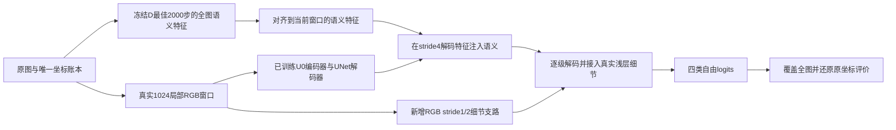

# HRDecoder：10月3日严格复诊与下一轮主方案

审查日期：2026-10-03。依据是10月2—3日的完整报告、实际运行日志/指标JSON、模型和数据代码，以及9月26日历史复诊记录。整理与交叉核对交给三位 GPT-6-Luna（max）子代理；关键判断和方案由主代理审查。本次没有调用DeepSeek，没有启动训练、登录服务器、改动旧实验或清理权重。

**最重要的判断：本轮确实得到了一项可复核的进步，但还没有验证原方案中最关键的“真实细节进入语义分类器”这一设计。当前主要障碍不是缺少又一个损失函数，而是新训练没有形成足够强、可比较且能被最终输出充分利用的病灶表征。几何协议不一致、外部数据实际缩水、结构实施偏离，使几项负结果不能承担原本赋予它们的解释。下一轮先用现成权重排除几何影响，再集中做一个真正的全局—局部特征融合实验，不再同时换三套骨干。**

这不是宣布“查到一个bug，修好必涨3点”。下面明确区分已证实事实、因果假设和需要新实验验证的设计。报告本身已经诚实说明不少限制；严格审查的对象是实验能够支持什么判断，而不是把报告一概判为不可信。

**一、成绩与目标：先固定参照**

|对象|val mIoU|test mIoU|解释|
|---|---:|---:|---|
|历史baseline|历史口径约39.39%|42.20%|既有历史参照，不重训|
|原冠军，本轮同评估器复核|42.6691%|44.2110%|旧报告44.2115%的微小差异不影响判断|
|原冠军75%＋历史U0 25%|43.4877%|**44.7809%**|本轮真正锁定并测试的新成绩|
|原冠军75%＋U0高分辨率续训1000步25%|**43.7328%**|未测试|只有验证集发现，不能写成更高测试成绩|

当前相对42.20已经增加约2.5809个百分点，距离最早的47.20目标还差约2.4191点。9月26日方案采用更严格的“相对44.2115再提高3点”，目标47.2115，还差约2.4306点。本文保留这两个既有目标，主验收取47.2115；不悄悄将目标改成相对最新44.7809再加3点。后者若被另行要求，对应47.7809。

已锁定测试的逐类结果如下。均为四类各自全图累计TP/FP/FN计算IoU，再对四类平均；不是图像IoU的简单均值。

|类别|原冠军test|当前管线test|增量，百分点|
|---|---:|---:|---:|
|EX|53.8610%|54.5977%|+0.7367|
|HE|44.5121%|45.2021%|+0.6900|
|SE|49.8134%|50.0838%|+0.2704|
|MA|28.6575%|29.2400%|+0.5825|

四类都提高，值得保留。但是这些数字来自**完整集成管线**，不是某个新单模型。也不能把val高分辨率候选的+0.2451点直接加到44.7809上。历史test已经被多次查看，后续同一227图上的结果仍应如实标为探索性延续。

验证集上的取舍并不相同：最终固定混合EX/HE/SE/MA分别为47.7365/42.5062/57.0692/26.6388%，其中**HE低于原冠军的43.7567%**。不能从test四类全涨就断言所有类别的提升都已稳定复现。

**二、为什么大量训练只换来了这点提升**

**1. U1与历史U0的差距，混入了明显的推理几何差异。**

`trainer/data/augment.py:74–76`训练时按长边等比例缩放，再随机裁剪；`trainer/eval.py:136–147`却按`resize_to=[2048,2048]`直接拉伸验证图，再把输出插值回原图。U1使用这种方形画布上的1024/768滑窗；历史U0使用原尺寸整图。

本机PIL图像头统计表明，76张val有17种分辨率，中位长边2592，多数宽高比约1.5。拉成正方形对这些图像造成约1.5倍的各向异性形变。回到原坐标计算指标，只恢复了坐标，并未撤销网络看到的病灶形状与尺度变化。

而且U0/U1的ConvNeXt编码器使用LayerNorm，UNet解码器却明确使用GroupNorm（`convnext_unet.py:192–204`）。整图与滑窗还改变了上下文和GN的空间统计。不能只看配置里的`layernorm_native`就断言整图/裁块预测应相同。[GroupNorm论文](https://www.ecva.net/papers/eccv_2018/papers_ECCV/papers/Yuxin_Wu_Group_Normalization_ECCV_2018_paper.pdf)

本轮曾因错误套用新几何而无法复现U0；恢复native whole后通过逐像素检查。这直接证明协议必须跟随权重，但没有量化U1如果换几何能恢复多少。**因此36.6934对38.4469不构成“外部预训练使U0退步1.75点”的干净因果证据。** 也不能反过来保证修正几何就能追回这1.75点。

**2. H1训练的对象和推理的对象不同，不能代表完整HRDecoder路线。**

训练引擎只调用`self.model(image)`和统一BCE+Dice（`engine.py:193–203`）。H1的普通`forward`是HRNet多尺度特征拼接、FCNHead、上采样；其`eval_forward`则将整图缩到1024，提取全局特征后放大裁块，输出全局/局部各50%的融合（`hrdecoder_adapter.py:164–239`）。代码中没有原方法高分辨率表示学习的额外裁块监督接口。

这是已证实的训练/部署路径差异。HRDecoder原文明确让高分辨率表示学习与融合参与训练，而不是只在验证时临时改变解码路径。[HRDecoder论文](https://arxiv.org/html/2411.03976v1)

但也应记住历史教训：之前FusionAware修正另一种训练/融合不一致后，只得到小收益。这类差异值得优先修正，却不能再次被当作“修完必涨3点”的唯一根因。

**3. 原计划最重要的新信息入口没有实施。**

`convnext_unet.py:260`附近直接拒绝`detail_branch=true`。U1/H1实际配置均无真实RGB stride1/2细节支路。现有UNet虽然输出到stride1，其最浅RGB编码特征仍为stride4；后两次上采样没有接入新的原图浅层特征。

9月26日方案提出的是“真实局部RGB编码＋坐标对齐全局特征＋stride1/2跳连”；本轮主要执行的是另一套骨干/预训练对照，以及后来增加的尺度续训。**故本轮没有否定原计划的核心结构假设。** 同时，原计划也应承担设计上的不足：资产与模块的前置条件没有变成足够明确的开跑验收，导致“方案名字相似”与“实际训练相同”脱节。下一轮必须以实际前向图、初始化清单和一次真实梯度检查验收，而不是凭配置名认定模块已经训练。

**4. 外部预训练实际是48张用户加工图，不是完整的外部细标注迁移。**

54张IDRiD衍生图按48/6划分，标签来自用户YOLO多边形栅格化；图像本身也已加工为方形，例如IDRiD_01为4194×4194。manifest明确记为`user_curated_best_segmentation_20261002`，不是未经处理的官方原图。

本次核对54张图和多边形文件哈希，并对部分mask重新栅格化，结果与实验资产一致。这支持“当前转换按其定义执行正确”，不能证明标注等同官方像素GT，也不能仅凭polygon格式说它有错。全54图都有MA多边形，没有证据支持简单的“MA类整体漏标”指控。

MAPLES只有标签包，没有配对MESSIDOR图像；FGADR没有实际执行证据。IDRiD衍生图的MA矩形面积占比约0.107%，DDR train/val约0.0225%/0.0173%，显示训练域差异，但面积占比还受到选图、几何和独立mask/互斥标签的影响，不能据此直接判定标签膨胀。[IDRiD官方说明](https://idrid.grand-challenge.org/Data/)、[MAPLES数据说明](https://liv4d.github.io/MAPLES-DR/en/welcome/dataset_description.html)

因此，应把结论写成“这份衍生数据和当前训练配方没有培养出更好的部署成员”，而非“外部真实病灶监督已经证伪”。另一方面，也没有足够理由继续盲目增加这48张图的训练步数。

**5. 训练曲线反映了不同问题，不能用一个‘欠训’或‘过拟合’解释所有实验。**

|运行|完整val轨迹，mIoU %|可作出的判断|
|---|---|---|
|U1 DDR，3/6/9/12k|24.7993→31.4984→34.2788→36.6934|末段还涨2.41点，不能宣布已收敛；也不能据此保证多训能超过冠军|
|H1 DDR，3/6/9/12k|32.0916→33.3371→35.5950→35.4032|9k附近已出现平台/回落，优先核查路径与数据，而非机械加长|
|A0，3/6k|6.9485→9.6781|当前随机初始化骨干＋项目解码器红病灶学习失败；停止合理，不能代表原HACDR论文|
|U0高分辨率续训，1/2/4k|39.6065→37.4874→38.4937|早期改善后退化，增加长度没有超过1k；不能仅以步数少称其欠训|

U0续训加载了模型权重，却新建了AdamW和4000步学习率计划，不是沿用旧optimizer的精确继续。C/T两臂同样重置，所以这不破坏它们起点的一致性；但它与早峰相关的机制值得另行验证，不能把“从旧12k继续”理解为原轨迹平滑延长。

高分辨率实验仍使用0.5–2.0大范围尺度扰动，只把基础长边从2048改成2048/2560混合；并未构成一个稳定的部署尺度适配。且C在2k停、T到4k，最公平的比较只能看共同节点：1k固定融合T−C为+0.3665点，2k约−0.0054点。不能以两者各自最后成绩宣称稳定获胜。

还有两个次级实施细节：Dice按真实microbatch汇总，4×2累积不等价于一次batch8的Dice；`cat_max_ratio`当前只检查四类前景占整个裁块的占比，不含背景，不能称为与mmseg原采样语义相同。二者都需要在后续配对中固定，但现有证据不足以把它们说成本轮失败主因。

H1的配置来源链还有一处缺口：campaign记录的配置SHA与完成摘要/本机resolved配置SHA不一致。现有日志和节点足以确认12k运行发生；外部权重加载有配置、权重SHA和加载代码的强路径证据，但缺逐键载入记录，不能声称已逐项证明当时模型初始化状态。下一轮将实际解析后配置和加载清单随checkpoint不可变保存，详见训练审查附件。

**三、本轮真正改变研究方向的正证据**

U0单模val仅38.4469%，与冠军混合却达到43.4877%，锁定test也四类提高。这说明**候选专家的价值应由它给最终管线带来的改善衡量，不能要求每一个专家先单模超过冠军**。上一轮关于逐类固定路由43.0645的结论，只限制那一组二值路由，不是概率融合上限；本轮结果再次验证这个边界。

已锁定test的原始计数复算显示，四类合计TP增加7679、FP减少75352、FN减少7679。HE/SE的收益主要来自压低FP，EX主要来自补TP且FP略增，MA两者兼有。尤其SE减少13611个TP的同时减少31170个FP，IoU上升但recall由约64.59%降到62.21%。这符合本项目IoU目标，却不是“所有漏检都变少”。总计只能说明错误变化方向，不能代替四类mIoU，因为四类分母和权重不同。

目前本机留存的折外融合计数还显示：EX、SE的增益主要伴随FP减少；其中EX和MA也同时增加TP。HE在折外组合中反而退步。这些折的U0比例为0.25/0.125/0.25，**不是最后固定25%的全val结果**，不能混用；但已足以否定“只要提高病灶召回，指标就会提高”的单向叙事。下一轮必须同时记录漏检和新增误报。

一个此前未充分利用的数学约束也很重要。设当前融合为：

`P = 0.75 × P_champion + 0.25 × P_expert`，判阳规则为`P > 0.5`。

- 当`P_champion ≤ 1/3`，即使expert输出1，也无法判阳。
- 当`P_champion > 2/3`，即使expert输出0，也无法判阴。
- 因而固定25%专家只能改变冠军概率中间区间的决策；它无法纠正冠军所有的高置信错误。

这是结构能力的数学限制，不是实验猜测。它也不是当前数据的实际性能上限：缺少本机连续概率缓存，尚不能计算有多少剩余错误被挡在这个区间外。若保留的服务器缓存可用，逐类诊断上界为：`可达到的TP = count(GT=1 且 Pc>1/3)`，`无法移除的FP = count(GT=0 且 Pc>2/3)`，再以`TP/(GT总数+无法移除FP)`计算。它只用于判断固定混合能否容纳目标，不得把这种GT oracle当作可部署模型。

所以，我不再把“让一个新模型稍微更好，再固定占25%”当作足以达到剩余2.43点的主设计。应使新模型在分类前利用两类表征，产生不受旧概率范围限制的四类logits；旧冠军保留为参照和最后的可选融合成员。

**四、下一轮：只做一个主结构，按证据逐步投入**

优先顺序是：**G：现有权重几何复核 → M：异构全局—局部特征融合＋真实细节 → E：资产齐备后才检验官方细标注迁移。** G是排除混杂和找回已有资产，M是主要提分实验，E是条件分支，不自动开新队列。

**G：先花推理成本，弄清现有模型到底学得怎样。**

对历史U0与U1@12k固定权重，预先规定“native／等比例长边2048”דwhole／1024窗口stride768”的2×2评估矩阵。U1已经保存的“2048正方形＋滑窗”作为原协议参照，不再扩张任意尺寸搜索。逐项分别比较分辨率与推理方式，不把它们同时改变后称为单变量。whole如果OOM，标记无法评价，不得静默缩图。

另对H1@9k，在相同2048正方形输入上比较普通`forward`与现有`eval_forward`，检验那条没有直接接受对应监督的推理路径是否带来实际损害。两者均回原始坐标按原指标计算。这是现有checkpoint诊断，不是要求重训历史baseline。

每次同时保存四类TP/FP/FN、按图计数、按病灶连通域面积分桶的漏检，以及相同原坐标的概率缓存。用于结构决策的几个关键问题是：丢失的是整颗病灶还是边缘；误报集中在血管/视盘/黑边还是普通组织；专家和冠军一起错的区域占多少；不同几何是否只改变校准而未增加识别能力。人工看图按这些错误类型取代表样本，不只挑最漂亮的成功图。

同时查看每类PR和IoU随阈值的诊断曲线，区分排序能力差与校准失配。曲线上的oracle最佳点不能冒充固定0.5的模型成绩；若主要问题只是稳定的概率偏移，应先做在val内拟合、折外核验的简单校准对照，而非直接支付新结构训练成本。当前没有缓存和相应曲线，不能预先宣称阈值调整能追回多少。

这一步有明确终点：矩阵完成即锁定后续几何，不继续扫分辨率。随后只给U0高分辨率@1000候选补做一次锁定协议的val，确定M0/M1统一起点，不让它再参加整套几何搜索。保留原部署协议不动；新模型若使用新协议，在报告中另列。完成前不延长U1、不重开H1/A0训练。若已有权重就满足目标，先确认并封存，没必要为了方案完整继续建新网。

**M：让HRDecoder的全局语义指导U0的局部细节，输出自由四类预测。**

这是我最愿意投入下一轮主预算的设计。其依据一半来自本项目——U0已经证明与HRDecoder家族互补；另一半来自高分辨率分割研究——细节需要在分类前与语义结合。它不是把三个论文模块串起来。[HRDA](https://arxiv.org/abs/2204.13132)、[M2MRF](https://arxiv.org/abs/2111.00193)、[PointRend](https://openaccess.thecvf.com/content_CVPR_2020/html/Kirillov_PointRend_Image_Segmentation_As_Rendering_CVPR_2020_paper.html)

具体结构与初始化如下：

- 全局分支通过已有冠军加载器还原D@2000的学生HRNet/FCN，取分类层之前已训练的64通道特征，全分支冻结，BN统计也冻结。不能新建一个近似adapter后用`strict=False`跳过不匹配权重。整图按固定、等比例的低分辨率视图处理一次；提取的特征和原图共享明确坐标映射。其作用是给局部纹理提供病灶语义与大范围背景。
- 局部分支复用U0的完整编码器、解码器。默认从本轮**高分辨率1000步best**起步，因为它是已验证的更优val候选；它尚无test成绩，不能用44.7809给它背书。如果G发现该候选在锁定的新几何下并不优于历史U0，则两臂一致改用历史U0。这个选择只做一次，写入冻结协议。
- 在U0的stride4解码特征中加入对齐全局特征的投影/残差adapter；初始最后一层为零，保持新模型的初始化可核对。
- 增加很轻的真实RGB细节stem：stride1约16通道、stride2约32通道，在现有最后两级上采样后以投影跳连接入。投影末层零初始化，继承旧解码器参数，不把整个head清空重练。新增支路使用逐像素的通道归一化，避免再引入随padding面积改变的归一化统计。
- 保留四个独立logits和标准sigmoid；不做`clip(p+残差)`，不把旧冠军低概率区域设为永久禁区，不要求EX/SE保持不变。两类原本较强的病灶也有改进空间。

这里的“自由”指不受旧概率混合区间限制，不是无限扩大模型。与旧MA小头/refiner的区别是：**局部表征来自已经训练的完整编码器，分类器同时读取全图语义，真正的stride1/2 RGB信息进入最后解码过程，四类都能学习。** 若删掉这些条件，只是再把RGB和概率丢进随机小CNN，我不建议重做。

工程改动为中等：给HRDecoder适配器增加pre-classifier特征导出；给ConvNeXtUNet增加全局adapter及两级RGB跳连；数据层增加坐标配准；训练和推理共享同一窗口函数。旧指标、标签、主骨干实现和部署包不用重写。

**必须做一个小而真正匹配的结构对照。**

|实验臂|共同部分|唯一结构差异|
|---|---|---|
|M0|D全局语义＋预训练U0局部分支＋对齐解码|不接入真实stride1/2 RGB跳连|
|M1|与M0同初始化、同窗口、同损失、同采样、同更新预算|接入真实stride1/2 RGB跳连|

两臂既要与对方比较，也要与**44.7809对应的完整旧部署管线**在val上的43.4877比较。仅比一个更弱的M0高，不算达成项目目标。M0若已经带来收益而M1无效，就保留M0，并明确真正有用的是跨骨干语义融合，不为保住“细节模块”叙事扭曲结论。

默认先用原生像素窗口，不强制正方形整图缩放；全局视图等比例缩放。1024输入窗口带128像素上下文边缘，监督并回填中心768区域，边缘补齐方式训练/推理相同，覆盖全图。先不叠加FOV裁剪或0.5–2倍强尺度扰动；只用翻转和90度旋转，所有几何坐标同步变换。若G证明必须采用其他画布，则两臂同步采用同一已锁定画布。

**全局分支不具有被证明的旋转/翻转等变性。** 第一版应对增强后的完整图像先做`no_grad`全局前向，再取对应窗口特征；不能把旧特征图直接旋转就当成网络看过增强图。缓存若要加速，只能缓存固定几何/增强版本各自真正前向得到的特征，并在逐图坐标和输出一致性通过后启用。

旧U0解码器的GN保留，在固定形状窗口上训练和推理；这只能控制窗口分布差异，不能宣称任意padding/上下文下预测完全不变。全局特征不能从局部裁图独立计算冒充整图上下文；缓存只能保存已冻结的分支，且须记录权重与几何SHA。

两条预训练分支各自保留已核验的通道顺序和归一化，不能因为看到同一张RGB就直接共用一份未经核对的标准化张量。模型0步应验证M0/M1输出一致、D无梯度、允许更新的U0层与新增支路能获得梯度、所有像素被回填一次且标签坐标不变；零初始化投影会使上游支路第一步梯度为零，须在投影更新后再验上游，避免把正常初始化误判为未接通。

训练默认：先保持原BCE+Dice组合，不增加第三个损失；梯度累积两臂完全一致。沿用随机/前景混合采样，但前景判定必须针对实际监督的中心768区，不能只保证halo中有病灶，并记录四类中心前景出现率。以micro4×2为起点，若显存要求更小，两臂一起改为micro2×4，并在第一次正式更新前固定，不能训练途中单臂更换。继承编码器早期stage先冻结，后两个stage与解码器训练；预训练参数LR建议1e-5，新adapter/细节支路1e-4，AdamW、权重衰减0.01、梯度裁剪与FP32损失计算共同固定。它们是首版可审查默认值，不是假装已经调出的最优参数。

首组共同预算8000次optimizer更新，完整val节点固定为0/1000/2000/4000/8000；不因训练loss下降或一个节点退步就把某一臂叫作收敛。每个节点同时保留单模和一个预先声明的固定融合候选：`0.5 × 当前完整部署预测 + 0.5 × 新模型预测`。以完整76图四类mIoU选择节点和输出方式，平分选更早节点、再平分选单模，记录全部候选而非只留下最大值。不扫描逐类权重，不用test挑比例，也不让25%比例成为所有新模型的永久能力约束。

如果两臂到4000步的最好部署候选均未超过起点、最近完整区间也没有上升，可一起止损；若任一仍有实际提升趋势则共同跑满。最好点孤立出现时保留权重，但降低信心，不把晚期下降当随机噪声抹掉。如果8000仍稳步上涨，只能说当前预算未到平台；是否延长要记录成新阶段，两臂采用匹配预算，不能把单臂延长后的结果冒充原对照。

值得继续的标准是最终管线的稳定增益：首组约+0.5点可作为是否投入第二种子配对的工程门槛，而非统计显著性；同时检查收益是否只由极少数图像支撑。第二组M0/M1同规则复核。配对不仅要设同seed，还要重放同一图像/窗口/增强清单，让新增模块的随机数消耗不改变数据流。目标距离仍有2.43点，只有+0.2点时不应宣布主问题已解决；若数据表明只是边缘修补，就停止追加小模块。

M0/M1首先检验的是“增加整套RGB细节分支”的效果，包含新增容量，不能单凭它证明收益专门来自高频信息。只有M1稳定胜出后，为论文机制解释追加一个容量完全相同、但RGB跳连输入先下采样再恢复的对照；其余分支仍接收相同图像。这样才能区分真实浅层细节与简单加参数。没有主收益时不追加这项实验。

**E：真正补外部监督，但必须与结构效应拆开。**

IDRiD官方原图/像素GT与MAPLES配对原图齐备后，再做一个最佳结构的“DDR-only／外部病灶迁移后DDR适配”对照。类别映射、图像变换和未知区域ignore先验收，不能继续把用户polygon当官方GT替身。MAPLES标注有其自身风格，数据多不保证目标域IoU更好。[MAPLES论文](https://www.nature.com/articles/s41597-024-03739-6)、[跨数据集研究](https://arxiv.org/html/2405.08329v1)

这条线解决的是患者、成像和病灶外观覆盖不足。没有官方资产时不占GPU等待；有资产也不与M0/M1同时改动，否则仍不知道收益来自哪里。既有IDRiD衍生数据可作附加域或质量对照，但先核对与官方图/标注的变换关系。暂不把FGADR粗细不一致标签、1000张伪标图和新结构一起混训。

**五、为什么没有选择另外几条看起来更激进的方向**

- 不再优先堆损失。已有FusionAware、Lovasz、加权/采样等实验表明优化目标调整不能替代新增有效表征。只有错误分析明确指向某种偏差，再设计相应监督。
- 不先做MA向血管粘贴。现有证据同时包含FP和FN；错误血管先验可能强化误报。血管信息可以是软语义输入，不能当排除血管外MA的硬门。[RTNet](https://arxiv.org/abs/2201.11037)
- 不用病灶面积动态阈值作为主贡献。预测面积本身有误差，容易形成循环选择；最多以后在val上预先固定做独立校准对照。
- 黑边预处理不是被否定了，而是被放进几何问题：若去边，必须保持纵横比、可逆坐标和完整GT评价，不能通过减少评价区域取得表面提升。先用已有权重核清它的收益来源。
- 不马上从零重训HACDR或移植SAM。A0的弱结果只限制当前适配；新的RetSAM也存在公开权重与论文模型不一致、公开输出不含MA、DDR训练来源需要排查等实际约束，不能当现成的3点收益。[RetSAM论文](https://arxiv.org/html/2602.07012v1)、[官方发布说明](https://github.com/Wzhjerry/RetSAM)

**六、如何判断这次设计是否真正对症**

最有价值的验证不是训练loss又降了多少，而是同一病灶区域出现以下可解释变化：M1相对M0在微小/中等MA与EX区域补回更多真值，同时没有等量制造血管和噪声误报；全局特征让HE/SE的假阳性或轮廓错误减少；收益在另一种子和多数相关图像上仍存在。若只改善连通域数量，却未改善面积占比较大的漏检和边界，像素mIoU不会自动受益。

四类mIoU要再增加2.4306点，需要四类IoU增量之和约9.7224点；只押MA就要求MA单类再涨约9.72点。这个算术说明四类一起改进更合理，不是给每类编造一个必达涨幅。

我的信心排序：**现有评估/实施混杂确实存在，置信度高；现有异构表征有互补信息，已有本项目test支持；真实细节与全局语义能进一步提高部署指标，是中等信心、可检验的结构假设；一次直接达到47.2115，目前没有依据给出可靠百分比或保证。** 主要失败风险是两套编码器仍共享错误、真实细节放大伪影、尺度/对齐引入新偏差，或454张图不足以学习新的跨骨干接口。遇到这些证据就应转向外部真实监督，而非继续给相同输入扩头。

保存现有赢家是无条件的；新方案是否晋级由val决定；全部方案与权重锁定后才进行一次最终评价。完整记录图像抽样不确定性和不同训练种子差异，两者不能互相替代。旧test不能重新变成盲测，发表时还需要独立外部证据；这不妨碍如实记录本项目既定划分的工程进步。该结构的论文创新性也需要实证与消融支持，不能仅靠“跨骨干融合”命名就宣称新的SOTA方法。

本次的交付是诊断和下一轮设计。接下来应先实施G的有限复核及M0/M1代码验收，验收通过后再确定服务器时长；本次没有启动任何付费计算。

**审查材料入口**

- [数据与来源审查](02_外部数据审查_Luna.md)：哈希、标签来源、几何统计与证据边界。
- [原始结果审查](03_运行与结果审查_Luna.md)：完整节点、计数、融合/测试关系和缓存缺口。
- [训练实现审查](04_训练实现审查_Luna.md)：初始化、前向路径、优化与恢复、实际批次配置。
- [文献取舍](05_文献取舍与新方案依据.md)：本次检索的原始来源、使用方式和淘汰理由。
- [原完整报告](D:/dataset/experiment/HRDecoder_Ready_20261002/reports/HRDecoder_完整实验报告_20261003.md)与[既有最终测试JSON](D:/dataset/experiment/HRDecoder_Ready_20261002/server_results/reports/finish/final_test.json)。
