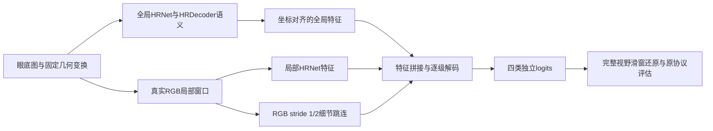

# HRDecoder：历史实验重新诊断与下一轮主方案

审查日期：2026-09-26。本文是研究判断和可执行设计，不是新一轮训练结果。已按要求停止推进旧任务；本次没有启动训练、修改旧实验或访问4090。目录索引、WorkBuddy委派答复、复算数据与CPU诊断均随本文保存。

**我的判断：我们尚未证明HRDecoder到了性能上限。此前真正成功的改进，主要是预测互补和MA校正；之后大量算力消耗在同源预测的微调上。同时，部分“排除某条路线”的结论，实际上建立在过早终止、错误起点、失真的统计推断或未完成的实验上。下一轮应把主要资源投入“外部真实病灶表征迁移＋原始图像细节与全局语义的特征级融合”，四类共同优化。**

我把“至少提高3个百分点”作为验收标准。不能把未运行的方案写成已被证明一定能达到的成绩；也不通过改对照、选测试集或更换指标来兑现这个数字。下面说明为什么押这一方向、怎样把失败尽早暴露，以及怎样保留真正有效的部分。

## 目标先固定，避免再次换参照

|参照|目前test mIoU|提高3个百分点后的目标|还需超过现冠军多少|
|---|---:|---:|---:|
|历史baseline|42.20%|45.20%|0.9885个百分点|
|当前可复核冠军H5/H7|约44.2115%|**47.2115%**|**3.0000个百分点**|

本方案以较严格的第二行设计，同时报告相对42.20的差值。3个百分点不等于相对增长3%。主指标保持四类全数据集累计TP/FP/FN得到IoU，再取四类均值；背景不计入、忽略区域规则不变，标准输出严格`p>0.5`，标签不改。454/76/227划分保持不变。

现冠军val为42.6694%，不能直接用test的44.2115%评判val是否进步。若要求val相对冠军也提高3点，其对应值为45.6694%；它是筛选证据，不是test保证。

## 先把真实经过讲清楚

本次对`D:\dataset\experiment`建立了3862个文件的目录索引，覆盖各顶层实验家族，并回溯了最早两轮及WorkBuddy的9月17日后续报告。没有把图片、权重逐个重新推理，也没有声称逐字阅读了全部文件。细账见[历史实验台账](02_历史实验台账_审核版.md)，完整索引见[local_file_catalog.jsonl](local_file_catalog.jsonl)。报告、配置、运行日志、指标JSON的证据强度不同，不能互相替代。

|阶段|实际得到的证据|应留下的经验|
|---|---|---|
|最早SE粘贴、滑窗、类别加权|test约39.67/40.07/40.79；几组SE加权也未超过42.20|增加某类出现次数不等于提高mIoU；粘贴实现还存在图像覆盖与标签保留不一致，不能用它否定正确的copy-paste|
|第二轮Tversky、CE+Dice、E2E3、E4|CE+Dice39.43；E2E3约39.98；E4约41.63；E4+CE+Dice约41.08|确实有负结果，但多模块合并、单种子、训练轨迹和测试域差异限制了因果解释|
|autodl100 A/B|B约41.92；E4/B等权概率融合42.35|复杂新分支未取胜，概率互补开始有效|
|D真实高分辨率裁剪|val41.615@2000，20000步降到40.476；test42.576|原图局部编码有价值，但继续训练会退化；2000步是从已训练模型出发，不是从零两千步就收敛|
|E/L/TTA/集成|D/E/B/E4加翻转test43.229；Lovasz臂约41.777|集成有效，但不是不同独立强架构的集成；很多成员共享训练谱系|
|H4→H5/H7|完整集成MA由约24.73升至28.66，mIoU43.23→44.21|后融合MA校正确实有效；这是最重要的正结果，而不是“所有小头都没用”|
|9月17日T/U/E/V/J/C/F队列|T0/T1小头、194万参数多尺度头、续训、多种子、J0/J1、锁定融合均有执行记录；未超过冠军|旧档案把这一批标成NOT_RUN是过时信息；这些实验只限制对应的输入、起点和训练配方|
|FusionAware R1/R5/R6|融合监督两臂最佳约41.67/41.75；纯融合监督约41.87；小型随机MA专家未改善|训练/推理不一致是真问题，但修它并未产生预期的大收益；不能继续把它当唯一根因|
|C/S实例采样|固定融合val+0.1963点，test−0.4052点|小幅val优势不能支撑强泛化宣称；两臂本已几乎全为前景窗口，干预幅度有限|
|FullCompetition U0/H0|U0跑完12000步，val38.4464且末点仍涨；H0止于6000步，val36.9226|当前checkpoint较弱属实，“换骨干也没有机会”不成立；U1/H1外部预训练没有完成证据|
|refiner_v1|8图Stage1的val41.9112；Stage2完整本地断点ep19/step12597，后续恢复异常；没有正式最终结果|工程失败和小样本过拟合检查不能作为完整方法的负结论；这轮还有本次新发现的训练/部署偏差|

H5/H7冠军是2026-09-16至17日形成的**推理管线**：D最佳2000步、E最佳1500步、B最佳3000步、E4最佳36000步按3:2:1:1融合并翻转，再接H4 MA头。它不是某个名叫H7的单模型从零训练出来的分数。

## 我对过去判断作出的实质性修正

### 1. 大量实验没有给模型增加足够独立的表征

E4→B→D/E构成了当前模型家族的主要谱系。后续多是冻结骨干、小学习率续训、同一预测场上的损失或小头变化。改变代码行数并不等于引入新的病灶经验。

证据也不支持“只要把历史单类最好的拼起来就能再涨3点”：目前统一口径的8个模型，EX取MIX_C2000、HE取D_blend、SE取MIX_C2000、MA取冠军，val仅到**43.0645%**，比冠军高**0.3951点**。这是现有8个模型的固定逐类选择结果，不是所有未来模型、空间门控或概率融合的上限。

U0/H0确实有冠军漏掉的HE像素，但新增误报也很多。U0的独有HE正确像素为79689、独有误报287515；H0相应为85883和196496。有互补信息，尚无足够可靠的选择器。

对只增加阳性、其他像素不动的融合，设新增TP为x、FP为y，IoU上升的条件是`x/y > 原IoU`，不是“发现了一些独有TP就值得融合”。如果还删除原预测，则必须同时计算丢失TP和移除FP。此前一些“净TP−FP”的直观解释并不等价于IoU变化。

### 2. 把“没有检测到差异”写成了“证明没有空间”

以下结论应撤回：

- “H4有效、HE头失败，所以融合有收益的类别必然不能再校正。”不存在这个定理。
- “换成194万参数MA头没显著超过3361参数头，所以表达能力和感受野都被排除。”它只检验了那一种网络和训练条件。
- “三种子MA标准差可以把另一个模型的test差异换成5.65σ。”这是跨模型、跨数据集和跨随机性来源套用方差。
- “所有小于0.8点的val改善都只是噪声。”不同模型对的误差相关性不同，没有统一的0.8点噪声线。
- “任何val选最佳点都是无效过拟合。”验证集选点正常；问题是反复扩张候选、报告选择后的最大值，却不计选择偏差。
- “首层40%的权重能量在RGB上，证明RGB产生了增益。”不同输入尺度下权重大小不是因果消融。

小头多次未超过H4，足以降低这条线的优先级；还不足以把整个研究问题封死。

### 3. 一些路线被不充分的运行提前否定

J0/J1从D的20000步继续训，而D验证最好在2000步。把最佳早期权重称为“欠训”、把退化后的末权重称为正确起点，缺少验证依据。后来的FusionAware纠正起点后只得到小收益，又说明**起点错误是真问题，但修正它也不是3点提升的充分条件**。

U0的val为17.4759→35.0005→37.4359→38.4464（3000/6000/9000/12000）。它末段尚未平台，且原始日志确认340个ConvNeXt编码器键已从官方ImageNet权重加载；旧占位配置不能据此推翻实际初始化。另一方面，这也不证明把U0继续训练就必胜。

H0本地有6000步元数据压缩包，含训练日志和验证JSON；“本地未训练、无日志”的说法不准确。H1/U1外部病灶预训练则仍只是计划。**真正有希望提供不同监督的那一步，此前没有完成。**

### 4. refiner_v1有两个可复现的实现风险，不能归咎于论文路线

`refiner/dataset.py:174`把不同大小训练块补零到batch最大尺寸；`refiner/tiled_infer.py`推理按尺寸分组、不补零；`model.py:68`却声称GroupNorm不受补零影响。GroupNorm包含空间维度统计，这条注释错误。[Group Normalization原论文](https://openaccess.thecvf.com/content_ECCV_2018/html/Yuxin_Wu_Group_Normalization_ECCV_2018_paper.html)

我用CPU加载真实ep19权重做了合成输入检查：同一个64×80有效区域与补零至128×160的结果，最大概率差0.2548，内部平均差0.0208，10240个通道像素中248处跨越0.5。这个检查证明**实现不具有声称的补零不变性**；不是实际验证集损失估计，也不能把248处变化换算成IoU下降。

另一个风险是`clip(p_base + 0.5*tanh(r),0,1)`。当错误预测被裁到0或1，该位置对残差的局部梯度可能为零。实际损失函数的合成正样本检查得到loss约311.85，但残差梯度为0。其他像素共享参数仍可能间接改变它，不能说该像素永远学不回来；应避免这类不必要的优化障碍。

证据与脚本：[synthetic_audit_results.json](synthetic_audit_results.json)、[audit_synthetic.py](audit_synthetic.py)。此次没有修改旧模型。

恢复逻辑还误把“零初始化时必须恒等”用于已经训练过的模型，导致identity_broken。恢复后应该验证权重/优化器/步数一致、冻结对象和推理结构不变量，而不是要求新输出仍等于基准。旧失败标记、旧状态快照也不能当当前进程状态。报告“恢复成功”必须有步数继续增长和新产物作证，单有修复脚本或启动日志不够。

### 5. 最容易被忽视的目标错位：mIoU并不平均对待每个病灶

现冠军val四类计数如下；这些是已有原始记录的核对结果，不是此次新跑的评估。

|类别|IoU|TP|FP|FN|precision|recall|
|---|---:|---:|---:|---:|---:|---:|
|EX|45.7715%|181588|105924|109215|63.16%|62.44%|
|HE|43.7583%|704581|404243|501343|63.54%|58.43%|
|SE|55.1807%|138913|50338|62491|73.40%|68.97%|
|MA|25.9672%|27149|35267|42135|43.50%|39.19%|

MA既漏检又误报，不能只提高召回。更关键的是，在已有原尺寸连通域分桶中，MA的≥65像素组含47706/69284，即约**68.85%的MA标注像素**；≤28像素组只有约7.09%。大组可能含相邻病灶连成的区域，不能直接解释成临床“大微动脉瘤”。但对当前像素IoU而言，只盯最小病灶的实例检出数，会忽略更多面积上的边界和完整性错误。

四类均值要涨3点，需要四类IoU增量之和达到12点。只靠MA，就要求MA一类再涨12点。这比争取HE/SE的泛化和MA/EX的细节共同改善更冒险。

候选区域也不是当前已证实的主要上限：旧refiner约覆盖93.35%的MA真值和93.02%的HE真值，其中容纳了约89.07%/83.20%的原漏检。它有局限，但不能凭剩下约7%的区域外真值断言候选机制解释了停滞。理想区域内全正确可得很高的乐观上界；真实网络并没有这种能力。

### 6. 选择证据偏弱，不等于数据集“不可用”

454/76/227按SE情况分层，并未同时平衡四类面积；早期统计EX像素比例在train/val/test约为0.2466%/0.0728%/0.1337%。SE阳性val图只有24张。反复做几十个近似候选，选择不稳定并不意外。

历史test已经多次被查看，因此未来沿此划分的提升要标为探索性延续。它仍有工程比较价值，但不能重新包装为一次从未接触的独立测试。发表时需要新增独立证据：外部保留集，或预先锁定、严格隔离训练权重的重复验证。不能把已在全部454张训练过的冠军拿去充当454内部交叉验证的“未见样本”模型。

HRDecoder官方DDR采用383/149/225，官方仓库约32.24 mIoU、论文三次均值约32.25；我们的42.20来自不同划分，二者不能作直接超越比较。[HRDecoder论文](https://arxiv.org/abs/2411.03976)、[官方仓库](https://github.com/CVIU-CSU/HRDecoder)

## 文献怎样改变了我的下注

我优先检索彩色眼底四类像素分割、DDR/IDRiD同任务论文、明确的迁移实验和可用代码；把OCT层分割、DR分级、使用真值点框提示的分割结果排除在直接证据之外。没有把“所有相关论文”当成可以穷尽的清单。代表性论文、来源与取舍记录见[文献筛选](03_文献筛选与证据.md)。

**第一条证据最强：真实病灶监督可以迁移，但标注风格决定是否有益。** MAPLES-DR报告中，UNet预训练后在IDRiD微调，HE和CWS的AP分别从0.616/0.596到0.685/0.661；MA、EX没有同样收益。这直接支持把HE/SE作为迁移重点，不能把AP涨幅等同于DDR IoU增益。[MAPLES-DR论文](https://pmc.ncbi.nlm.nih.gov/articles/PMC11343847/)

反面证据同样重要：跨数据集研究的DDR留出实验，细标注源数据Dice0.426，加入FGADR后0.409。数据更多没有自动更好。这使我放弃“把FGADR全部并入DDR训练就能涨点”的粗方案，改为细标注优先、外部预训练后目标域适配。[Cross-Dataset Generalization](https://arxiv.org/html/2405.08329v1)

**第二条证据是保留真实细节和语义，不是再插一个名字新颖的块。** HRDA提供真实高分辨率局部编码与全局上下文的设计依据；M2MRF处理重采样时小目标激活损失；RTNet表明血管与病灶特征的软关系值得利用。它们支撑结构选择，不提供我们这套划分的收益保证。[HRDA](https://arxiv.org/abs/2204.13132)、[M2MRF](https://arxiv.org/abs/2111.00193)、[RTNet](https://arxiv.org/abs/2201.11037)

HACDR-Net、WSRFNet、更新的WFDENet也纳入了筛选。旧refiner只是Haar高频输入加异构卷积，**并未完整复现WSRFNet的尺度递归反馈，也未完整复现HACDR-Net的可变形/关系模块**。因此不能用旧refiner否定这些论文；但也不应把几个借用的算子包装成论文原方法。[HACDR-Net](https://ojs.aaai.org/index.php/AAAI/article/view/28453)、[WSRFNet](https://www.ijcai.org/proceedings/2024/115)

我专门检查了较新的MS-SAM。其论文有DDR提升报告，但当前作者仓库仍只有待发布代码说明；它的增益不能直接加到我们的44.21上。DINOv3可以作为语义骨干候选，却没有现成证据证明其微小MA分割更强。二者暂不占第一轮主线。[MS-SAM论文](https://doi.org/10.1016/j.bspc.2025.109104)、[作者仓库](https://github.com/luoxingcheng7/MS-SAM)、[DINOv3](https://arxiv.org/abs/2508.10104)

## 最终主方案：外部细标注迁移后的全局—局部四类分割

### 为什么选它

它同时改变三件此前反复调头没有改变的事：**学到更多真实病灶外观；让原始局部纹理在语义条件下被分类；允许四类一起改善。** 与旧实验的关键差别不是头更大，而是模型可训练的表征、监督来源和信息融合位置都明确改变。

为避免把三件事同时改变却无法解释，实施分成一个小型2×2对照。它们构成同一主方向，不是四条互不相干的押注。

### 模型：保留HRNet/HRDecoder骨架，改细节进入最终分类器的方式

默认仍用HRNet-W48。全局分支保留HRDecoder现有多尺度语义；局部支路对真实RGB窗口进行编码，在最终分类前把对应全局特征与局部特征融合，增加从RGB到stride 1/2的轻量跳连，逐级恢复四类logits。局部输入不是先缩小图像再插值回来的伪细节；但这里的“原始”是相对预处理画布，不应宣称恢复了相机原图全部分辨率。

实施边界如下：

- 全局与局部编码器先共享HRNet参数，降低24GB显存压力；全局对应区域的特征在浅/中层解码器融合。第一版用投影、拼接和普通卷积，暂不增加学习式路由。
- 四类输出都能更新。采用普通logits加sigmoid，删除概率域硬裁剪残差这一优化障碍。旧冠军作为独立对照保留，不要求新模型始终恒等于冠军。
- 局部窗口先沿用2048画布、1024裁剪作为可比起点，增加stride 1/2特征；输入尺度提升作为后续单变量，不能和首轮的外部数据效应混在一起。
- 推理覆盖完整视野，不用冠军低概率区域来永久禁止新预测；训练同样包含均匀背景和全部类别。批处理采用固定形状窗口，边缘处理训练和推理一致；损失mask不能替代归一化处理。
- 旧E4是浅层细节logit残差，D主要是学生与参考概率融合；本方案在**分类前**结合语义与细节。旧U0虽然输出到stride 1，真正来自RGB的最浅编码特征仍为stride 4；新跳连不是简单把低分辨率logits放大。
- 若基础结构在MA/EX边界上有明确改善但仍存在重采样损失，只在一个尺度转换位置加入M2MRF作消融。第一轮不同时叠加小波、可变形卷积、注意力和三种损失。

改动量属于中等：新增全局/局部特征对齐与密集解码模块、统一滑窗训练/推理接口、数据适配器。不是重写HRNet，也不是只加十行后处理。应先完成尺寸、加载与梯度检查，再估算工程时间，不能提前承诺一晚完成。

### 数据：细标注先行，不直接混合所有公开数据

第一阶段使用IDRiD官方训练54张和MAPLES-DR官方训练子集（138张，按发布清单核验）。保留各自测试部分。MAPLES原图需要从MESSIDOR取得，标签开放不代表本机已经具备原图。[MAPLES-DR数据文档](https://liv4d.github.io/MAPLES-DR/en/)

第二阶段回到DDR的454张训练图进行目标域适配，验证和测试清单不变。第一版末阶段只用DDR，避免外部标注风格持续支配边界。EX/HE/SE/MA的映射必须逐项核验；CWS映射SE；不确定红/亮病变、缺失标注采用逐类ignore，不能一律当背景，也不把新生血管或玻璃体出血直接映射成HE。

FGADR有1842张像素标注图，不是2842张都可做分割。它是后备的表征扩充源：只有细标注预训练已有帮助、或错误分析表明明显的外观覆盖不足时，才增加一个“FGADR预训练→细标注适配→DDR”的序列。初始不使用它的粗边界监督最终DDR分类头。[FGADR](https://arxiv.org/abs/2008.09772)

这不是已有病灶被复制87%的同图增强。它增加患者、成像条件和真实病灶形态，但也会带来域差异。外部数据收益不确定，正因为如此，必须有匹配的DDR对照。

只使用来源可核验的通用ImageNet初始化或我们自定义train派生的权重。不得直接使用已经在官方DDR train上做过病灶监督的第三方权重：官方train可能与当前自定义val/test重叠。本次E4运行日志实际写的是ImageNet初始化、`load_from=None`，所以**没有依据认定现冠军发生了这类泄漏**；交接文档里的权重描述不足以定罪。

### 训练：优化完整预测，但不堆损失

固定四类等权，第一版使用数值稳定的BCEWithLogits与soft Dice；两项均按有效像素/类别计算，不因一个batch没有MA就破坏分母。它们是稳定训练配方，不作为新颖性主张。不要因为focal损失数值小，就把系数乘30而不看梯度。

采样保持均匀图像/视野覆盖，同时保留类别阳性窗口；不能只按病灶实例数均衡而失去病灶面积的代表性。难负例必须来自train。若以后训练需要旧模型误报作为输入，不能把训练内过于乐观的旧模型预测冒充折外预测。第一版不依赖学习式冠军门控，避免这项复杂性。

充分训练与早停分开：先固定最大更新预算与学习率日程，设等间隔验证，保存best和可完整恢复的last。只有数值异常、加载/数据错误或预先规定的持续退化才中止；不能把刚开始几千步没有超过四模型冠军当成停止理由。学习率、初始化、有效batch、数据曝光量和验证节点数量都进入对照契约。

初始建议有效batch 8，micro-batch由显存实测决定；新解码器与已训练骨干用分组学习率。具体学习率先在**训练子集**做短程稳定性检查后锁定，不能假装未测过的新结构已经有最优参数。损失、采样和优化器不同时大规模搜索。

### 最小实验矩阵和推进顺序

|编号|结构|训练数据路线|回答的问题|
|---|---|---|---|
|P00|现有HRDecoder/HRPlus可训练分支|DDR→DDR匹配训练量|新的训练预算下对照能达到什么水平|
|P01|同P00|外部细标注→DDR|不改架构，真实外部病灶监督是否有益|
|P10|新增特征级局部细节解码|DDR→DDR匹配训练量|结构本身是否改善|
|P11|同P10|外部细标注→DDR|主方案，以及数据与结构能否共同起作用|

主推进顺序：**P00/P01先做，P10/P11随后做；最后只对有价值的成对比较补种子。** 先验证最便宜且历史未真正做完的数据假设，同时准备新解码器。若P01在HE/SE上已有大增益，就保留这条简单路线，结构不应为凑论文而强加。

四臂共享可核验的起始HRNet权重。用于探索可从D最佳学生权重初始化共同部分，但要记录它已有DDR训练经历，准确称“外部适配后再回DDR”，不要称从零独立预训练。新增参数在P10/P11之间使用同一种子初始化。DDR-only对照在外部阶段对应的时间继续看DDR，以匹配优化步数；同时记录图像曝光量和GPU时间。因此结果解释为“新增外部监督路线的效应”，不把额外训练时长偷算成纯数据贡献。

如果准备发表关于**从外部预训练学习**的严格结论，再从同一ImageNet权重进行匹配复核；不能把D权重已有DDR训练隐藏掉。历史42.20不用现在重训，但它是历史参照，不能取代新方法的匹配消融。

## 保留一条有条件的第二方向：软血管关系，不是硬粘贴约束

只有当新模型错误审阅显示MA/HE误报显著集中于血管交叉、末梢或边缘，且外部数据取得了可信血管标注，才加入这一项。

把MAPLES的血管监督用于共享浅层表征，再让病灶解码器接收血管特征或距离图，采用轻量软条件融合；DDR没有血管GT时，该辅助损失关闭，或仅使用固定、来源明确的血管教师。病灶输出仍允许在远离可见血管的位置出现。RTNet给出相应机制依据，但不能证明它在本项目必有效。[RTNet](https://arxiv.org/abs/2201.11037)

优先级低于外部细标注＋密集解码：需要额外标签/教师，且血管预测失误可能传播。失败时首先检查血管信息是否真能区分我们的误报、是否引入了标注域偏差，不继续扩大注意力模块。

## 对你此前四个想法的具体判断

|想法|本次取舍|理由与实现边界|
|---|---|---|
|MA粘贴到血管区域|不作为主线；软解剖条件保留|MA与微血管有关，不等于必须贴在RGB可见的大血管上。硬限制会制造错误先验；若做粘贴，必须按病灶掩膜处理遮挡及四类标签，而非覆盖RGB却保留被遮病灶标签|
|叠加多篇损失|不采用“越多越好”；先稳定BCE+Dice|已有Tversky/Lovasz/多配比没有持续收益；应先解决有效梯度、标签风格和可观测错误。一个损失对应一个具体目标，并有消融|
|去黑边|可作为受控预处理，单独记账|对纯背景真负像素的删除本身不会提高IoU。只有改变有效视野尺度、纹理或错误分布才可能有益；不得裁掉GT或改变评估范围，必须逆变换回原图|
|按病灶体积动态阈值|暂不优先|眼底照片这里是二维预测面积，不是体积；推理时没有真值面积。现MA误报按面积区分的AUC约0.55，单纯面积规则辨别力弱。若以后做，只能用预测面积/置信度，在训练内部校准并冻结|

## 达标依据、停止规则与失败后的去向

我对“现有同源模型继续扫融合权重难出3点”的判断有较强证据；对“先迁移真实病灶监督、再做语义条件细节解码”的优先级有中等信心；对“必到47.2115”目前没有可量化的成功概率，不给伪造的百分比。

为了避免新一轮继续原地绕圈，提前固定以下决策：

1. **先过工程检查**：随机配对图像/标签空间一致，外部类映射和ignore正确，训练与推理同一几何规则，初始化键与冻结/可训练范围符合设计；梯度检查覆盖正、负、空类别及饱和预测。恢复检查必须实测步数增长。
2. **主方向看成对增益与错误变化**：P01−P00、P11−P10分别回答数据路线；P10−P00、P11−P01回答结构。既看mIoU，也看新增TP/FP、病灶面积分桶、不同图像的变化，不能只有一个最高点。
3. **预先设实用门槛**：某因素在匹配对照上最好val提升不足0.5点，且末段/第二种子不支持同向改善，就不继续为它加模块；0.5是投入决策门槛，不是统计显著性阈值。若曲线仍明显上升，按预先计划的训练预算走完，而不是临时停掉宣判无效。
4. **有价值的配方补到3个训练种子**。对给定预测做患者级配对bootstrap；没有患者ID则做图像级并披露限制。种子差异单独报告，不套用旧实验方差。确认机制时可在454内部另做训练/校准分组，但各折所有DDR监督权重必须排除对应留出图，不能复用见过它们的D作折外基线。
5. **最终候选限制为三个**：旧冠军、新模型、两套完整管线固定等权概率融合。只用val决定是否采用融合，不扫描几十个权重。外部预训练的新模型带来独立性后，融合才重新有值得测试的理由；旧H4头不直接移植到改变后的输入分布。
6. **方案与checkpoint锁定后才集中test**：完整推理四类，保存逐图计数和GT/配置/权重哈希，不能用三项历史常数拼四类mIoU。测试不达标就记未达标，不回看test挑节点。

一个仅用于规划的分摊例子是EX+2、HE+4、SE+2、MA+4，均值+3。它不是预测，也不是四个分别可保证的指标。这样写的作用，是提醒我们不能再次把全部任务压在MA一个类别上。

若P01/P11主要改善HE/SE、MA仍差，下一项应检验细节分辨率/重采样或软血管关系；若外部预训练全面变差，首先查标注域差异和目标域适配，不增加FGADR规模；若训练集很好而val不涨，转向泛化和选择证据，不加大网络；若训练集连小样本都拟合不好，先查损失/标签/优化，不做论文模块拼装。

## 资源和当前交付

当前只做了本机审查、文献研究、文件整理和CPU合成检查。无需现在开服务器。旧自动化保持暂停；本地残留RUNNING快照不代表服务器仍运行。

未来用一台24GB GPU即可顺序完成，3090也可；4090主要改善周转时间，不自动提高精度。本轮旧U0实际12000步约3.82小时，是可参考的实测，不是新全局/局部模型的耗时保证。新方案至少包含四个匹配首种子训练，以及入选配方的种子复核、缓存/验证/备份，应按数十至上百GPU小时级别规划；先用200步吞吐和一次完整val换算各阶段时间，再锁定费用，不能沿用50元承诺。

你取消的是token限制，并未明确给服务器无限预算；此次不会据此开机或支出。实际实施前会提交基于实测的总时长/费用上限。代码、上传、数据转换、运行状态整理继续可交WorkBuddy，我审核数据边界、对照公平性、梯度/推理一致性和结果解释。

本次最重要的成果不是又列出一串网络名，而是重新确定了证据边界：**冠军有效；已有小改动收益有限；强结构和真实病灶迁移尚未被充分检验；最新精修器的负面叙述还混入了可复现的工程问题。** 下一轮先把这条尚未走通、又有直接同任务文献支撑的路线做成可靠的成对实验，再决定是否保留更复杂的结构。
